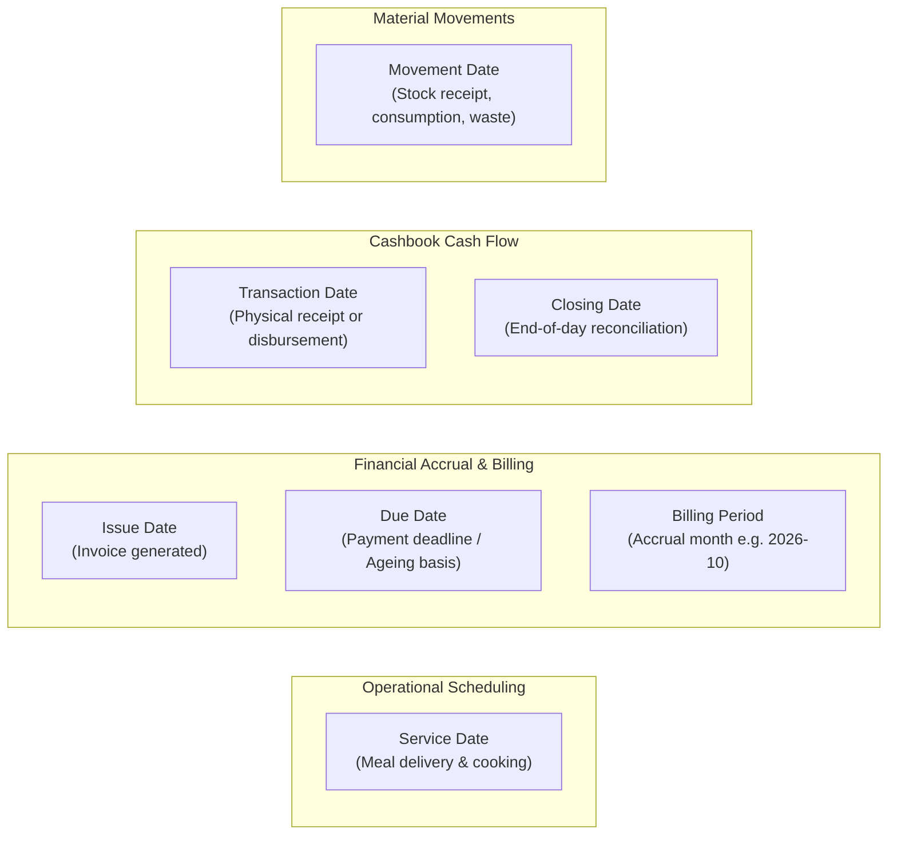

# Task 01B.55 — Business Views, Financial Reporting & Operational Reconciliation Audit

**Repository:** `zevats/raviNarayana-Erp`  
**Branch:** `master`  
**Evaluation Date:** 23 October 2026  
**Auditor:** Senior ERP Architect, Implementation Engineer & QA Lead  
**Safety Status:** `data/erp.db` and external databases strictly untouched and preserved  

---

## 1. Executive Summary

This report establishes the Phase 1 Mandatory Inspection-Only Audit for **Task 01B.55**. Prior tasks (01B.37 through 01B.54) have incrementally constructed operational capabilities spanning authentication, room management, resident tenancy, cashbook ledger, invoicing, commercial tiffin subscriptions, kitchen meal plans, recipe inventory, delivery tracking, checkout settlements, daily cashbook closing, and atomic room transfers.

The primary objective of Task 01B.55 is to audit and implement authoritative **Business Views, Financial Reporting, and Operational Reconciliation** across all modules. This entails:
1. Enabling server-side **Division Filtering** (`COMBINED`, `PG`, `TIFFIN`) across transactions, cashbook, invoices, and executive reporting.
2. Providing **Multi-Dimensional Date-Range Aggregations** respecting distinct date drivers (`transaction_date`, `issue_date`, `due_date`, `service_date`, `closing_date`).
3. Introducing an **Accounts Receivable Invoice Ageing Schedule** (Current, 1–30d, 31–60d, 61–90d, 90+d overdue).
4. Constructing an **Operational Reconciliation Engine** connecting kitchen demand, actual cooking, raw material consumption, wastage, leftovers, delivery dispatches, and delivery completions.
5. Addressing the confirmed **Tiffin Revenue Query Bug** in dashboard and executive export routines where commercial tiffin payments were omitted due to legacy transaction type assumptions.
6. Reconciling authoritative **Room and Bed Capacity** (distinguishing 39 confirmed physical beds from provisioned 41 beds pending owner confirmation for Master Suite `M01`).

---

## 2. Exhaustive Feature Matrix & Gap Analysis

Each functional capability across the ERP has been inspected and classified into one of four statuses:
- **Complete and Verified:** Fully implemented across schema, server services, APIs, and UI with passing regression tests.
- **Partially Implemented:** Functional in some layers but missing multi-division filtering, custom date ranges, or UI controls.
- **Missing:** Required by PRD and operational specifications, but currently absent.
- **Present but Potentially Incorrect:** Code exists but exhibits logical errors, SQL mismatches, or omission of canonical entity types.

### A. Dashboard & Executive Overview
| Capability / Feature | Status | Source References | Observations & Verified Gaps |
| :--- | :---: | :--- | :--- |
| **Occupancy & Bed KPI Cards** | **Complete & Verified** | `dashboardService.ts:85-108`, `dashboard/page.tsx:167-189` | Accurately queries active rooms and active resident stays. Total capacity = 41 beds. |
| **Financial Summary Cards** | **Partially Implemented** | `dashboardService.ts:111-196`, `dashboard/page.tsx:190-236` | Summarizes rent billed, rent collected, expenses, and deposits. **Gap:** Locked to current month (`YYYY-MM%`); lacks date-range and division filtering. |
| **Tiffin Revenue Calculation** | **Present but Potentially Incorrect** | `dashboardService.ts:162-168`, `reports/executive/route.ts:110-116` | **Defect:** SQL filters by `transaction_type = 'RENT_PAYMENT' AND (category = 'TIFFIN' OR description LIKE '%tiffin%')`. Commercial tiffin payments recorded in Task 01B.46 use `transaction_type = 'TIFFIN_PAYMENT'`. Genuine commercial tiffin collections are omitted. |
| **Monthly Revenue Chart** | **Partially Implemented** | `dashboardService.ts:199-234`, `MonthlyRevenueChart.tsx:1-120` | Visualizes 6-month historical rent vs expense trend. **Gap:** Only aggregates `RENT_PAYMENT`, omitting `TIFFIN_PAYMENT` from historical collections. |
| **Meal Fulfillment Tracker** | **Partially Implemented** | `dashboardService.ts:236-350`, `dashboard/page.tsx:319-517` | Shows cooked vs dispatched vs delivered portions for Breakfast, Lunch, Dinner. **Gap:** Queries only today or fallback single date; no multi-day date range or division breakdown. |
| **Executive CSV Export** | **Partially Implemented** | `reports/executive/route.ts:1-265`, `ExportReportModal.tsx:1-58` | Generates sanitized CSV with formula injection defense. **Gap:** Hardcoded to current month; no division filter or custom date range. |
| **Division Filter Toggle** | **Missing** | `PROJECT_REQUIREMENTS.md:304-308` | No toggle between Combined, PG Guesthouse, and Tiffin Service on the dashboard. |

### B. Finance, Cashbook & Transactions
| Capability / Feature | Status | Source References | Observations & Verified Gaps |
| :--- | :---: | :--- | :--- |
| **Cashbook Ledger Summary** | **Complete & Verified** | `financeService.ts:836-932`, `finance/page.tsx:40-90` | Reconciles rent, deposits, tiffin collections, expenses, and cross-period reversals across date ranges. |
| **Division Filtering in Cashbook** | **Missing** | `financeService.ts:836-870`, `api/finance/cashbook/route.ts` | `getCashbookSummary` and `/api/finance/cashbook` accept `startDate` and `endDate`, but lack `division?: 'COMBINED' | 'PG' | 'TIFFIN'`. |
| **Division Filtering in Transactions** | **Missing** | `financeService.ts:700-765`, `api/finance/transactions/route.ts` | `listTransactions` accepts `type`, `category`, `paymentMethod`, `residentId`, `customerId`, `stayId`, `startDate`, `endDate`, but lacks `division`. |
| **Payment Method Normalization** | **Complete & Verified** | `financeService.ts:20-25`, `types/index.ts:55-61` | Canonical methods `CASH`, `UPI`, `BANK_TRANSFER`, `CHEQUE`, `OTHER` strictly enforced (Task 01B.51). |
| **Deposit Custodial Separation** | **Complete & Verified** | `financeService.ts:370-460`, `schema/index.ts:188-213` | Security deposits recorded as custodial liabilities, isolated from operating revenues. |

### C. Daily Cashbook Closing & Discrepancies
| Capability / Feature | Status | Source References | Observations & Verified Gaps |
| :--- | :---: | :--- | :--- |
| **Daily Closing Preview & Finalization**| **Complete & Verified** | `cashbookClosingService.ts:1-932`, `DailyClosingView.tsx:1-777` | Calculates expected cash balance, channel breakdown, records physical cash count, bank verification, discrepancy reasons, and delivery summary. |
| **Division Support in Closing** | **Complete & Verified** | `cashbookClosingService.ts:76-130`, `types/index.ts:1464` | Fully supports `COMBINED`, `PG`, and `TIFFIN` divisions with separate opening balances and historical records. |
| **Historical Closing Listing** | **Complete & Verified** | `cashbookClosingService.ts:500-600`, `api/finance/closing/list/route.ts` | Supports filtering by `startDate`, `endDate`, `division`, `status`, `hasDiscrepancy`. |

### D. Invoicing & Accounts Receivable Ageing
| Capability / Feature | Status | Source References | Observations & Verified Gaps |
| :--- | :---: | :--- | :--- |
| **Invoice Creation & Sequential Numbering** | **Complete & Verified** | `invoiceService.ts:166-350`, `InvoiceLedgerView.tsx:1-400` | Format `INV-YYYY-XXXX`; supports `REGULAR_BILL` and `GST_TAX_INVOICE`; allocates payments to specific invoices. |
| **Invoice Category Filtering** | **Complete & Verified** | `invoiceService.ts:1173-1248`, `api/finance/invoices/route.ts` | Allows filtering invoices by `invoiceCategory` (`RESIDENT` vs `TIFFIN`). |
| **Invoice Ageing Schedule** | **Missing** | `PROJECT_REQUIREMENTS.md:§11.3` | **Missing:** No ageing schedule aggregating outstanding balances across ageing buckets (Current $\le 0$ days past due, 1–30 days, 31–60 days, 61–90 days, 90+ days overdue). |

### E. Kitchen Demand, Production & Raw Material Inventory
| Capability / Feature | Status | Source References | Observations & Verified Gaps |
| :--- | :---: | :--- | :--- |
| **Daily Meal Planning & Production** | **Complete & Verified** | `kitchenService.ts:441-600`, `kitchen/page.tsx:1-500` | Tracks planned resident count, planned tiffin count, actual cooked count, leftovers, and waste. |
| **Raw Material Inventory & Recipes** | **Complete & Verified** | `kitchenInventoryService.ts:1-1850` | Tracks raw materials, receipts, recipe-based consumption, stock adjustments, and material waste. |
| **Operational Kitchen Reconciliation** | **Missing** | `PROJECT_REQUIREMENTS.md:§12.4` | **Missing:** Consolidated date-range report comparing portions planned vs cooked vs leftover vs wasted, along with raw material consumption and kitchen costs. |

### F. Delivery Fulfillment & Route Exceptions
| Capability / Feature | Status | Source References | Observations & Verified Gaps |
| :--- | :---: | :--- | :--- |
| **Delivery Task Lifecycle** | **Complete & Verified** | `deliveryService.ts:134-1180`, `delivery/page.tsx:1-600` | Supports assignment, batch dispatch, completion, exception reporting, and retries. Distinguishes `order_type = 'RESIDENT'` vs `'EXTERNAL'`. |
| **Delivery Date-Range Summary** | **Missing** | `deliveryService.ts:1397-1470` | `getDeliveryDashboardSummary` is single-date only. No multi-day delivery completion rate and exception report by division exists. |

### G. Authoritative Room & Bed Layout (Task 01B.54 Review)
| Capability / Feature | Status | Source References | Observations & Verified Gaps |
| :--- | :---: | :--- | :--- |
| **Authoritative 22-Room Layout** | **Complete & Verified** | `task01b_54_rooms.test.ts:110-180`, `PROJECT_REQUIREMENTS.md:§8.1` | 22 rooms: `OL1`–`OL5` (5 beds), `001`–`008` (16 beds), `101`–`102` (6 beds), `103`–`108` (12 beds), `M01` (Executive suite). Confirmed beds = 39. Total provisioned = 41. |
| **Master Suite M01 Capacity Ambiguity** | **Present but Potentially Incorrect** | `schema/index.ts`, `dashboardService.ts:87-93` | DB provisions `M01` with `capacity = 2`. Physical property survey documented 1 or 2 beds pending owner confirmation. Reports must clearly distinguish Confirmed Physical Beds (39) from Provisioned Capacity (41). |
| **Room Transfer Financial Continuity** | **Complete & Verified** | `residentService.ts:480-660`, `task01b_54_rooms.test.ts` | Atomically reassociates unsettled financial transactions (`stay_id = newStayId`) while preserving stay history. |
| **Check-in & Transfer Concurrency Locks**| **Complete & Verified** | `residentService.ts:341`, `residentService.ts:530` | `SELECT ... FOR UPDATE` in PostgreSQL; transactional serialized write in SQLite WAL. |

---

## 3. Explicit Date Drivers Analysis

Financial and operational integrity requires disambiguating dates across different business events:

1. **Cashbook Transaction Date (`transaction_date`):**
   - **Definition:** The calendar day on which monetary funds were received, deposited, refunded, or disbursed.
   - **Application:** Drives `getCashbookSummary`, `listTransactions`, and daily inflows/outflows. Does **not** determine service fulfillment or invoice generation.
2. **Invoice Issue Date (`issue_date`) & Due Date (`due_date`):**
   - **Definition:** `issue_date` is when the legal invoice is rendered. `due_date` is the contractually mandated payment deadline.
   - **Application:** Drives Accounts Receivable Ageing:
     $$\text{Days Overdue} = \text{asOfDate} - \text{due\_date}$$
     - $\text{Days Overdue} \le 0$: Current (Not yet due)
     - $1 \le \text{Days Overdue} \le 30$: 1–30 Days Overdue
     - $31 \le \text{Days Overdue} \le 60$: 31–60 Days Overdue
     - $61 \le \text{Days Overdue} \le 90$: 61–90 Days Overdue
     - $\text{Days Overdue} > 90$: 90+ Days Overdue
3. **Kitchen & Delivery Service Date (`service_date`):**
   - **Definition:** The calendar day on which meal preparations occurred in the kitchen and deliveries were executed by couriers.
   - **Application:** Drives meal counts, delivery dispatches, leftover counts, and production reconciliations.
4. **Daily Closing Date (`closing_date`):**
   - **Definition:** The accounting date for which cash drawers were counted, bank slips verified, and courier tasks checked.
   - **Application:** Drives `daily_cashbook_closings` records and opening balance propagation for subsequent days.

---

## 4. Source Mapping for Verified Gaps

| Identified Gap | Primary Source Files | Database Tables Involved | Target Resolution |
| :--- | :--- | :--- | :--- |
| **GAP-01: Missing Division Filtering in Finance & Cashbook** | `apps/erp/src/server/finance/financeService.ts` `apps/erp/src/app/api/finance/cashbook/route.ts` `apps/erp/src/app/api/finance/transactions/route.ts` | `financial_transactions`, `residents`, `tiffin_customers` | Add optional `division?: 'COMBINED' \| 'PG' \| 'TIFFIN'` to `getCashbookSummary`, `listTransactions`, and API query params. Filter transactions accordingly. |
| **GAP-02: Tiffin Revenue Query Bug in Dashboard & Reports** | `apps/erp/src/server/dashboard/dashboardService.ts:162-168` `apps/erp/src/app/api/reports/executive/route.ts:110-116` | `financial_transactions` | Update SQL to match `transaction_type IN ('TIFFIN_PAYMENT', 'RENT_PAYMENT') AND (customer_id IS NOT NULL OR category = 'TIFFIN' OR description LIKE '%tiffin%')`. |
| **GAP-03: Missing Invoice Ageing Schedule** | `apps/erp/src/server/finance/invoiceService.ts` `apps/erp/src/server/reports/businessReportingService.ts` (New) | `invoices`, `residents`, `tiffin_customers` | Implement `getInvoiceAgeingReport(actor, { division, asOfDate })` aggregating unpaid/partially paid balances into standard ageing buckets. |
| **GAP-04: Missing Operational Reconciliation Engine** | `apps/erp/src/server/reports/businessReportingService.ts` (New) `apps/erp/src/server/kitchen/kitchenService.ts` `apps/erp/src/server/delivery/deliveryService.ts` | `daily_meal_plans`, `stock_movements`, `raw_materials`, `delivery_tasks` | Implement `getOperationalReconciliationReport(actor, { division, startDate, endDate })` aggregating meal demand, actual cooked, leftovers, wastage, raw materials consumed, delivery dispatches, deliveries, and exceptions. |
| **GAP-05: Missing Date-Range & Division Controls in Dashboard** | `apps/erp/src/server/dashboard/dashboardService.ts` `apps/erp/src/app/(management)/dashboard/page.tsx` | `financial_transactions`, `rooms`, `resident_stays`, `daily_meal_plans` | Allow `getDashboardMetrics` to accept optional `{ division, startDate, endDate }`. Add interactive Division Selector (`COMBINED`, `PG`, `TIFFIN`) in dashboard UI. |
| **GAP-06: Room Capacity Discrepancy Reporting** | `apps/erp/src/server/reports/businessReportingService.ts` `apps/erp/src/server/dashboard/dashboardService.ts` | `rooms`, `resident_stays` | Clearly report: Confirmed Physical Beds = 39, Total Provisioned = 41, with Suite `M01` capacity flagged as pending physical owner verification. |

---

## 5. Phase 2 Implementation Architecture

To ensure modularity and zero regression across existing services:

1. **Dedicated Business Reporting Service:**
   Create `apps/erp/src/server/reports/businessReportingService.ts` exporting:
   - `getMultiDivisionFinancialReport(actor, { startDate, endDate })`: Generates side-by-side or division-specific financial summaries (`COMBINED`, `PG`, `TIFFIN`).
   - `getInvoiceAgeingReport(actor, { division, asOfDate })`: Computes aged debtor schedules with buckets (Current, 1–30d, 31–60d, 61–90d, 90+d).
   - `getOperationalReconciliationReport(actor, { division, startDate, endDate })`: Correlates kitchen demand, production, stock movements, and delivery fulfillments across a date range.
   - `getPropertyCapacityAudit(actor)`: Breaks down confirmed physical beds (39) vs provisioned (41) with room-by-room status.
2. **Server-Side API Route (`/api/reports/business`):**
   - Protected by `requireRole(actor, ['SUPER_ADMIN', 'OPERATIONS_MANAGER', 'ACCOUNTANT'])`.
   - Supports query params: `type` (`financial` | `ageing` | `operational` | `capacity`), `division`, `startDate`, `endDate`, `asOfDate`.
3. **Core Finance Service Enhancement:**
   - Add `division` filtering to `getCashbookSummary` and `listTransactions` in `apps/erp/src/server/finance/financeService.ts`.
   - Support `division` query parameter in `/api/finance/cashbook` and `/api/finance/transactions`.
4. **Dashboard & Executive Route Hardening:**
   - Fix `TIFFIN_PAYMENT` query in `dashboardService.ts` and `apps/erp/src/app/api/reports/executive/route.ts`.
   - Add Division Selector UI in Dashboard and Finance views.
5. **Automated Verification:**
   - Author `tests/task01b_55_reporting.test.ts` covering division filtering, invoice ageing buckets, operational reconciliation, and RBAC security.
   - Register `test:task55` in `package.json` and verify monorepo test suite.
