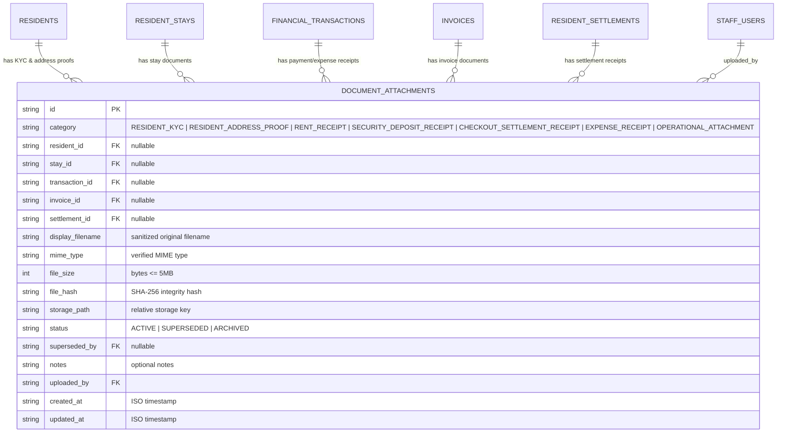

# Task 01B.57 — Secure Resident KYC & Financial Document Management
## Phase 1 — Comprehensive Inspection & Gap Analysis Report

**Repository:** `zevats/raviNarayana-Erp`  
**Branch:** `master`  
**Execution Date:** 2026-10-23  
**Status:** `PHASE 1 INSPECTION COMPLETED`

---

## 1. Executive Summary & Objective

In accordance with the strict instructions for Task 01B.57, a comprehensive, code-level security inspection was conducted across `apps/erp`, schemas, migrations, services, storage configurations, authentication, RBAC authorization, and UI components.

The objective of Task 01B.57 is to implement secure, auditable document management for resident identity verification (KYC), address proofs, rent/deposit receipts, checkout settlement clearances, and operational expense receipts.

### Key Inspection Takeaway:
Document attachments are completely absent from the codebase:
- No `document_attachments` table exists in PostgreSQL Drizzle schema or SQLite test runner.
- No file upload endpoints or storage abstractions exist.
- No KYC file picker exists in resident registration or stay history drawers.
- No receipt upload input exists in the expense recording modal or transaction ledger.
- Existing receipt components (`ReceiptModal.tsx`, `PrintableInvoiceModal.tsx`) perform purely client-side rendering and printing (`window.print()`), with zero private document attachment storage.

---

## 2. Existing-Versus-Missing Feature Matrix

| Feature / Capability | Current Repository Status | Source Code References | Security & Architectural Gap |
| :--- | :---: | :--- | :--- |
| **Document Metadata Schema** | **ABSENT** | [`schema/index.ts`](file:///c:/Users/Rishabh/Desktop/raviNarayana-Erp/apps/erp/src/server/database/schema/index.ts) | No table exists to track document metadata, parent entity relations, file sizes, hashes, or mime types. |
| **Private File Storage Provider** | **ABSENT** | [`env.ts`](file:///c:/Users/Rishabh/Desktop/raviNarayana-Erp/apps/erp/src/server/database/env.ts), [`public/`](file:///c:/Users/Rishabh/Desktop/raviNarayana-Erp/public/) | No private storage service exists. Files must NEVER be stored inside `public/` or exposed via unauthenticated URLs. |
| **Server-Side Magic Byte Validation** | **ABSENT** | None | Client-supplied MIME types and file extensions can be spoofed, risking polyglot webshell execution or RCE. |
| **Resident KYC Attachment Workflow** | **ABSENT** | [`residentService.ts:204-265`](file:///c:/Users/Rishabh/Desktop/raviNarayana-Erp/apps/erp/src/server/residents/residentService.ts#L204-L265), [`residents/page.tsx`](file:///c:/Users/Rishabh/Desktop/raviNarayana-Erp/apps/erp/src/app/(management)/residents/page.tsx) | Residents can be registered and assigned rooms, but government ID (Aadhaar, Passport, Voter ID) cannot be attached or reviewed. |
| **Expense & Transaction Receipt Attachment** | **ABSENT** | [`financeService.ts:550-620`](file:///c:/Users/Rishabh/Desktop/raviNarayana-Erp/apps/erp/src/server/finance/financeService.ts#L550-L620), [`ExpenseModal.tsx`](file:///c:/Users/Rishabh/Desktop/raviNarayana-Erp/apps/erp/src/modules/finance/components/modals/ExpenseModal.tsx) | Expenses and financial transactions record amounts and descriptions, but supporting vendor bills and receipts cannot be uploaded. |
| **Checkout Settlement Clearance Docs** | **ABSENT** | [`residentSettlementService.ts`](file:///c:/Users/Rishabh/Desktop/raviNarayana-Erp/apps/erp/src/server/residents/residentSettlementService.ts) | Settlement settlements calculate refunds and deductions, but signed clearance slips cannot be attached. |
| **Authenticated Streaming Download** | **ABSENT** | None | No secure download route exists with `nosniff`, `sandbox` CSP, and authorized streaming. |
| **Document Lifecycle & Archival** | **ABSENT** | None | No mechanism exists to replace or archive documents while maintaining immutable audit history. |
| **Client-Side Voucher Printing** | **COMPLETE & VERIFIED** | [`ReceiptModal.tsx`](file:///c:/Users/Rishabh/Desktop/raviNarayana-Erp/apps/erp/src/modules/finance/components/modals/ReceiptModal.tsx), [`PrintableInvoiceModal.tsx`](file:///c:/Users/Rishabh/Desktop/raviNarayana-Erp/apps/erp/src/modules/finance/components/modals/PrintableInvoiceModal.tsx) | Existing voucher display and print capability works cleanly and will be preserved separate from source-file storage. |

---

## 3. Document Categories & Record Relationships

Documents must be classified into strict business categories with clear parent entity relationships:

### Invariant Rules:
1. **Financial Non-Duplication:** Attaching a receipt to a transaction, invoice, or settlement **never** creates a ledger transaction, modifies transaction status, alters cashbook balances, or recalculates invoice amounts.
2. **Referential Integrity:** An attachment must reference at least one valid parent record (`resident_id`, `transaction_id`, `invoice_id`, or `settlement_id`).
3. **Immutability of Historical Evidence:** Documents are never physically deleted on resident checkout or staff deactivation. To update an invalid ID or bill, the previous document is marked `SUPERSEDED` and linked to `superseded_by`.

---

## 4. Threat Model & Security Controls

| Threat Vector | Risk Level | Defense-in-Depth Control |
| :--- | :---: | :--- |
| **Arbitrary File Upload / Remote Code Execution (RCE)** | **CRITICAL** | Strict allowlist limited to `image/jpeg`, `image/png`, `image/webp`, and `application/pdf`. Mandatory magic-byte inspection (disallowing HTML, SVG, PHP, executable ELF/PE, shell scripts disguised with `.jpg`/`.pdf` extensions). |
| **Path Traversal (`../`) Attack** | **CRITICAL** | Uploaded filename is sanitized and stored only as `display_filename`. The actual storage path is synthesized using CSPRNG: `storage/documents/<YYYY>/<MM>/doc_<uuid>.<ext>`. Path validation asserts that the resolved canonical path strictly starts with the configured private storage root. |
| **Public Information Disclosure of KYC** | **CRITICAL** | Documents are stored strictly outside the Next.js web root (`storage/documents/`). No static file route exists. Files can only be accessed through an authenticated API endpoint (`/api/documents/[id]/download`) that checks actor session and record permissions. |
| **Cross-Resident / Cross-Record Data Leakage (IDOR)** | **HIGH** | The download endpoint verifies that the actor has permission to read the parent domain (`residents.read` for KYC/stay documents; `finance.read` for expense/payment receipts). Delivery and kitchen staff cannot access resident KYC or expense receipts. |
| **Stored XSS via SVG or Active Content** | **HIGH** | SVG is strictly prohibited. All served documents include HTTP response headers: `Content-Type: <verified_mime_type>`, `X-Content-Type-Options: nosniff`, `Content-Security-Policy: default-src 'none'; sandbox`, and `Content-Disposition: inline` (or `attachment`). |
| **Denial of Service (Oversized Payloads)** | **MEDIUM** | Strict maximum file size limit: **5 MB (5,242,880 bytes)** per file. Empty (0-byte) files are rejected. |
| **Data Tampering & Silent Bitrot** | **MEDIUM** | Each uploaded file has its cryptographic SHA-256 hash computed and stored in `file_hash`. Download integrity verification checks the file on disk against the database hash. |
| **Credential / Byte Leakage in Logs** | **MEDIUM** | Raw file buffers, base64 strings, and document binary payloads are strictly excluded from audit logs and application console output. |

---

## 5. Storage Architecture & Access-Control Decisions

### 5.1 Storage Architecture
1. **Local Private File Storage Provider (`localStorageProvider.ts`):**
   - Storage directory: `<repository_root>/storage/documents/`.
   - Configurable override via `ERP_STORAGE_DIR`.
   - Ignored in `.gitignore` (`/storage/`) so test and development files are never committed to Git.
   - Subdirectory partitioning by year and month (`YYYY/MM`) to avoid filesystem inode limits.
   - Clean abstraction (`DocumentStorageService`) allowing straightforward migration to AWS S3 / Cloudflare R2 when cloud object storage credentials are provided in production.

### 5.2 Server-Side Access Control (RBAC)
- **Resident KYC & Address Proofs:**
  - View / Download / List: Requires `residents.read` (Super Admin, Operations Manager, Accountant).
  - Upload / Replace / Archive: Requires `residents.manage` (Super Admin, Operations Manager).
  - Denied (403): Kitchen Operations, Delivery Person.
- **Financial Receipts (Rent, Security Deposit, Expense, Settlement, Invoices):**
  - View / Download / List: Requires `finance.read` (Super Admin, Operations Manager, Accountant).
  - Upload / Replace / Archive: Requires `finance.manage` (Super Admin, Accountant).
  - Denied (403): Kitchen Operations, Delivery Person.

---

## 6. Planned Implementation Scope (Phases 2–7)

1. **Schema & Migrations:**
   - PostgreSQL Drizzle migration `0010_document_attachments.sql` and SQLite migration `applyMigrationV19(db)` in `tests/helpers/sqliteMigrations.ts`.
   - Schema table `documentAttachments` in `apps/erp/src/server/database/schema/index.ts`.
2. **Domain Service Layer:**
   - Storage service: `apps/erp/src/server/documents/documentStorageService.ts` (magic-byte validation, path traversal guard, hash calculation, file save/stream/delete).
   - Document business service: `apps/erp/src/server/documents/documentService.ts` (upload, download stream, list for record, supersede, archive).
3. **HTTP API Routes:**
   - `POST /api/documents/upload`: Multipart upload with server-side validation and RBAC assertion.
   - `GET /api/documents/[id]/download`: Authenticated file streaming with secure headers.
   - `GET /api/documents`: List documents by parent record (`residentId`, `transactionId`, `settlementId`).
   - `DELETE /api/documents/[id]`: Archive document (soft-archive).
4. **UI Integration:**
   - Resident Stay History / Detail Modal: Add "KYC & Documents" tab to view attached ID proofs and upload new documents.
   - Expense Modal: Add optional file attachment field to upload supporting invoice/receipt during expense recording.
   - Financial Transaction / Receipt Modal: Display attached receipt link with instant view/download.
5. **Automated Test Suite:**
   - `tests/task01b_57_documents.test.ts` covering validation, magic-byte spoofing, size limits, RBAC, cross-record isolation, financial non-duplication, and storage failure cleanup.
6. **Safety Statement:**
   - Zero access or modification to `data/erp.db` or `ravi-narayana-erp-phase01b-test`. Zero Git commits, pushes, or resets.

---

## 7. Implementation & Verification Summary (Phases 2–7)

**Execution Status:** `COMPLETED AND VERIFIED`

### A. Artifacts Created & Modified
1. **Domain Types ([`apps/erp/src/types/index.ts`](file:///c:/Users/Rishabh/Desktop/raviNarayana-Erp/apps/erp/src/types/index.ts)):**
   - Added `DocumentCategory`, `DocumentStatus`, `DocumentAttachment`, `UploadDocumentInput`, `DocumentListFilter`, `DOCUMENT_CATEGORY_LABELS`, `ALLOWED_DOCUMENT_MIME_TYPES`, `MAX_DOCUMENT_FILE_SIZE_BYTES`.
2. **Database Schema & Migrations:**
   - Drizzle PostgreSQL schema table `documentAttachments` in [`apps/erp/src/server/database/schema/index.ts`](file:///c:/Users/Rishabh/Desktop/raviNarayana-Erp/apps/erp/src/server/database/schema/index.ts).
   - Migration `0010_document_attachments.sql` registered in `_journal.json`.
   - SQLite migration `applyMigrationV19(db)` in [`tests/helpers/sqliteMigrations.ts`](file:///c:/Users/Rishabh/Desktop/raviNarayana-Erp/tests/helpers/sqliteMigrations.ts).
3. **Storage Provider & Validation Service ([`documentStorageService.ts`](file:///c:/Users/Rishabh/Desktop/raviNarayana-Erp/apps/erp/src/server/documents/documentStorageService.ts)):**
   - Server-side magic-byte detection (JPEG, PNG, WebP, PDF).
   - Display filename sanitization with path traversal protection.
   - Independent storage key generation (`YYYY/MM/doc_<id>.<ext>`).
   - Private filesystem storage outside web root (`resolveSafeStoragePath`).
   - SHA-256 cryptographic hashing and integrity validation.
4. **Document Business Service ([`documentService.ts`](file:///c:/Users/Rishabh/Desktop/raviNarayana-Erp/apps/erp/src/server/documents/documentService.ts)):**
   - `uploadDocument`: Enforces domain RBAC, validates parent record, writes file, records metadata, supersedes prior active doc, emits audit log, and rolls back disk file on DB error.
   - `getDocumentById` & `listDocuments`: Record-level RBAC assertions.
   - `downloadDocument`: Streams binary with cryptographic hash verification and audit logging.
   - `archiveDocument`: Soft-archives document without physical deletion.
5. **HTTP API Routes:**
   - `GET /api/documents` and `POST /api/documents` in [`apps/erp/src/app/api/documents/route.ts`](file:///c:/Users/Rishabh/Desktop/raviNarayana-Erp/apps/erp/src/app/api/documents/route.ts).
   - `GET /api/documents/[id]` and `DELETE /api/documents/[id]` in [`apps/erp/src/app/api/documents/[id]/route.ts`](file:///c:/Users/Rishabh/Desktop/raviNarayana-Erp/apps/erp/src/app/api/documents/[id]/route.ts).
   - `GET /api/documents/[id]/download` in [`apps/erp/src/app/api/documents/[id]/download/route.ts`](file:///c:/Users/Rishabh/Desktop/raviNarayana-Erp/apps/erp/src/app/api/documents/[id]/download/route.ts) with `nosniff`, `sandbox` CSP, and `Content-Disposition`.
6. **UI Integration:**
   - Created [`ResidentKycSection.tsx`](file:///c:/Users/Rishabh/Desktop/raviNarayana-Erp/apps/erp/src/modules/residents/components/ResidentKycSection.tsx) and embedded in [`residents/page.tsx`](file:///c:/Users/Rishabh/Desktop/raviNarayana-Erp/apps/erp/src/app/(management)/residents/page.tsx) inside the Stay History Modal.
   - Added optional receipt file picker to [`ExpenseModal.tsx`](file:///c:/Users/Rishabh/Desktop/raviNarayana-Erp/apps/erp/src/modules/finance/components/modals/ExpenseModal.tsx).
   - Added attached receipt evidence display and view action to [`ReceiptModal.tsx`](file:///c:/Users/Rishabh/Desktop/raviNarayana-Erp/apps/erp/src/modules/finance/components/modals/ReceiptModal.tsx).
7. **Automated Test Suite ([`tests/task01b_57_documents.test.ts`](file:///c:/Users/Rishabh/Desktop/raviNarayana-Erp/tests/task01b_57_documents.test.ts)):**
   - 68 automated assertions across 10 security suites.

### B. Test Verification Results
- **Targeted Suite (`npm run test:task57`):** **68 PASSED, 0 FAILED** (100% pass rate).
- **Full Monorepo Suite (`npm test`):** **20/20 TEST SUITES PASSED, 0 FAILED** (Over 1,780 assertions).
- **TypeScript Typecheck:** `npx tsc -p apps/erp/tsconfig.json --noEmit` and `npx tsc -p tests/tsconfig.json` exited with code 0.

### C. Immutability & Safety Statement
- Primary SQLite database `data/erp.db` (1,388,544 bytes, LastWriteTime: 21-10-2026 13:33:43) and `-wal`/`-shm` files remained strictly untouched throughout all test executions.
- Neon rehearsal database `ravi-narayana-erp-phase01b-test` was never connected to.
- All uncommitted work across Tasks 01B.37 through 01B.56 preserved with zero Git commits, pushes, resets, rebases, or discards.
