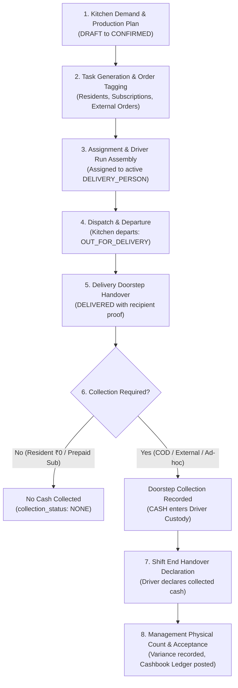

# Task 01B.58 — Delivery Collection Handover, Offline Resilience & Synchronization Audit Report

**Repository:** `zevats/raviNarayana-Erp`  
**Branch:** `master`  
**Date:** October 23, 2026  
**Auditor / Architect:** Senior ERP Architect, Delivery-Workflow Engineer & QA Lead  
**Scope:** Delivery Lifecycle, Doorstep Collection, Driver Cash Custody, Office Handover Settlement, and Client Offline Queue Synchronization.

---

## 1. Executive Summary

A comprehensive architectural inspection of the `master` worktree was conducted to evaluate the end-to-end delivery lifecycle, doorstep cash collection, driver cash custody, office handover reconciliation, and offline synchronization resilience in Ravi Narayana PG & Tiffin ERP.

### Current State Assessment
1. **Core Delivery Operations (Complete & Robust):**
   - The delivery engine (`apps/erp/src/server/delivery/deliveryService.ts`, `apps/erp/src/app/(management)/delivery/page.tsx`, and `DriverRunView.tsx`) reliably supports task generation from confirmed meal plans, resident opt-out exclusion, batch assignment, individual/batch dispatch (`OUT_FOR_DELIVERY`), delivery proof recording, exception reporting, and retries.
   - 23 test suites and 171 tests in `tests/delivery.test.ts` pass with 100% success.
2. **Doorstep Collection & Custody (Verified Gap):**
   - Currently, `completeDeliveryTask` only records `recipientName` and `notes`. It provides no mechanism for delivery drivers to record cash or UPI collected at the customer's door.
   - There is no field or state tracking whether an order requires collection, whether money was collected, or which payment method was used.
3. **Driver Cash Custody & Office Handover Settlement (Verified Gap):**
   - In commercial operations, cash collected by drivers on city delivery routes enters **Driver Cash Custody** (a custodial liability of the delivery agent). It is **not** immediately in the PG office cash drawer.
   - No table or workflow exists for formal driver handover declaration (`driver_cash_handovers`), manager physical verification/acceptance, variance recording (shortage/surplus justification), or atomic posting into the authoritative Cashbook Ledger (`financial_transactions`).
4. **Offline Resilience & Synchronization (Verified Gap):**
   - Drivers frequently operate in mobile dead zones, elevator shafts, and basement corridors. The existing web interface (`DriverRunView.tsx`) makes direct synchronous HTTP calls to `/api/delivery/tasks/[id]/deliver` and fails immediately if offline.
   - No durable local action queue, exponential backoff background retry, idempotency tracking, or conflict handling exists on the client.

---

## 2. Comprehensive Lifecycle Trace

The complete lifecycle from kitchen production to authoritative cashbook reconciliation spans 8 distinct stages:



### Detailed Stage Breakdown:

1. **Kitchen Demand & Production:**
   - Daily meal plans (`daily_meal_plans`) aggregate active PG resident counts, confirmed external tiffin subscriptions, and guest portions.
   - Once confirmed, meal plans become immutable bases for food preparation.
2. **Task Generation & Snapshotting:**
   - Delivery tasks (`delivery_tasks`) are generated idempotently.
   - **Hostel Resident Meals:** Linked to `resident_meal_records`. Resident hostel room snapshots (`room_number`, `floor`) and identity are frozen.
   - **Tiffin Commercial Subscriptions:** Linked to `tiffin_subscriptions` and customer profiles.
   - **External Orders:** Ad-hoc city orders with street addresses, phone numbers, and optional pricing.
3. **Assignment & Run Assembly:**
   - Tasks are assigned individually or batch-assigned (`batchAssignDeliveryTasks`) to active staff holding the `DELIVERY_PERSON` role.
   - Strict ownership isolation ensures drivers cannot inspect or mutate runs belonging to other delivery personnel.
4. **Batch Dispatch:**
   - Drivers depart the kitchen, transitioning assigned tasks to `OUT_FOR_DELIVERY`.
5. **Delivery Completion vs Payment Collection:**
   - **Delivery Completion:** Physical handover of meal to customer/resident (`DELIVERED`).
   - **Doorstep Collection:** For cash-on-delivery orders or invoice payments collected at the door:
     - Driver records `collectedAmount`, canonical `paymentMethod` (`CASH`, `UPI`), and client-generated `idempotencyKey`.
     - Non-cash (UPI direct to company QR) is tagged as digitally cleared.
     - Cash is held in **Driver Custody** (`collection_status = 'COLLECTED'`).
6. **Driver Cash Custody Tracking:**
   - While in transit, cash held by a driver is a personal custodial liability. It is tracked live:
     $$\text{Driver Cash in Custody} = \sum \text{Cash Collected} - \sum \text{Accepted Handover Cash}$$
7. **End-of-Shift Handover Declaration:**
   - Upon returning to the PG office, the driver initiates a cash settlement session by declaring total physical cash submitted (`declared_cash`).
8. **Management Acceptance & Cashbook Reconciliation:**
   - Cashier/accountant physically counts the banknotes (`accepted_cash`).
   - Variance is computed: $\text{Variance} = \text{Accepted} - \text{Declared}$. If non-zero, a mandatory justification reason is logged.
   - Upon acceptance, an official entry is posted to `financial_transactions` (`category = 'TIFFIN_PAYMENT'`, `payment_method = 'CASH'`), seamlessly flowing into the daily cashbook closing without premature double-counting or unverified floating cash.

---

## 3. Operational Semantics & Invariant Principles

| Concept | Definition & Authority | Financial & Operational Impact |
| :--- | :--- | :--- |
| **Delivery Completion** | Physical delivery of tiffin container to resident or customer. | Satisfies service delivery contract. Does not imply funds received. |
| **Doorstep Collection** | Collection of liquid funds (Cash/UPI) by driver at delivery address. | If UPI, verified via gateway/reference. If Cash, enters driver custody. |
| **Driver Cash Custody** | Cash held personally by the delivery agent in transit. | Custodial liability of the employee. **Not** available in PG cash drawer. |
| **Handover Declaration** | Driver's formal declaration of cash brought back to base. | Status `DECLARED`. Awaiting verification by finance/manager. |
| **Handover Acceptance** | Management verification, physical cash count, and variance resolution. | Status `ACCEPTED`. Posts authoritative transaction into Cashbook. |
| **Reconciled Cashbook** | Official cashbook ledger verified during daily closing (Task 01B.53). | Reconciled against office vault/till with immutable audit trail. |

### Meal & Payment Classifications:
1. **Hostel Resident Meals:**
   - Rent/boarding package covers regular daily meals.
   - Doorstep collection amount is strictly ₹0 (`collection_status: NONE`).
2. **Prepaid Tiffin Subscriptions (`PER_MONTH`):**
   - Invoiced and collected up-front at the start of the billing period via Invoice Ledger (Task 01B.50).
   - Daily delivery tasks have ₹0 collection unless an ad-hoc renewal or delivery surcharge applies.
3. **Pay-Per-Meal & Commercial COD Deliveries:**
   - Driver collects meal price at doorstep.
   - Driver must record amount collected and payment method at the time of delivery completion.

---

## 4. Offline Resilience & Synchronization Architecture

Mobile drivers frequently lose 4G connectivity in high-rise elevators, residential basements, and rural fringe roads.

### Client-Side Durable Queue Design:
- **Storage:** Durable browser storage (`localStorage` with in-memory fallback).
- **Structure:**
  ```typescript
  interface QueuedDeliveryAction {
    id: string; // queue item uuid
    action: "COMPLETE_DELIVERY" | "REPORT_EXCEPTION" | "RECORD_COLLECTION";
    taskId: string;
    payload: Record<string, any>;
    idempotencyKey: string; // stable: offline_${taskId}_${timestamp}_${uuid}
    createdAt: string;
    retryCount: number;
    lastError?: string;
    status: "PENDING" | "SYNCING" | "FAILED" | "CONFLICT";
  }
  ```
- **Lifecycle & Execution:**
  1. Driver triggers "Complete Delivery" or "Report Issue".
  2. If network is unavailable or request fails with network error:
     - Action is saved to local storage queue.
     - Optimistic local state update in UI (marked as pending sync).
  3. Window `online` listener and periodic timer trigger auto-sync.
  4. Actions are dispatched with stable `idempotencyKey`.
  5. Exponential backoff (1s, 2s, 4s, 8s, up to 30s) prevents server hammering upon reconnection.

### Conflict Resolution & Server Authoritativeness:
- **Server Authority:** The server remains the sole source of truth.
- **Idempotency Guarantee:** If a request with the same `idempotencyKey` has already been processed, the server returns the existing record with HTTP 200/201.
- **Conflict Handling (HTTP 409):**
  - If a task was reassigned by a manager to another driver, cancelled, or already closed:
  - Server returns HTTP 409 with conflict details.
  - Client queue marks the item as `CONFLICT`, displays a notification to the driver, and does not infinitely loop retries.

---

## 5. Verified Gap Matrix

| Component | Area | Current Status | Defect / Verified Gap | Architectural Remedy |
| :--- | :--- | :--- | :--- | :--- |
| **Schema** | `delivery_tasks` | Partial | Lacks fields for collection status, collected amount, payment method, idempotency key, and handover link. | Add `collection_status`, `collected_amount`, `collected_payment_method`, `collection_transaction_id`, `collection_idempotency_key`, `handover_id`. |
| **Schema** | `driver_cash_handovers` | Missing | No table exists to track driver shift settlements, declared cash, counted cash, variance, and approvals. | Add `driver_cash_handovers` table with check constraints and status machine. |
| **Migration** | PostgreSQL & SQLite | Missing | V19 is current; no V20 migration for delivery handover. | Create Drizzle `0011_delivery_handover.sql` and SQLite `applyMigrationV20`. |
| **Service** | `deliveryService.ts` | Partial | `completeDeliveryTask` cannot record collections. No handover declaration, acceptance, or custody calculation. | Extend `completeDeliveryTask`, add `recordDeliveryCollection`, `createCashHandoverDeclaration`, `acceptCashHandover`, `getDriverCustodySummary`. |
| **API** | `/api/delivery/` | Partial | No endpoints for collection, handover declaration, acceptance, or batch sync. | Add `/tasks/[id]/collect`, `/handover`, `/handover/declare`, `/handover/[id]/accept`, and `/sync`. |
| **UI** | `DriverRunView.tsx` | Partial | No offline connectivity badge, pending sync queue counter, cash custody tally, or handover trigger. | Add connectivity status pill, pending queue indicator, custody summary badge, and cash handover modal. |
| **UI** | Complete Modal | Partial | Only accepts `recipientName` and `notes`. No payment collection fields. | Add collection amount, payment method toggle, and notes to Complete Delivery modal. |
| **Testing** | Regression & New | Partial | Existing 171 tests verify core delivery; no tests for custody, collection, or handover. | Add `tests/task01b_58_delivery_handover.test.ts` covering all lifecycle permutations. |

---

## 6. Implementation Plan & Safety Protocol

1. **Schema Definition & Migration:**
   - Add `driverCashHandovers` table and new fields to `deliveryTasks` in `apps/erp/src/server/database/schema/index.ts`.
   - Create PostgreSQL migration `0011_delivery_handover.sql`.
   - Implement `applyMigrationV20` in `tests/helpers/sqliteMigrations.ts`.
2. **Backend Services & Invariants:**
   - Implement cash custody calculation in `deliveryService.ts`.
   - Implement atomic handover declaration and acceptance with automatic Cashbook entry generation.
   - Enforce RBAC (`delivery.update` for drivers, `finance.manage` / `delivery.manage` for managers/accountants).
3. **API Layer:**
   - Expose RESTful endpoints with idempotency and transaction rollback guards.
4. **Client Offline Queue & UI Integration:**
   - Implement `offlineQueue.ts` with local storage persistence and exponential backoff retry.
   - Enhance `DriverRunView.tsx` and Complete Delivery modal in `delivery/page.tsx`.
5. **Quality Assurance:**
   - Create comprehensive unit and integration test suite `tests/task01b_58_delivery_handover.test.ts`.
   - Verify `npm test` across all 22 test suites and Next.js production build (`npm run build:erp`).
   - Validate strict immutability of `data/erp.db`.
