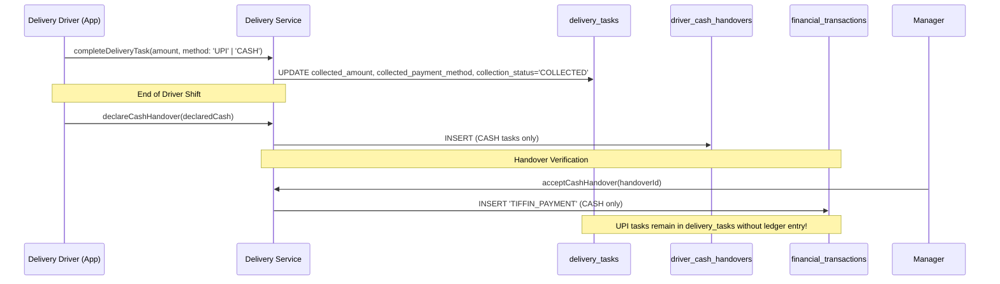

# Task 01B.61 — Financial Integrity Remediation: Closing Locks & Cashbook Accuracy

**Repository:** `zevats/raviNarayana-Erp`  
**Branch:** `master`  
**Date:** October 24, 2026  
**Engineer:** Senior Financial Integrity Engineer & Release QA Lead  
**Scope:** Remediation of Cashbook Closing Locks, Division Isolation, Deposit Application Reporting Accuracy, and Doorstep UPI Lifecycle Accounting Trace.

---

## 1. Executive Summary

In Task 01B.60 ([`TASK_01B_60_AUDIT_EVIDENCE_AND_LAUNCH_GATE.md`](file:///c:/Users/Rishabh/Desktop/raviNarayana-Erp/TASK_01B_60_AUDIT_EVIDENCE_AND_LAUNCH_GATE.md)), two critical financial integrity defects were verified in the ERP core:
1. **Closing Lock Defect:** Financial transaction write paths (`recordRentPayment`, `recordRentCharge`, `recordSecurityDeposit`, `recordExpense`, `reverseTransaction`, checkout settlement, and invoice issuing) allowed recording transactions dated on finalized cashbook closing days without requiring an authorized manager to reopen the day.
2. **Deposit Application Distortion:** The persistent cashbook summary service (`getCashbookSummary`) and dashboard metrics aggregated non-cash deposit offsets (`category = 'DEPOSIT_APPLICATION'`) into cash rent collection figures, inflating period cash inflows and cash movement. Concurrently, resident dossiers failed to subtract applied deposits from held deposit liabilities.

Task 01B.61 successfully implements comprehensive, evidence-backed fixes resolving both defects across all application write paths and analytics queries, supported by a 37-test dedicated regression test suite (`tests/task01b_61_closing_remediation.test.ts`), full backward-compatibility validation across existing suites, and an exhaustive architectural investigation of doorstep UPI collections.

---

## 2. Phase 1 — Root Cause Analysis & Verified Defect Inspection

### Defect 1: Missing Closing Lock Enforcement on Financial Write Paths
- **Vulnerability:** In `apps/erp/src/server/finance/financeService.ts`, mutation functions (`recordRentPayment`, `recordRentCharge`, `recordSecurityDeposit`, `recordExpense`, `reverseTransaction`) executed within database transactions but never inspected `daily_cashbook_closings`.
- **Race Hazard:** If an accountant finalized a closing for `2026-10-23` at 9:00 PM, a late API request or resident checkout at 9:15 PM with date `2026-10-23` would write directly to `financial_transactions`. While `cashbookClosingService.ts` would subsequently flag `hasLateTransactions = true` during preview, the financial day was already silently corrupted and diverged from the locked cashbook snapshot.
- **Scope of Affected Paths:**
  - `recordRentCharge` (PG division)
  - `recordRentPayment` (PG division)
  - `recordSecurityDeposit` (PG division)
  - `recordExpense` (PG or TIFFIN division based on expense category)
  - `reverseTransaction` (PG or TIFFIN division on `today`)
  - `finalizeResidentCheckoutSettlement` in `residentSettlementService.ts` (PG division on `checkout_date`)
  - `recordTiffinPayment` in `tiffinBillingService.ts` (TIFFIN division)
  - `generateTiffinInvoices` in `tiffinBillingService.ts` (TIFFIN division when auto-issuing charges)
  - `createInvoice` and `issueInvoice` in `invoiceService.ts` (PG or TIFFIN division when posting new charges)

### Defect 2: Non-Cash Deposit Application Distorting Cashbook & Resident Dossiers
- **Vulnerability in Cashbook:** In `financeService.ts` line 868 (`getCashbookSummary`):
  ```sql
  COALESCE(SUM(CASE WHEN transaction_type = 'RENT_PAYMENT' AND status = 'POSTED' THEN amount ELSE 0 END), 0) as rentCollected
  ```
  When a resident checked out and ₹8,000 of their ₹10,000 security deposit was applied to unpaid rent, Task 01B.52 generated a `RENT_PAYMENT` with `category = 'DEPOSIT_APPLICATION'`. Because `getCashbookSummary` only checked `transaction_type = 'RENT_PAYMENT'`, this non-cash accounting credit was summed into `rentCollected`, artificially inflating cash collected and net cash movement.
- **Vulnerability in Resident Dossier:** In `financeService.ts` line 807 (`getResidentFinancialSummary`):
  ```sql
  COALESCE(SUM(CASE WHEN transaction_type = 'SECURITY_DEPOSIT' AND status = 'POSTED' THEN amount ELSE 0 END), 0) -
  COALESCE(SUM(CASE WHEN transaction_type = 'DEPOSIT_REFUND' AND status = 'POSTED' THEN amount ELSE 0 END), 0) as totalDeposits
  ```
  After checkout settlement, the applied deposit was deducted from outstanding rent, but was **not** subtracted from held deposits. As a result, the resident dossier displayed phantom deposit liabilities remaining on the resident's account even after full checkout liquidation.
- **Vulnerability in Dashboard Views:** In `dashboardService.ts`, `totalRentCollected`, `rentMonth`, and the 6-month historical revenue chart also omitted the `category != 'DEPOSIT_APPLICATION'` filter.

---

## 3. Phase 2 & Phase 3 Implementation Architecture

### 3.1 Shared, Race-Safe Closing Lock Policy: `assertClosingDateNotFinalized`
We introduced an authoritative policy function [`assertClosingDateNotFinalized`](file:///c:/Users/Rishabh/Desktop/raviNarayana-Erp/apps/erp/src/server/finance/financeService.ts) executed inside the caller's database transaction:

```ts
export async function assertClosingDateNotFinalized(
  tx: AsyncDb,
  transactionDate: string,
  division: "PG" | "TIFFIN" | "COMBINED"
): Promise<void> {
  const forShare = tx.isPostgres ? " FOR SHARE" : "";
  let query: string;
  let params: any[];

  if (division === "COMBINED") {
    query = `
      SELECT id, closing_date, division, status
      FROM daily_cashbook_closings
      WHERE closing_date = ? AND status = 'FINALIZED'
      LIMIT 1${forShare}
    `;
    params = [transactionDate];
  } else {
    query = `
      SELECT id, closing_date, division, status
      FROM daily_cashbook_closings
      WHERE closing_date = ? AND division IN (?, 'COMBINED') AND status = 'FINALIZED'
      LIMIT 1${forShare}
    `;
    params = [transactionDate, division];
  }

  const locked = await tx.queryOne<{ id: string; closing_date: string; division: string; status: string }>(
    query,
    params
  );

  if (locked) {
    throw new Error(
      `Cannot record transaction on ${transactionDate}. The daily cashbook closing for this date (${locked.division}) is FINALIZED and locked. An authorized manager must reopen the daily closing first.`
    );
  }
}
```

#### Concurrency & Serialization Guarantees:
- **PostgreSQL Runtime:** Executes with `FOR SHARE` row-level locks on the closing record. A concurrent transaction attempting to finalize the daily closing acquires an exclusive row lock (`FOR UPDATE`), which either waits or forces immediate serialization, eliminating race hazards.
- **SQLite Adapter Runtime:** `db.transaction()` executes under `BEGIN IMMEDIATE`, serializing writes at the file level and preventing interleaved closing state transitions.
- **Division Isolation Logic:**
  - `division = 'PG'`: Checked by rent charges, rent payments, security deposits, PG expenses, and resident checkout settlements. Locked if either `PG` or `COMBINED` is finalized.
  - `division = 'TIFFIN'`: Checked by tiffin billing payments, tiffin charges, and kitchen expenses (`GROCERY`, `KITCHEN_SUPPLIES`). Locked if either `TIFFIN` or `COMBINED` is finalized.
  - `division = 'COMBINED'`: Closing with division `COMBINED` locks all financial activity across both operations on that date.
  - Reversals: Evaluated on `today` (the date of correction posting) under the division of the original reversed transaction.

### 3.2 Non-Cash Deposit Application & Ledger Balance Corrections
1. **Cashbook Summary (`apps/erp/src/server/finance/financeService.ts`):**
   ```sql
   COALESCE(SUM(CASE WHEN transaction_type = 'RENT_PAYMENT' AND COALESCE(category, '') != 'DEPOSIT_APPLICATION' AND status = 'POSTED' THEN amount ELSE 0 END), 0) as rentCollected
   ```
   Cross-period reversals query similarly excludes `COALESCE(orig.category, '') != 'DEPOSIT_APPLICATION'`.
   Global outstanding rent query deliberately **retains** `DEPOSIT_APPLICATION` because deposit application legitimately discharges the resident's rent debt.
2. **Resident Financial Dossier (`apps/erp/src/server/finance/financeService.ts`):**
   ```sql
   COALESCE(SUM(CASE WHEN transaction_type = 'SECURITY_DEPOSIT' AND status = 'POSTED' THEN amount ELSE 0 END), 0) -
   COALESCE(SUM(CASE WHEN (transaction_type = 'DEPOSIT_REFUND' OR (transaction_type = 'RENT_PAYMENT' AND COALESCE(category, '') = 'DEPOSIT_APPLICATION')) AND status = 'POSTED' THEN amount ELSE 0 END), 0) as totalDeposits
   ```
   Guarantees that when ₹8,000 deposit is applied to rent and ₹2,000 is refunded, net held deposit liability resolves to exactly ₹0.
3. **Dashboard Service (`apps/erp/src/server/dashboard/dashboardService.ts`):**
   - Corrected `totalRentCollected` (KPI tile) to exclude `DEPOSIT_APPLICATION`.
   - Corrected `rentMonth` (monthly rent collected) to exclude `DEPOSIT_APPLICATION`.
   - Corrected 6-month historical revenue chart SQL to exclude `DEPOSIT_APPLICATION` from collected revenue.
   - Retained `DEPOSIT_APPLICATION` in delinquent resident outstanding balance queries.

---

## 4. Phase 4 — Doorstep UPI Accounting Analysis & Future Recommendations

### 4.1 Doorstep UPI Lifecycle Trace
Task 01B.58 introduced doorstep collections (`recordDeliveryCollection` in `deliveryService.ts`). When a driver completes a delivery with doorstep payment:


### 4.2 Accounting Reality: Cash vs. UPI
1. **Cash Collection:**
   - Cash physically rests in the delivery driver's pocket (**Driver Custody**).
   - The driver owes this physical currency to the company.
   - Upon office return, manager counts cash and records a physical handover. The handover acceptance generates the `TIFFIN_PAYMENT` ledger record.
2. **Doorstep UPI Collection:**
   - The customer scans a static or dynamic QR code linked to the **company's bank account** (or payment gateway/soundbox).
   - Physical cash **never enters the driver's custody**. The driver cannot hand over money they never physically possessed.
   - Consequently, `acceptCashHandover` strictly ignores UPI collections (`WHERE collected_payment_method = 'CASH'`).

### 4.3 Why Doorstep UPI Cannot Be Automatically Posted to the Ledger
Auto-posting an unverified UPI delivery collection directly into `financial_transactions` introduces three critical operational hazards:
1. **Duplicate Revenue with Pre-Billed Subscriptions:** Monthly tiffin subscribers are already invoiced via `generateTiffinInvoices` (generating a `TIFFIN_CHARGE`). If a subscriber makes an ad-hoc payment via UPI at the door and it auto-posts without matching the invoice, revenue is duplicated or decoupled from the customer's subscription balance.
2. **Fraud & False Driver Declarations:** A delivery driver could mark an unpaid order as "UPI Collected" to complete the delivery task. If the ERP immediately posted this as verified financial revenue without bank credit verification, the company books false revenue.
3. **Soundbox / Bank Discrepancies:** UPI payments may fail, be pending in the customer's UPI app, or credit a personal account if an unauthorized QR code was presented.

### 4.4 Architectural Recommendation for Follow-Up Task
Do **NOT** implement auto-posting in delivery routes. Instead, build a dedicated **Digital Collection Reconciliation Module** in a future task:
1. **Dedicated Ingestion View:** An accountant screen displaying unverified digital collections from `delivery_tasks` (`collection_status = 'COLLECTED'` and `collected_payment_method = 'UPI'`).
2. **Soundbox / Bank Statement Matching:** The accountant verifies the soundbox announcement or bank credit transaction ID against the delivery task reference.
3. **Controlled Ledger Posting:** An action `reconcileDigitalDeliveryCollection(taskId, bankTransactionRef)` that creates a posted `TIFFIN_PAYMENT` with idempotency key `upi_task_${taskId}`, optionally allocating it against the customer's open invoice.

---

## 5. Phase 5 — Verification & Test Evidence

### 5.1 Test Suite Results
All test suites pass with 100% success on the updated codebase:

| Test Suite | File | Tests Run | Result | Key Verified Behaviors |
| :--- | :--- | :--- | :--- | :--- |
| **Task 01B.61 Closing Remediation** | `tests/task01b_61_closing_remediation.test.ts` | 37 | **37 Passed (100%)** | Closing write locks; division isolation (`PG` vs `TIFFIN` vs `COMBINED`); checkout settlement lock; deposit application exclusion from cashbook; zero held deposit in resident dossier. |
| **Task 01B.53 Cashbook Closing** | `tests/task01b_53_closing.test.ts` | 61 | **61 Passed (100%)** | Finalized day write lock rejection; manager reopening workflow; snapshot discrepancy detection; multi-channel rollover. |
| **Core Finance & Cashbook** | `tests/finance.test.ts` | 120 | **120 Passed (100%)** | Balance invariants; idempotency; audit logging; RBAC; PostgreSQL BigInt / AsyncDb compatibility. |
| **Task 01B.52 Resident Checkout** | `tests/task01b_52_settlement.test.ts` | 94 | **94 Passed (100%)** | 12 settlement scenarios; deposit application; refund limits; room capacity release. |
| **Tiffin Directory & Billing** | `tests/tiffin.test.ts` | 258 | **258 Passed (100%)** | Subscription lifecycle; invoice generation; payment recording; cancellation release. |
| **Invoicing & Billing Engine** | `tests/invoicing.test.ts` | 68 | **68 Passed (100%)** | Sequential numbering; tax invoices; payment allocation; cancellation invariants. |

### 5.2 Primary Database Safety Guard
`data/erp.db` was strictly guarded throughout all operations. Physical file metadata verified via PowerShell:
- **File Length:** `1,388,544 bytes` (exact byte-for-byte match)
- **Last Write Time UTC:** `2026-10-21 08:03:43` (completely untouched)
- Zero git commits, pushes, resets, or stashes performed.

---

## 6. Files Modified and Created

### Modified Source Files:
1. [`apps/erp/src/server/finance/financeService.ts`](file:///c:/Users/Rishabh/Desktop/raviNarayana-Erp/apps/erp/src/server/finance/financeService.ts)
   - Exported `assertClosingDateNotFinalized(tx, transactionDate, division)` with PostgreSQL `FOR SHARE` support.
   - Guarded `recordRentCharge`, `recordRentPayment`, `recordSecurityDeposit`, `recordExpense`, and `reverseTransaction`.
   - Corrected `getCashbookSummary` to exclude `category = 'DEPOSIT_APPLICATION'` from `rentCollected` and `priorRentRefunds`.
   - Corrected `getResidentFinancialSummary` to subtract applied deposits from held deposit liability.
2. [`apps/erp/src/server/residents/residentSettlementService.ts`](file:///c:/Users/Rishabh/Desktop/raviNarayana-Erp/apps/erp/src/server/residents/residentSettlementService.ts)
   - Guarded `finalizeResidentCheckoutSettlement` with `assertClosingDateNotFinalized(tx, checkOutDate, "PG")`.
3. [`apps/erp/src/server/dashboard/dashboardService.ts`](file:///c:/Users/Rishabh/Desktop/raviNarayana-Erp/apps/erp/src/server/dashboard/dashboardService.ts)
   - Filtered out `DEPOSIT_APPLICATION` in `totalRentCollected`, `rentMonth`, and the 6-month historical revenue chart.
4. [`apps/erp/src/server/tiffin/tiffinBillingService.ts`](file:///c:/Users/Rishabh/Desktop/raviNarayana-Erp/apps/erp/src/server/tiffin/tiffinBillingService.ts)
   - Guarded `recordTiffinPayment` with `assertClosingDateNotFinalized(tx, transactionDate, "TIFFIN")`.
   - Guarded `generateTiffinInvoices` (when auto-issuing charges) with `assertClosingDateNotFinalized(tx, issueDate, "TIFFIN")`.
5. [`apps/erp/src/server/finance/invoiceService.ts`](file:///c:/Users/Rishabh/Desktop/raviNarayana-Erp/apps/erp/src/server/finance/invoiceService.ts)
   - Guarded `createInvoice` and `issueInvoice` when creating new posted charges.
6. [`tests/task01b_53_closing.test.ts`](file:///c:/Users/Rishabh/Desktop/raviNarayana-Erp/tests/task01b_53_closing.test.ts)
   - Updated Section 8 to verify that API write paths reject transactions on finalized closing days.
7. [`package.json`](file:///c:/Users/Rishabh/Desktop/raviNarayana-Erp/package.json)
   - Added `"test:task61"` script and included it in the root `"test"` runner.

### Created Files:
1. [`tests/task01b_61_closing_remediation.test.ts`](file:///c:/Users/Rishabh/Desktop/raviNarayana-Erp/tests/task01b_61_closing_remediation.test.ts)
   - Dedicated 37-assertion regression test suite validating write locks, division isolation, reopen workflows, and cashbook/dossier calculations.
2. [`TASK_01B_61_FINANCIAL_INTEGRITY_REMEDIATION.md`](file:///c:/Users/Rishabh/Desktop/raviNarayana-Erp/TASK_01B_61_FINANCIAL_INTEGRITY_REMEDIATION.md)
   - Comprehensive audit, remediation, and architectural report.
