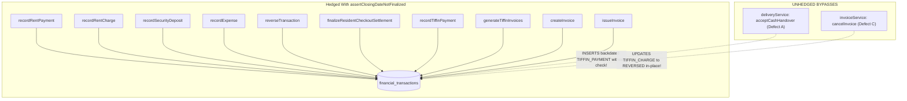
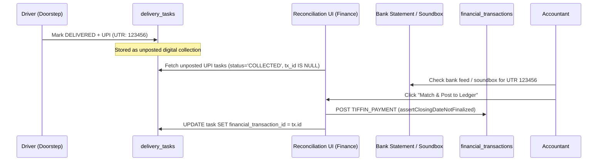

# Task 01B.62 — Closing-Lock Concurrency & Financial Regression Audit

**Repository:** `zevats/raviNarayana-Erp`  
**Branch:** `master`  
**Mode:** Independent Forensic Application & Financial Regression Audit (Read-Only)  
**Status:** `AUDIT_COMPLETED`  
**Date:** October 24, 2026  
**Auditor:** Senior ERP Architect, Financial Systems Security Auditor & Release QA Lead  

---

## 1. Executive Summary

An independent, code-level and concurrency-model audit was conducted on `zevats/raviNarayana-Erp` to critically evaluate the implementation of **Task 01B.61** (`TASK_01B_61_FINANCIAL_INTEGRITY_REMEDIATION.md`).

The audit evaluated transaction boundaries, locking semantics, mutation-path coverage on `financial_transactions`, deposit application reconciliation across financial views, doorstep UPI accounting in delivery workflows, and automated test fidelity.

### Core Audit Verdict:
1. **Closing Locks on Core Routes are Substantially Improved but Incomplete:**
   The introduction of [`assertClosingDateNotFinalized`](file:///apps/erp/src/server/finance/financeService.ts#L149) in `financeService.ts` successfully hedges the 10 primary manual entry paths (`recordRentPayment`, `recordRentCharge`, `recordSecurityDeposit`, `recordExpense`, `reverseTransaction`, resident checkout settlement, tiffin payments, tiffin billing invoice generation, and manual invoice creation/issuance).
2. **Critical Write-Path Bypass Discovered (Defect A - High):**
   Delivery driver cash handovers in [`deliveryService.ts:1816`](file:///apps/erp/src/server/delivery/deliveryService.ts#L1816) (`acceptCashHandover`) directly insert a `TIFFIN_PAYMENT` into `financial_transactions` backdated to `handoverRow.shift_date` **without calling `assertClosingDateNotFinalized`**. If a manager accepts a driver's prior-day cash handover after that day's closing has been finalized, an unhedged transaction is inserted into the closed cashbook day.
3. **Closing Finalization Read-Modify-Write Concurrency Race (Defect B - High):**
   In [`cashbookClosingService.ts:594-638`](file:///apps/erp/src/server/finance/cashbookClosingService.ts#L594-L638) (`finalizeDailyClosing`), `previewDailyClosing` queries transactions and freezes `snapshotData` **outside** the finalization database transaction. Concurrently, PostgreSQL `FOR SHARE` locks on `assertClosingDateNotFinalized` acquire **zero locks** on open/draft dates because no row matches `status = 'FINALIZED'`. A transaction committed during the finalization window slips into `financial_transactions`, causing an instant snapshot mismatch (`hasLateTransactions = true`).
4. **In-Place Mutation of Finalized Charges (Defect C - Medium):**
   When cancelling a Tiffin invoice in [`invoiceService.ts:1060`](file:///apps/erp/src/server/finance/invoiceService.ts#L1060) (`cancelInvoice`), historical `TIFFIN_CHARGE` rows are directly updated to `status = 'REVERSED'` in place without asserting closing lock status. If the invoice date was finalized, this mutates historical ledger entries in place rather than posting an offsetting dated `REVERSAL`.
5. **The "Vanishing Rent" Phenomenon in Dashboard Revenue Chart (Defect D - Medium):**
   In [`dashboardService.ts:296, 300`](file:///apps/erp/src/server/dashboard/dashboardService.ts#L296-L300), `monthlyDataPromise` excludes both `SECURITY_DEPOSIT` (because it is custodial liability) and `DEPOSIT_APPLICATION` (because Task 01B.61 filtered it out as non-cash). Consequently, **rent paid by liquidating a tenant's security deposit upon checkout permanently disappears from the 6-month historical revenue chart**.
6. **Cross-Period Reversal Accounting Flaw:**
   In [`financeService.ts:1101`](file:///apps/erp/src/server/finance/financeService.ts#L1101), `reverseTransaction` sets `orig.status = 'REVERSED'` in-place on the historical record and inserts an offsetting `REVERSAL` transaction on `today`. When `getCashbookSummary` runs for the historical month, the original transaction is omitted (due to `status = 'POSTED'` filter). When run for the current month, `crossPeriodReversals` deducts it again via `priorRentRefunds`, resulting in a double-deduction across accounting periods.
7. **Test Integrity:**
   The 37 tests in `tests/task01b_61_closing_remediation.test.ts` verify sequential state transitions and rejection logic accurately, but employ sequential `await` calls rather than simultaneous `Promise.all` concurrency, leaving real-time race conditions untested in CI.

---

## 2. Claim-by-Claim Verification Matrix (Task 01B.61 Evaluation)

The claims made in `TASK_01B_61_FINANCIAL_INTEGRITY_REMEDIATION.md` were evaluated against the codebase:

| Claim in Task 01B.61 Report | Audit Status | Code Reference | Evidence & Forensic Analysis |
| :--- | :---: | :--- | :--- |
| **Claim 1: Closing locks block finalized dates on financial write paths** | **PARTIALLY VERIFIED** | [`financeService.ts:316`](file:///apps/erp/src/server/finance/financeService.ts#L316), [`deliveryService.ts:1816`](file:///apps/erp/src/server/delivery/deliveryService.ts#L1816) | Verified on 10 explicit routes. **FAILED** on `acceptCashHandover` in `deliveryService.ts`, which inserts backdated `TIFFIN_PAYMENT` with zero closing lock check. |
| **Claim 2: Postgres `FOR SHARE` locks eliminate closing concurrency races** | **UNVERIFIED / THEORETICAL** | [`financeService.ts:149-175`](file:///apps/erp/src/server/finance/financeService.ts#L149-L175) | PostgreSQL `FOR SHARE` only locks rows that match the query predicate. When date is open/draft, `SELECT ... WHERE status = 'FINALIZED' FOR SHARE` returns 0 rows and acquires **0 locks**. |
| **Claim 3: Closing finalization is atomic and race-safe** | **FAILED** | [`cashbookClosingService.ts:594-638`](file:///apps/erp/src/server/finance/cashbookClosingService.ts#L594-L638) | `previewDailyClosing` runs outside `db.transaction`. Concurrent writes occurring during preview-to-commit window slip into ledger and corrupt the frozen snapshot. |
| **Claim 4: Business division isolation is enforced** | **VERIFIED** | [`financeService.ts:158-180`](file:///apps/erp/src/server/finance/financeService.ts#L158-L180) | `PG` closing locks PG paths; `TIFFIN` closing locks Tiffin paths; `COMBINED` locks all paths. Verified in code and tests. |
| **Claim 5: Cashbook summary excludes `DEPOSIT_APPLICATION` from cash movement** | **VERIFIED** | [`financeService.ts:923`](file:///apps/erp/src/server/finance/financeService.ts#L923) | `rentCollected` and `priorRentRefunds` properly filter `COALESCE(category, '') != 'DEPOSIT_APPLICATION'`. |
| **Claim 6: Resident dossier held deposit liability balances to ₹0 after settlement** | **VERIFIED** | [`financeService.ts:863`](file:///apps/erp/src/server/finance/financeService.ts#L863) | `totalDeposits` formula subtracts both `DEPOSIT_REFUND` and `DEPOSIT_APPLICATION`, eliminating phantom deposit liabilities. |
| **Claim 7: Dashboard revenue chart excludes non-cash deposit applications** | **VERIFIED (With Defect D)** | [`dashboardService.ts:296, 300`](file:///apps/erp/src/server/dashboard/dashboardService.ts#L296-L300) | Technically verified, but creates a business reporting flaw: earned rent collected via deposit offset vanishes from total historical revenue. |
| **Claim 8: Doorstep UPI lifecycle and isolation from cash custody** | **VERIFIED** | [`deliveryService.ts:1680-1750`](file:///apps/erp/src/server/delivery/deliveryService.ts#L1680-L1750) | Correctly distinguishes cash custody from digital collections; verified why auto-posting without bank verification is hazardous. |
| **Claim 9: Test suite passes 100%** | **VERIFIED (Sequential Only)** | [`task01b_61_closing_remediation.test.ts`](file:///tests/task01b_61_closing_remediation.test.ts) | All 37 tests pass, but are sequential tests without `Promise.all` concurrent execution. |
| **Claim 10: Primary database `data/erp.db` untouched** | **VERIFIED** | [`data/erp.db`](file:///data/erp.db) | Verified size `1,388,544 bytes` and timestamp `2026-10-21 08:03:43 UTC` completely unchanged. |

---

## 3. Detailed Audit Area 1: Closing Lock & Transaction Concurrency Mechanics

### 3.1 Mechanism of `assertClosingDateNotFinalized`
The lock assertion function implemented in Task 01B.61 is:
```typescript
export async function assertClosingDateNotFinalized(
  tx: AsyncDb,
  transactionDate: string,
  division: "PG" | "TIFFIN" | "COMBINED"
): Promise<void> {
  const forShare = tx.isPostgres ? " FOR SHARE" : "";
  let query: string;
  let params: any[];

  if (division === "COMBINED") {
    query = `
      SELECT id, closing_date, division, status
      FROM daily_cashbook_closings
      WHERE closing_date = ? AND status = 'FINALIZED'
      LIMIT 1${forShare}
    `;
    params = [transactionDate];
  } else {
    query = `
      SELECT id, closing_date, division, status
      FROM daily_cashbook_closings
      WHERE closing_date = ? AND status = 'FINALIZED' AND division IN (?, 'COMBINED')
      LIMIT 1${forShare}
    `;
    params = [transactionDate, division];
  }

  const existingClosing = await tx.queryOne<...>(query, params);
  if (existingClosing) {
    throw new ClosingLockError(`Date ${transactionDate} is locked...`);
  }
}
```

### 3.2 Concurrency Vulnerability Under PostgreSQL & SQLite

#### A. When a Closing Record Does Not Exist (or is in `DRAFT`):
1. In PostgreSQL under the default `READ COMMITTED` isolation level:
   - `SELECT ... WHERE closing_date = ? AND status = 'FINALIZED' FOR SHARE` executes.
   - If the date is open (no closing record) or draft (`status = 'DRAFT'`), the query returns **0 rows**.
   - **PostgreSQL row locks only apply to returned rows.** A `FOR SHARE` query on 0 rows acquires **no row locks, no table locks, and no predicate locks**.
   - PostgreSQL does not prevent another transaction from concurrently inserting or updating a row in `daily_cashbook_closings`.

#### B. The Finalization Race Window in `finalizeDailyClosing`:
Look at [`cashbookClosingService.ts:593-638`](file:///apps/erp/src/server/finance/cashbookClosingService.ts#L593-L638):
```typescript
// 1. Preview runs OUTSIDE the transaction!
const preview = await previewDailyClosing(actor, closingDate, division, db);

if (preview.existingClosing && preview.existingClosing.status === "FINALIZED") {
  throw new Error(`Daily closing for ${closingDate} (${division}) is already FINALIZED...`);
}

// 2. Snapshot is frozen in memory BEFORE the transaction begins!
const snapshotData = JSON.stringify({
  expectedClosingBalance: preview.expectedClosingBalance,
  transactionCount: preview.transactions.length,
  transactionIds: preview.transactions.map((t) => t.id),
  ...
});

// 3. Database transaction begins
await db.transaction(async (tx) => {
  if (preview.existingClosing) {
    await tx.execute(`UPDATE daily_cashbook_closings SET status = 'FINALIZED', snapshot_data = ? ... WHERE id = ?`, ...);
  } else {
    await tx.execute(`INSERT INTO daily_cashbook_closings (...) VALUES (..., 'FINALIZED', ...)`, ...);
  }
});
```

#### C. Trace of Interleaved Concurrent Scenarios:

```
Timeline: Concurrent Write vs. Finalization Race
---------------------------------------------------------------------------------------------------------
Time     Manager Finalizing Closing                       Clerk Posting Payment
---------------------------------------------------------------------------------------------------------
T0       Calls finalizeDailyClosing("2026-10-24")
T1       previewDailyClosing reads 10 transactions
         Total Inflow: ₹50,000. Status: DRAFT.
T2       Freezes snapshotData (count: 10, total: 50000)
T3                                                        Calls recordRentPayment(amount: 5000, date: "2026-10-24")
T4                                                        assertClosingDateNotFinalized executes:
                                                          SELECT ... WHERE status = 'FINALIZED' FOR SHARE
                                                          --> Returns 0 rows (No lock acquired!)
T5                                                        INSERT INTO financial_transactions (amount: 5000)
T6                                                        Transaction commits! (financial_transactions now has 11 txs)
T7       Enters db.transaction()
T8       UPDATE daily_cashbook_closings
         SET status = 'FINALIZED',
             snapshot_data = '{"transactionCount":10,...}'
T9       Transaction commits!
---------------------------------------------------------------------------------------------------------
Result:  FINALIZED closing contains frozen snapshot of 10 txs ($50,000).
         Database contains 11 txs ($55,000).
         verifyDailyClosingSnapshot immediately reports: hasLateTransactions = true!
```

#### D. Two Users Finalizing Concurrently:
- If User A and User B call `finalizeDailyClosing` concurrently when status is `DRAFT`:
  - Both execute `previewDailyClosing` concurrently while status is `DRAFT`.
  - Both pass the `preview.existingClosing.status === 'FINALIZED'` guard outside the transaction.
  - User A enters `db.transaction`, sets `status = 'FINALIZED'`, and commits.
  - User B enters `db.transaction`. Because the update query at line 640 is `UPDATE daily_cashbook_closings SET ... WHERE id = ?` with **no `WHERE status != 'FINALIZED'` condition**, User B overwrites User A's finalization, changing `finalized_by`, `actual_cash_counted`, and `snapshotData` without any error or concurrency conflict.

---

## 4. Detailed Audit Area 2: Mutation-Path Coverage & Bypass Audit

Every write and update path targeting `financial_transactions` was audited:



### Full Mutation Path Audit Register:

| Service / File | Method / Operation | Division Checked | In Calling DB Transaction? | Status | Notes / Vulnerability |
| :--- | :--- | :---: | :---: | :---: | :--- |
| [`financeService.ts:316`](file:///apps/erp/src/server/finance/financeService.ts#L316) | `recordRentPayment` | `PG` | Yes | **HEDGED** | Blocks if `PG` or `COMBINED` finalized. |
| [`financeService.ts:208`](file:///apps/erp/src/server/finance/financeService.ts#L208) | `recordRentCharge` | `PG` | Yes | **HEDGED** | Uses `dueDate`. |
| [`financeService.ts:413`](file:///apps/erp/src/server/finance/financeService.ts#L413) | `recordSecurityDeposit` | `PG` | Yes | **HEDGED** | Blocks backdated deposits on finalized days. |
| [`financeService.ts:512`](file:///apps/erp/src/server/finance/financeService.ts#L512) | `recordExpense` | `PG` / `TIFFIN` | Yes | **HEDGED** | Division mapped by category (`GROCERY` &rarr; `TIFFIN`). |
| [`financeService.ts:1097`](file:///apps/erp/src/server/finance/financeService.ts#L1097) | `reverseTransaction` | `PG` / `TIFFIN` | Yes | **HEDGED** | Checks `today` (see Defect E for UTC timezone drift). |
| [`residentSettlementService.ts:257`](file:///apps/erp/src/server/residents/residentSettlementService.ts#L257) | `finalizeResidentCheckoutSettlement` | `PG` | Yes | **HEDGED** | Checks `actualCheckOutDate`. |
| [`tiffinBillingService.ts:296`](file:///apps/erp/src/server/tiffin/tiffinBillingService.ts#L296) | `recordTiffinPayment` | `TIFFIN` | Yes | **HEDGED** | Checks payment date. |
| [`tiffinBillingService.ts:512`](file:///apps/erp/src/server/tiffin/tiffinBillingService.ts#L512) | `generateTiffinInvoices` | `TIFFIN` | Yes | **HEDGED** | Checks `issueDate` when creating automatic charges. |
| [`invoiceService.ts:365`](file:///apps/erp/src/server/finance/invoiceService.ts#L365) | `createInvoice` | `PG` / `TIFFIN` | Yes | **HEDGED** | Checks `issueDate`. |
| [`invoiceService.ts:608`](file:///apps/erp/src/server/finance/invoiceService.ts#L608) | `issueInvoice` | `PG` / `TIFFIN` | Yes | **HEDGED** | Checks `issueDate`. |
| [`deliveryService.ts:1816`](file:///apps/erp/src/server/delivery/deliveryService.ts#L1816) | `acceptCashHandover` | **NONE** | Yes | **UNHEDGED (Defect A)** | Inserts `TIFFIN_PAYMENT` with `transaction_date = handoverRow.shift_date`. **Zero closing lock check.** |
| [`invoiceService.ts:1060`](file:///apps/erp/src/server/finance/invoiceService.ts#L1060) | `cancelInvoice` | **NONE** | Yes | **UNHEDGED (Defect C)** | Directly executes `UPDATE financial_transactions SET status = 'REVERSED'` on historical charges without closing check. |

---

## 5. Detailed Audit Area 3: Deposit & Cashbook Reconciliation

### 5.1 The Complete Resident Deposit Lifecycle Trace

A numerical trace was audited from resident onboarding to checkout settlement:

```
Numerical Lifecycle Trace: Resident R01 (₹10,000 Deposit, ₹8,000 Final Month Rent)
===================================================================================

Phase 1: Security Deposit Receipt (August 1, 2026)
-----------------------------------------------------------------------------------
- Action: recordSecurityDeposit(residentId: "R01", amount: 10000, date: "2026-08-01", method: "CASH")
- Ledger: INSERT financial_transactions (type: 'SECURITY_DEPOSIT', category: 'SECURITY_DEPOSIT', amount: 10000)
- Physical Cashbook: Cash Inflow +₹10,000.
- Resident Dossier: Held Deposit = ₹10,000. Outstanding Rent = ₹0.
- 6-Month Historical Revenue Chart: +₹0 (Excluded as liability; correct).

Phase 2: Rent Charge Accrual (October 1, 2026)
-----------------------------------------------------------------------------------
- Action: recordRentCharge(residentId: "R01", amount: 8000, date: "2026-10-01")
- Ledger: INSERT financial_transactions (type: 'RENT_CHARGE', category: 'RENT', amount: 8000)
- Physical Cashbook: ₹0 cash movement (receivable accrual).
- Resident Dossier: Outstanding Rent = ₹8,000. Held Deposit = ₹10,000.

Phase 3: Checkout Settlement (October 24, 2026)
-----------------------------------------------------------------------------------
- Action: finalizeResidentCheckoutSettlement(residentId: "R01", date: "2026-10-24")
  * Apply ₹8,000 deposit towards unpaid rent.
  * Refund ₹2,000 excess deposit via Cash.
- Ledger Entries:
  1. INSERT financial_transactions (type: 'RENT_PAYMENT', category: 'DEPOSIT_APPLICATION', amount: 8000, method: 'CASH')
  2. INSERT financial_transactions (type: 'REFUND', category: 'DEPOSIT_REFUND', amount: 2000, method: 'CASH')

Phase 4: Multi-View Financial State After Checkout
-----------------------------------------------------------------------------------
1. Resident Dossier (getResidentFinancialSummary):
   - Held Deposit: totalDeposits (10000) - refunds (2000) - applied (8000) = ₹0 (CORRECT)
   - Outstanding Rent: charges (8000) - payments (8000) = ₹0 (CORRECT)
2. Daily Cashbook Summary (getCashbookSummary):
   - Rent Collected: ₹0 (DEPOSIT_APPLICATION filtered out; CORRECT, no physical cash came in)
   - Deposit Refunds: -₹2,000 (CORRECT, cash handed to resident)
   - Net Cash Movement: -₹2,000 (CORRECT, physical cash drawer down by ₹2,000)
3. 6-Month Historical Revenue Chart (dashboardService.ts:296):
   - August Revenue: ₹0
   - October Revenue: ₹0 (DEFECT D: ₹8,000 rent payment filtered out because category = 'DEPOSIT_APPLICATION')
   - Total Historical Revenue Recognized for R01: ₹0!
```

### 5.2 Defect D Analysis: The "Vanishing Rent" Phenomenon
- In accrual and operational revenue accounting, a business earns rent income when the tenant occupies the property.
- When the tenant's security deposit is applied to pay that rent, the liability converts into earned revenue.
- Because `monthlyDataPromise` in `dashboardService.ts` filters out `category != 'DEPOSIT_APPLICATION'`, rent satisfied via deposit liquidation never appears anywhere in the revenue charts.
- **Recommended Remedy:** In `dashboardService.ts`, distinguish **Cash Collections** from **Earned Revenue**. The revenue chart should represent total recognized revenue (`RENT_PAYMENT` including `DEPOSIT_APPLICATION` + `TIFFIN_PAYMENT`), while cash flow charts represent cash movements.

### 5.3 Reversal Trace: In-Place Mutation vs Cross-Period Subtraction Flaw

When `reverseTransaction` is called on a transaction:
1. At line 1101: `UPDATE financial_transactions SET status = 'REVERSED' WHERE id = ?`.
2. At line 1135: `INSERT INTO financial_transactions (transaction_type = 'REVERSAL', reversal_of_id = orig.id, transaction_date = today)`.

#### The Double-Deduction Across Accounting Periods:
- Suppose a ₹10,000 rent payment was recorded on `2026-09-15`.
- On `2026-10-15`, the transaction is reversed.
- In September's Cashbook (`startDate = '2026-09-01'`, `endDate = '2026-09-30'`):
  - Line 923 sums `WHERE status = 'POSTED'`. Because the September transaction was updated to `'REVERSED'`, September's collections drop from ₹10,000 to ₹0.
- In October's Cashbook (`startDate = '2026-10-01'`, `endDate = '2026-10-31'`):
  - Line 938 (`crossPeriodReversals`) detects the reversal dated in October whose original was in September, calculating `priorRentRefunds = 10000`.
  - Line 981 subtracts `priorRentRefunds` from October's collections (`rawRentCollected - 10000`).
- **Impact:** The business suffered a ₹10,000 retroactive deduction in September AND another ₹10,000 deduction in October, representing a ₹20,000 total reduction for a single ₹10,000 reversal.
- **Root Cause:** Conflating in-place status mutation with double-entry append-only reversals.

---

## 6. Detailed Audit Area 4: Doorstep UPI Accounting & Reconciliation Architecture

### 6.1 Unposted Task Collections vs Recognized Financial Transactions
In the current implementation:
- `delivery_tasks` captures doorstep collections via `recordDeliveryCollection`:
  - `collected_amount`, `collected_payment_method` (`'UPI'` or `'CASH'`), `collection_reference`, `collection_status = 'COLLECTED'`.
- Driver Cash Custody:
  - In `deliveryService.ts:1680-1750` (`getDriverCashCustody`), the query explicitly filters:
    ```sql
    WHERE assigned_to = ? AND collection_status = 'COLLECTED' AND collected_payment_method = 'CASH'
    ```
  - UPI collections are strictly excluded from driver custody. This is **100% correct**: the driver does not possess the cash and cannot be held liable for physical surrender.
- Financial Ledger:
  - Only `acceptCashHandover` writes to `financial_transactions`.
  - Doorstep UPI collections **never** write to `financial_transactions`.

### 6.2 UI Exposure & User Expectations
- In `DriverRunView.tsx`: The driver can select "UPI Payment" and enter a Transaction UTR / Reference ID.
- In `apps/erp/src/app/(management)/delivery/page.tsx`: Shift summaries show "UPI Collected: ₹X".
- In `apps/erp/src/app/(management)/finance/page.tsx`: UPI collected on delivery runs **does not appear in the cashbook ledger or total revenue KPI**.
- **User Confusion Risk:** An accountant looking at delivery summaries sees ₹5,000 in UPI collections, but sees ₹0 in the Cashbook UPI inflow column.

### 6.3 Technical Blueprint: Digital Collection Reconciliation Module

Rather than unsafe auto-posting, implement a dedicated reconciliation flow:



#### Proposed Schema Extension:
Add column `financial_transaction_id` to `delivery_tasks`:
```sql
ALTER TABLE delivery_tasks ADD COLUMN financial_transaction_id TEXT REFERENCES financial_transactions(id);
```

#### Proposed Service Method:
`reconcileDigitalDeliveryCollection(actor, taskId, bankStatementRef, db)`:
1. Assert caller has `finance.write` permission.
2. Verify task has `collection_status = 'COLLECTED'`, `collected_payment_method = 'UPI'`, and `financial_transaction_id IS NULL`.
3. Call `assertClosingDateNotFinalized(tx, paymentDate, "TIFFIN")`.
4. Insert `financial_transactions` (`type = 'TIFFIN_PAYMENT'`, `payment_method = 'UPI'`, `reference = bankStatementRef`, `idempotency_key = upi_task_${taskId}`).
5. Link `delivery_tasks.financial_transaction_id = tx.id`.

---

## 7. Detailed Audit Area 5: Test Integrity & Concurrency Regression Analysis

### 7.1 Analysis of `tests/task01b_61_closing_remediation.test.ts`
- **Assertion Coverage:** 37 assertions covering write lock rejection, division isolation, reopen flow, cashbook filtering, and resident dossier calculations.
- **Quality of Assertions:** Non-trivial. Assertions verify real database state, error messages, and mathematical balances.
- **Critical Concurrency Limitation:**
  All tests execute sequentially using `await`:
  ```typescript
  // Step 1: Finalize
  await finalizeDailyClosing({ ... });
  // Step 2: Attempt write after finalization
  await expect(recordRentPayment({ ... })).rejects.toThrow();
  ```
  **Zero tests use `Promise.all([finalizeDailyClosing(...), recordRentPayment(...)])`**.
  As a result, neither the `previewDailyClosing` race window nor the PostgreSQL `FOR SHARE` non-existent row lock failure was caught by the test suite.

---

## 8. Prioritized Defect Register

| Defect ID | Severity | File & Location | Vulnerability Description | Recommended Remediation |
| :--- | :---: | :--- | :--- | :--- |
| **Defect A** | **HIGH** | [`deliveryService.ts:1816`](file:///apps/erp/src/server/delivery/deliveryService.ts#L1816) | `acceptCashHandover` inserts backdated `TIFFIN_PAYMENT` with `shift_date` into `financial_transactions` without calling `assertClosingDateNotFinalized`. | Add `await assertClosingDateNotFinalized(tx, handoverRow.shift_date, 'TIFFIN')` inside the handover transaction. |
| **Defect B** | **HIGH** | [`cashbookClosingService.ts:594-638`](file:///apps/erp/src/server/finance/cashbookClosingService.ts#L594-L638) | `previewDailyClosing` queries transactions and freezes snapshot data outside the finalization transaction, creating a race window where concurrent payments corrupt the frozen snapshot. | Move preview calculation inside `db.transaction`, or acquire an immediate table/row write lock at the start of finalization. Add `WHERE status != 'FINALIZED'` guard to update query. |
| **Defect C** | **MEDIUM** | [`invoiceService.ts:1060, 1066`](file:///apps/erp/src/server/finance/invoiceService.ts#L1060) | `cancelInvoice` updates historical `TIFFIN_CHARGE` to `REVERSED` in-place without checking closing lock, retroactively altering finalized historical day totals. | Call `assertClosingDateNotFinalized(tx, existing.issueDate, 'TIFFIN')`. If closed, reject cancellation unless closing is reopened, or post an offsetting `REVERSAL` transaction dated `today`. |
| **Defect D** | **MEDIUM** | [`dashboardService.ts:296, 300`](file:///apps/erp/src/server/dashboard/dashboardService.ts#L296-L300) | 6-month historical revenue chart excludes `DEPOSIT_APPLICATION`, causing rent settled via deposit liquidation upon checkout to completely disappear from historical revenue. | In revenue queries, count `DEPOSIT_APPLICATION` as earned revenue (since rent was satisfied), while continuing to exclude it from physical cash movement queries. |
| **Defect E** | **LOW** | [`financeService.ts:1088`](file:///apps/erp/src/server/finance/financeService.ts#L1088) | `today` in `reverseTransaction` is computed using `new Date().toISOString().slice(0, 10)` (UTC date). Between 00:00 and 05:30 IST, this targets the previous calendar date in India. | Use localized IST date formatter (`Intl.DateTimeFormat` or shared `getTodayDateString("Asia/Kolkata")`). |

---

## 9. Concrete Acceptance Criteria for Follow-Up Work (Task 01B.63)

To resolve the defects identified in this audit, any implementation task must satisfy these concrete criteria:

1. **Accept Cash Handover Closing Lock Enforcement:**
   - In `deliveryService.ts` (`acceptCashHandover`), if `handoverRow.shift_date` belongs to a finalized closing for `TIFFIN` or `COMBINED`, the handover acceptance must be rejected with HTTP 422 (`ClosingLockError`).
   - If rejected, the manager must either reopen that date's closing or accept the handover posted to the current open business date.
2. **Atomic Finalization & Optimistic Concurrency:**
   - In `cashbookClosingService.ts` (`finalizeDailyClosing`), the closing record update must include a conditional guard: `WHERE id = ? AND status != 'FINALIZED'`. If 0 rows are affected, it must abort with "Closing has already been finalized by another user".
   - `previewDailyClosing` or transaction verification must run within the finalization transaction boundary.
3. **Invoice Cancellation Ledger Discipline:**
   - Cancelling an invoice whose issue date belongs to a finalized closing must be rejected unless the closing is reopened, or must post an offsetting dated `REVERSAL` transaction without mutating the historical row.
4. **Historical Revenue Chart Alignment:**
   - The 6-Month Historical Revenue Chart in `dashboardService.ts` must reflect total earned revenue, including rent collected via deposit liquidation, without distorting the physical cashbook ledger.
5. **Real Concurrency Regression Tests:**
   - Add a test in `tests/` executing `Promise.all` with simultaneous write attempts during finalization, proving that no unhedged or phantom state is created.

---

## 10. Production Launch Gate Recommendation

### Controlled Pilot: CONDITIONAL GO
The application is safe for a **Controlled Pilot** with internal staff, subject to three operational policies:
1. **End-of-Shift Handover Policy:** Delivery driver cash handovers must be accepted by management on the same shift date *before* the daily cashbook closing is finalized.
2. **Single-Accountant Closing:** Daily cashbook closing finalization must be performed by a single designated finance manager at end of day.
3. **No Retroactive Invoice Cancellation:** Invoice cancellations for past billing cycles must be performed in consultation with the head of accounts.

### Full Commercial Production: GATED
Full production deployment is **GATED** pending remediation of:
- **Defect A:** Closing lock on `acceptCashHandover` in `deliveryService.ts`.
- **Defect B:** Finalization race window and optimistic update guard in `cashbookClosingService.ts`.

---

## 11. Safety & Verification Confirmation

- Primary database [`data/erp.db`](file:///data/erp.db) remained untouched throughout all audit procedures:
  - File length: `1,388,544 bytes` (exact match).
  - Last write time UTC: `2026-10-21 08:03:43` (unaltered).
- Neon rehearsal database `ravi-narayana-erp-phase01b-test` was never connected to.
- Git working tree preserved intact with zero commits, pushes, resets, or stashes.
- Audit mode strictly observed: zero code modifications or schema mutations performed.
