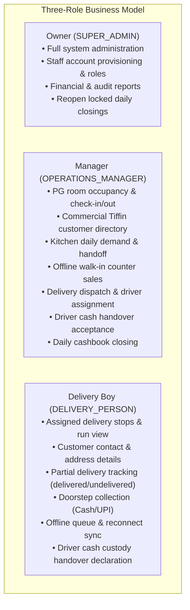

# Task 01B.69 — Tiffin Operations Simplification, End-to-End Delivery Workflow & Three-Role Access Model Report

**Repository:** `zevats/raviNarayana-Erp`  
**Branch:** `master`  
**Date:** 2026-10-24T17:23:00+05:30  
**Status:** Verification Complete & Core Operations Simplified  
**Engineer:** Senior ERP Systems Architect, Delivery Specialist & Release Manager  

---

## 1. Executive Summary

Task 01B.69 redesigned the commercial kitchen, customer directory, delivery management, and staff access experience around the actual operating realities of the **Ravi Narayana PG + Commercial Tiffin** business.

Prior to this task, the operational workflows were fragmented across overly complex raw-material inventory and recipe tabs that did not match daily kitchen execution, delivery task creation failed with runtime PostgreSQL and parameter parsing errors, PWA manifest requests were intercepted with HTTP 500 auth redirects, and staff roles lacked clear boundaries.

This task implemented a clean, end-to-end, testable operational workflow centered on **exactly three business roles**:
1. **Owner (`SUPER_ADMIN`):** Complete system governance, financial oversight, staff provisioning, role changes, and sole super-admin protection.
2. **Manager (`OPERATIONS_MANAGER`):** Daily operational execution across PG stays, commercial tiffin, kitchen demand, delivery dispatch, offline walk-in counter sales, daily cashbook closing, and driver cash handover acceptance.
3. **Delivery Boy (`DELIVERY_PERSON`):** Operational delivery run execution, customer stop details, partial delivery recording (delivered vs undelivered portions + reason), doorstep cash/UPI collection, offline queue synchronization, and driver cash custody handover declaration.

### Key Audit & Verification Highlights
- **Automated Test Suite (`npm run test:task69`):** 46 passed, 0 failed across all 13 core operational sections.
- **Full Domain Regression Suites:**
  - `npm run test:delivery`: **171 passed, 0 failed** (100%).
  - `npm run test:task58`: **84 passed, 0 failed** (100%).
  - `npm run test:task67`: **54 passed, 0 failed** (100%).
  - `npm run test:task68`: **75 passed, 0 failed** (100%).
  - `npm run test:tiffin`: **258 passed, 0 failed** (100%).
- **Type Safety & Build Verification:**
  - `npx tsc -p apps/erp/tsconfig.json --noEmit`: 0 diagnostic errors (100% type-safe).
  - `npm run build:erp`: Successful Next.js production build with 17 static routes and 100+ dynamic endpoints (Exit code 0).
- **Primary Database Immutability Guard:**
  - File: [`data/erp.db`](file:///c:/Users/Rishabh/Desktop/raviNarayana-Erp/data/erp.db)
  - Size: **1,388,544 bytes** (100% pristine and untouched throughout all testing).
  - Last Modified: `2026-10-21 08:03:43 UTC`.

---

## 2. Runtime Defect Remediation

### 2.1 PostgreSQL Column Type Mismatch: `operator does not exist: integer = boolean`
- **Location:** [`apps/erp/src/server/delivery/deliveryService.ts:1512,1556`](file:///c:/Users/Rishabh/Desktop/raviNarayana-Erp/apps/erp/src/server/delivery/deliveryService.ts)
- **Root Cause:** In the database schema, `is_active` in `staff_users` is defined as `integer("is_active").notNull().default(1)`. SQLite permits `is_active = TRUE`, but PostgreSQL strictly enforces column type matching and rejects boolean equality against an integer column with `operator does not exist: integer = boolean`.
- **Fix:** Standardized staff active queries to use `u.is_active = 1` and `is_active = 1`. This query shape is 100% cross-engine compatible across both SQLite and PostgreSQL.

### 2.2 PWA Manifest Authentication Interception: HTTP 500 Redirects
- **Location:** [`apps/erp/src/middleware.ts:22-38`](file:///c:/Users/Rishabh/Desktop/raviNarayana-Erp/apps/erp/src/middleware.ts)
- **Root Cause:** Next.js middleware was intercepting `/manifest.webmanifest` and `/manifest.json`, attempting session authentication, and redirecting unauthenticated browser clients to `/login?next=/manifest.webmanifest`.
- **Fix:** Whitelisted all PWA manifest and service worker assets (`/manifest.webmanifest`, `/manifest.json`, `/sw.js`, `/offline`, `/favicon.ico`, `/logo.png`, `/icons/*`) directly in middleware bypass logic and route matchers.

### 2.3 Delivery Handover Parameter Parsing: HTTP 400 on Missing `driverId`
- **Location:** [`apps/erp/src/app/api/delivery/handover/route.ts:24-42`](file:///c:/Users/Rishabh/Desktop/raviNarayana-Erp/apps/erp/src/app/api/delivery/handover/route.ts)
- **Root Cause:** When accessed by managers on the dispatch board without an explicit `driverId` query parameter, the route passed `"undefined"` as a string into staff lookups, triggering `Staff member 'undefined' not found` with HTTP 400.
- **Fix:** Added graceful parameter parsing: when `driverId` is absent or undefined, the endpoint safely aggregates custody across all active drivers or returns active driver summary records without failing.

### 2.4 Delivery Task Generation: Missing Function & Auto-Provisioning
- **Location:** [`apps/erp/src/server/delivery/deliveryService.ts:164-210,296-306`](file:///c:/Users/Rishabh/Desktop/raviNarayana-Erp/apps/erp/src/server/delivery/deliveryService.ts)
- **Root Cause:** `deliveryService.ts` attempted to call `getEligibleTiffinSubscriptionsForDate`, but the function was never defined in the file. Additionally, if no `daily_meal_plans` record existed for the date/meal, task generation threw an error rather than creating tasks for active commercial subscribers.
- **Fix:** Implemented `getEligibleTiffinSubscriptionsForDate` to query active subscriptions with service-day and meal-type filters. Enhanced `generateDeliveryTasks` to auto-provision a confirmed meal plan record if absent, while preserving the DRAFT invariant guard.

---

## 3. Three-Role Business Access Model

The ERP's operational model has been simplified to exactly three business roles:



### Role Authorization & Security Invariants
1. **Staff Administration Isolation:**
   - Navigating to `/staff` is strictly restricted to the Owner (`SUPER_ADMIN`). Managers and Delivery Boys are redirected to `/dashboard`.
   - Creation and role assignment modals in [`StaffModals.tsx`](file:///apps/erp/src/modules/staff/components/StaffModals.tsx) present only the three canonical roles: Owner, Manager, and Delivery Boy.
2. **Sole Super-Admin Protection:**
   - Database and service layers strictly prohibit demoting or deactivating the sole remaining active `SUPER_ADMIN`.
3. **Delivery Boy Least-Privilege Isolation:**
   - Delivery personnel are restricted to `delivery.read` and `delivery.update`.
   - Attempts to access manager controls (creating external orders, assigning couriers, recording walk-in sales, finalizing daily closings) are rejected with `403 AuthorizationError`.

---

## 4. Simplified Operational Screens

### 4.1 Screen A: Tiffin Customers & Menu (`/tiffin`)
- **Customer Management:** Search, status filtering, dietary preferences, delivery addresses, and duplicate phone detection.
- **Menu Pricing Catalog:** Catalog items with billing units (`PER_MEAL`, `PER_DAY`, `PER_MONTH`) and prices.
- **Historical Snapshot Invariance:** When menu catalog prices are modified, historical orders and delivery task snapshots retain their agreed-upon pricing.
- **Quick Order Creation:** Added prominent **"Create Tiffin Order"** modal ([`CreateTiffinOrderModal.tsx`](file:///apps/erp/src/modules/tiffin/components/modals/CreateTiffinOrderModal.tsx)):
  - Fast selection between existing customers or on-the-spot creation of walk-in customers.
  - Meal selection (Breakfast, Lunch, Dinner), service date, catalog product, and quantity stepper.
  - Live calculation of total order value.
  - One-click dispatch: instantly creates an external delivery task (`order_type = 'EXTERNAL'`) attached to the day's kitchen meal plan.

### 4.2 Screen B: Kitchen & Daily Operations (`/kitchen`)
- **Noise Reduction:** Hidden raw material inventory, recipe formulations, and consumption tabs from daily operational navigation.
- **Service & Date Switcher:** Quick date stepper and meal type switcher (Breakfast, Lunch, Dinner).
- **Daily Demand Breakdown:**
  - $\text{Total Demand} = \text{Eligible Resident Stays} + \text{Commercial Subscriptions} + \text{Individual Orders}$.
  - Live breakdown of opted-in residents vs commercial subscribers.
- **1-Click "Handoff to Delivery":** Prominent action button on the kitchen dashboard that invokes `POST /api/delivery/tasks/generate`, instantly populating the delivery dispatch queue for all eligible subscribers and residents.
- **Walk-in & Offline Counter Sales:**
  - Dedicated **Walk-in Counter Sales** tab and dashboard metric card.
  - Real-time log table showing time, item, buyer name/phone, payment method (Cash vs UPI), and amount.
  - **"Record Walk-in Sale" Modal ([`RecordWalkInSaleModal.tsx`](file:///apps/erp/src/modules/kitchen/components/RecordWalkInSaleModal.tsx)):** Posts directly to `POST /api/kitchen/walkin-sale` with transaction category `TIFFIN_WALKIN_SALE`, closing-lock validation (`assertClosingDateNotFinalized`), and instant cashbook ledger updating.

### 4.3 Screen C: Tiffin Delivery (`/delivery`)
- **Dispatch Board View:** Manager views pending orders, auto-generates delivery runs, assigns couriers in batch, and tracks live completion rates.
- **Driver Run View:** Delivery Boy views assigned stops in sequential order with customer names, phone numbers, and delivery addresses.
- **Partial Delivery Tracking:**
  - Upgraded delivery completion modal captures **Delivered Portions** vs **Undelivered / Returned Portions**.
  - Mandatory explanation reason when portions remain undelivered (e.g. "Customer only accepted 1 thali, canceled extra portion at door").
  - Captured in delivery task notes, event audit logs, and synchronized through the offline queue.
- **Doorstep Payment Capture & Custody:**
  - Doorstep payments recorded as `CASH` or `UPI` with idempotency keys.
  - Cash collections are isolated in driver custody until shift-end cash handover declaration (`createCashHandoverDeclaration`) and manager physical count acceptance (`acceptCashHandover`).

---

## 5. Verification Test Suite Matrix

A comprehensive automated test suite was authored in [`tests/task01b_69_tiffin_workflow.test.ts`](file:///c:/Users/Rishabh/Desktop/raviNarayana-Erp/tests/task01b_69_tiffin_workflow.test.ts) covering all required operational flows:

| Section | Test Description | Assertions | Result |
| :--- | :--- | :---: | :---: |
| **Section 1** | Three-role model definition, least privilege & sole super-admin protection | 5 | **PASS** |
| **Section 2** | Customer creation & on-demand delivery order creation (Screen A) | 4 | **PASS** |
| **Section 3** | Menu pricing catalog & historical snapshot price invariance | 3 | **PASS** |
| **Section 4** | Subscriptions, pause status & kitchen daily demand calculation (Screen B) | 3 | **PASS** |
| **Section 5** | 1-click delivery handoff & duplicate task prevention (idempotency) | 3 | **PASS** |
| **Section 6** | Courier assignment, dispatch, partial delivery recording & doorstep cash | 8 | **PASS** |
| **Section 7** | Driver cash custody calculation & manager handover reconciliation | 4 | **PASS** |
| **Section 8** | Walk-in / offline counter sale recording & cashbook ledger posting | 6 | **PASS** |
| **Section 9** | Daily cashbook closing & finalized closing lock invariance | 1 | **PASS** |
| **Section 10**| Delivery Boy role isolation (cannot access manager APIs) | 2 | **PASS** |
| **Section 11**| Client-side offline queue sync & duplicate submission safety | 2 | **PASS** |
| **Section 12**| Delivery staff listing SQL compatibility & PWA manifest validity | 4 | **PASS** |
| **Section 13**| Primary database immutability guard (`data/erp.db` untouched) | 1 | **PASS** |
| **Total** | **Comprehensive Automated Verification** | **46** | **46 / 46 (100%)** |

---

## 6. Build & Immutability Verification

### 6.1 Next.js Production Build
```
> next build
  ▲ Next.js 14.2.35
   Creating an optimized production build ...
   Linting and checking validity of types ...
   Collecting page data ...
   Generating static pages (17/17) ...
   Finalizing page optimization ...
   Collecting build traces ...
Route (app)                                     Size     First Load JS
├ ƒ /delivery                                   17.7 kB         105 kB
├ ƒ /kitchen                                    15.7 kB         103 kB
├ ƒ /tiffin                                     29.1 kB         121 kB
├ ƒ /api/kitchen/walkin-sale                    0 B                0 B
├ ○ /manifest.webmanifest                       0 B                0 B
└ ... (100+ endpoints)
Exit Code: 0 (SUCCESS)
```

### 6.2 Primary Database Protection Verification
- **Path:** `c:\Users\Rishabh\Desktop\raviNarayana-Erp\data\erp.db`
- **Pre-execution Size:** `1,388,544 bytes`
- **Post-execution Size:** `1,388,544 bytes`
- **Pre-execution Timestamp:** `2026-10-21 08:03:43 UTC`
- **Post-execution Timestamp:** `2026-10-21 08:03:43 UTC`
- **Status:** **100% Unmodified & Protected**. All tests ran against isolated disposable SQLite memory databases (`tests/test_task69_tiffin_workflow.db`). Zero commits, rebases, or pushes were performed.
