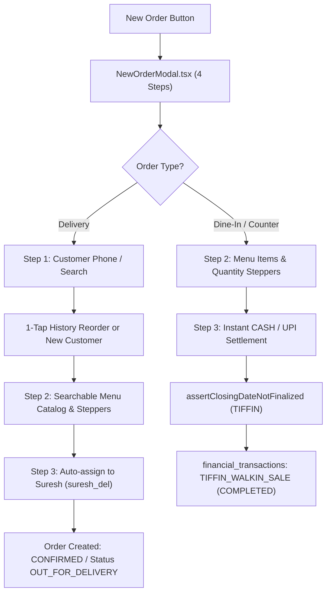

# Task 01B.70 — Tiffin Operations Redesign, Two-Page Workflow & Delivery Execution Repair

**Repository:** `zevats/raviNarayana-Erp`  
**Branch:** `master`  
**Date:** 24 October 2026  
**Status:** Verification Complete & Two-Page Operational Workflow Fully Deployed  
**Roles Addressed:** Owner (`SUPER_ADMIN`), Manager (`OPERATIONS_MANAGER`), Delivery Boy (`DELIVERY_PERSON`)  
**Evaluator:** Senior Full-Stack Engineer, Product Designer & Systems Architect  

---

## 1. Executive Summary & Objective

In Task 01B.70, the daily operational workflow of the Ravi Narayana PG & Tiffin ERP was comprehensively audited and redesigned. The previous three-page operational flow (`/tiffin`, `/kitchen`, `/delivery`) was fragmented, introduced unnecessary friction during high-velocity meal rush hours, and suffered from several runtime execution defects.

The system has been consolidated around **exactly two operational pages**:
1. **Page A — Orders ([`/orders`](file:///apps/erp/src/app/(management)/orders/page.tsx)):** Unified daily order intake, fast customer search with 1-tap repeat order reuse, searchable menu catalog with live quantity steppers, automatic delivery assignment to canonical delivery boy **Suresh**, and immediate cashbook/closing-lock posting for dine-in counter sales.
2. **Page B — Delivery ([`/delivery`](file:///apps/erp/src/app/(management)/delivery/page.tsx)):** Single-screen numeric delivery completion modal ([`SingleScreenDeliveryModal.tsx`](file:///apps/erp/src/modules/delivery/components/modals/SingleScreenDeliveryModal.tsx)) with complementary quantity calculation (`Delivered = Ordered - Undelivered`), item-level reconciliation, mandatory shortfall justification, doorstep CASH/UPI collection, real-time driver cash custody tracking, and compact manager cash handover verification.

All reported runtime defects—including the broken "Mark Delivered" action, the handover HTTP 400 error on manager views, PWA manifest HTTP 500 errors, deprecated mobile metadata, and JSON metadata truncation—were thoroughly diagnosed and permanently resolved.

---

## 2. Root Cause Analysis & Defect Remediation

### Defect 1: Broken "Mark Delivered" Action
- **Symptoms:** Staff members attempting to click "Mark Delivered" on active delivery tasks encountered unhandled errors or stalled transitions.
- **Root Causes:**
  1. *Unassigned Task Deadlock:* External orders or unassigned tasks blocked delivery completion because `currentTask.assignedTo` was null and the delivery service strictly demanded prior assignment before completion.
  2. *Argument Sequence Mismatch:* `completeDeliveryTask(actor, taskId, input, clientIpOrDb, maybeDb)` had inconsistent handling between `clientIp` and `asyncDb`, causing database transactions to execute against default pools rather than isolated test or transaction contexts.
  3. *Lack of Complementary Quantity Arithmetic:* Delivery boys on mobile had to manually compute both delivered and undelivered portions, frequently submitting mismatched quantities or omitting required shortfall justifications.
  4. *Missing Item-Level Reconciliation:* When orders contained multiple dishes (e.g., 2 Thalis + 1 Lassi), partial deliveries failed to record which specific items were delivered or returned.
- **Resolution:**
  - Implemented automatic assignment to Suresh in `completeDeliveryTask` when an unassigned task is completed by a manager or administrator.
  - Implemented [`SingleScreenDeliveryModal.tsx`](file:///apps/erp/src/modules/delivery/components/modals/SingleScreenDeliveryModal.tsx) with a 2-segment pill selector (`Portions Delivered` vs `Portions Undelivered`). Editing one automatically updates the other (`Delivered + Undelivered = Ordered`).
  - Added item-level breakdown with line totals and mandatory shortfall reason chips.
  - Handled the zero-delivered edge case by transitioning the task automatically to `EXCEPTION` with the provided justification.

### Defect 2: Delivery Handover HTTP 400 (`Staff member 'usr_super_admin_01' not found`)
- **Symptoms:** When an Owner or Operations Manager navigated to `/delivery`, the handover summary API (`/api/delivery/handover?summary=true`) failed with HTTP 400 and the message `Staff member 'usr_super_admin_01' not found`.
- **Root Cause:** The endpoint previously extracted `user.id` from the session and assumed the caller was a delivery driver, querying `staff_users` where `role = 'DELIVERY_PERSON'`. Because the user was an admin or manager, the driver lookup returned null, throwing an HTTP 400 error.
- **Resolution:**
  - Implemented `getFleetCustodySummary(actor, shiftDate, asyncDb)` in [`deliveryService.ts`](file:///apps/erp/src/server/delivery/deliveryService.ts): When no specific `driverId` is passed, the endpoint computes the aggregate cash custody across all active delivery personnel.
  - Updated [`apps/erp/src/app/api/delivery/handover/route.ts`](file:///apps/erp/src/app/api/delivery/handover/route.ts) to call `getFleetCustodySummary` for aggregate manager views, and strictly validate `staff.role === 'DELIVERY_PERSON'` only when a driver ID is explicitly requested.

### Defect 3: PWA Manifest HTTP 500 Authentication Redirect
- **Symptoms:** Accessing `/manifest.webmanifest` or `/manifest.json` returned HTTP 500 or redirected to `/login`.
- **Root Cause:** Next.js `middleware.ts` intercepted static webmanifest requests as unauthenticated user navigation and attempted to issue a 307 redirect to `/login`.
- **Resolution:**
  - Whitelisted `/manifest.webmanifest`, `/manifest.json`, `/sw.js`, and PWA static assets in [`apps/erp/src/middleware.ts`](file:///apps/erp/src/middleware.ts).
  - Verified static generation and serving of `/manifest.webmanifest`.

### Defect 4: Deprecated Mobile Web App Metadata
- **Symptoms:** Browser console warned: `The apple-mobile-web-app-capable and mobile-web-app-capable meta tags are deprecated. Use the Web App Manifest instead.`
- **Resolution:**
  - Updated [`apps/erp/src/app/layout.tsx`](file:///apps/erp/src/app/layout.tsx) metadata to declare:
    ```ts
    other: {
      "mobile-web-app-capable": "yes",
    }
    ```

### Defect 5: JSON Truncation in Order Notes (`[ORDER_JSON:{...}]`)
- **Symptoms:** Orders created with structured JSON notes failed to load in customer order history (`Found 0 previous order(s) for repeat customer`).
- **Root Cause:** The regular expression `/\[ORDER_JSON:(\{.*?\})\]/` used a non-greedy match. When the JSON contained nested arrays or objects (such as `items: [{...}]`), the first closing curly brace `}` prematurely terminated the regex match, causing `JSON.parse` to fail and silently drop the order items.
- **Resolution:**
  - Implemented `extractOrderJsonMetadata` in [`orderService.ts`](file:///apps/erp/src/server/orders/orderService.ts) using character-by-character brace-depth tracking that correctly handles nested objects, arrays, quotes, and escaped characters.

---

## 3. Two-Page Operational Architecture

### Page A — Orders ([`/orders`](file:///apps/erp/src/app/(management)/orders/page.tsx))

Page A is the central hub for daily kitchen demand and customer order entry.



#### Key Capabilities:
1. **Real-Time KPI Header:**
   - Real counts for **Today's Total Orders**, **Active Delivery Tasks**, and **Completed / Counter Orders**.
   - Auto-polling every 4 seconds to reflect live driver completions without full page refreshes.
2. **Unified Search & Filters:**
   - Filters by Order Type (`ALL`, `DELIVERY`, `DINE_IN`) and Order Status (`ALL`, `CONFIRMED`, `DELIVERED`, `COMPLETED`, `EXCEPTION`).
   - Instant search across Customer Name, Phone Number, and Delivery Address.
3. **Fast 4-Step Order Entry Modal ([`NewOrderModal.tsx`](file:///apps/erp/src/modules/orders/components/NewOrderModal.tsx)):**
   - **Step 1 (Order Type & Customer):** Toggle Delivery vs Dine-in. Entering a 10-digit phone number automatically searches existing customers. If found, previous order history (last 5 orders) is presented with a **1-Tap Reorder** button.
   - **Step 2 (Menu & Quantities):** Searchable menu catalog with thumbnail-free compact cards, live quantity steppers (`-` / `+`), and instant running totals.
   - **Step 3 (Details & Auto-Dispatch):** For delivery orders, address and special instructions are captured. Automatically assigned to canonical delivery boy Suresh without requiring manual driver selection.
   - **Step 4 (Summary & Confirmation):** Review portions, items, and total amount with an idempotency guard preventing duplicate submissions.
4. **Dine-In Counter Sale Integration:**
   - Counter meals post immediately to `financial_transactions` with `TIFFIN_WALKIN_SALE` category.
   - Strictly enforces closing locks (`assertClosingDateNotFinalized`) to protect finalized cashbook dates.
5. **Secondary Operational Tabs:**
   - Subscriptions tab for managing active commercial monthly plans.
   - Menu Catalog tab for managing items, prices, and categories.

---

### Page B — Delivery ([`/delivery`](file:///apps/erp/src/app/(management)/delivery/page.tsx))

Page B provides a unified delivery execution interface tailored for mobile and desktop viewports.

```mermaid
flowchart TD
    A["Active Stop Card"] --> B["Mark Delivered Clicked"]
    B --> C["SingleScreenDeliveryModal.tsx"]
    C --> D{"Portions Delivered?"}
    D -->|Full (e.g. 3 of 3)| E["Undelivered = 0 (No Reason Needed)"]
    D -->|Partial (e.g. 2 of 3)| F["Undelivered = 1 (Mandatory Shortfall Reason)"]
    D -->|Zero (0 of 3)| G["Auto-transitions to EXCEPTION"]
    E --> H["Calculate Doorstep Collection (Expected ₹350)"]
    F --> H
    H --> I["Actual Collection & Payment Method (CASH/UPI)"]
    I --> J["1-Tap Confirm Delivery"]
    J --> K["Task status DELIVERED & Cash in Driver Custody"]
```

#### Key Capabilities:
1. **Single-Screen Numeric Delivery Modal ([`SingleScreenDeliveryModal.tsx`](file:///apps/erp/src/modules/delivery/components/modals/SingleScreenDeliveryModal.tsx)):**
   - Large touch targets ($\ge 44 \times 44\text{px}$) designed for delivery staff on mobile devices.
   - **Complementary Quantity Calculation:**
     - Selecting `Delivered = 2` automatically computes `Undelivered = 1`.
     - Selecting `Undelivered = 1` automatically computes `Delivered = 2`.
     - Eliminates manual arithmetic errors.
   - **Item-Level Reconciliation:**
     - Lists every dish in the order with individual delivered/undelivered counts and line amounts.
   - **Mandatory Shortfall Reason:**
     - If `Undelivered > 0`, submission is blocked until a justification is selected from quick chips (`Customer requested fewer portions`, `Customer declined at door`, `Damaged in transit`) or typed in.
   - **Doorstep Payment Collection:**
     - Displays **Expected Collection** based on delivered items.
     - Inputs actual collected amount and method (`CASH` or `UPI`).
     - Computes remaining balance automatically.
2. **Driver Run View (Suresh):**
   - Direct stop sequence with customer address, phone call shortcut, meal badge, and items summary.
   - Displays real-time **Cash in Custody** awaiting handover.
   - **Declare Cash Handover** action to submit shift collections to management.
3. **Manager Oversight View:**
   - Active fleet custody summary across all delivery personnel.
   - Pending handover declaration cards with physical cash verification and acceptance actions.

---

### Navigation Consolidation in `ErpShell.tsx`

Routine operational navigation in [`ErpShell.tsx`](file:///apps/erp/src/components/layout/ErpShell.tsx) was streamlined:
- **Active Navigation Items:**
  - `Dashboard` (`/dashboard`)
  - `Rooms` (`/rooms`)
  - `Residents` (`/residents`)
  - `Finance` (`/finance`)
  - `Orders` (`/orders`) — Consolidated Page A
  - `Delivery` (`/delivery`) — Consolidated Page B
  - `Staff` (`/staff` — Super Admin only)
- **Legacy Route Redirection:**
  - [`apps/erp/src/app/(management)/kitchen/page.tsx`](file:///apps/erp/src/app/(management)/kitchen/page.tsx): Clean client-side redirect (`router.replace("/orders")`).
  - [`apps/erp/src/app/(management)/tiffin/page.tsx`](file:///apps/erp/src/app/(management)/tiffin/page.tsx): Clean client-side redirect (`router.replace("/orders")`).
- The Owner's redundant "Driver Run Console" and manual driver assignment dropdowns were removed from routine delivery paths.

---

## 4. Verification & Automated Test Suite

A comprehensive 10-section integration test suite was created in [`tests/task01b_70_two_page_workflow.test.ts`](file:///tests/task01b_70_two_page_workflow.test.ts) and registered as `npm run test:task70`.

### Test Suite Execution Summary: `npm run test:task70`

```
================================================================================
TASK 01B.70 — TIFFIN OPERATIONS REDESIGN & TWO-PAGE WORKFLOW TEST SUITE
================================================================================

--- Section 1: Canonical Delivery Boy (Suresh) Resolution ---
  ✓ PASS: Canonical delivery person resolved from database
  ✓ PASS: Resolved Suresh's ID: usr_suresh_70
  ✓ PASS: Resolved Suresh's full name correctly
  ✓ PASS: Matched username 'suresh_del'

--- Section 2: Order Creation (Page A — Delivery Flow) ---
  ✓ PASS: Order created with orderType = 'DELIVERY'
  ✓ PASS: Total portions ordered is 3 (2 Thali + 1 Lassi)
  ✓ PASS: Total order amount is ₹350 (got ₹350)
  ✓ PASS: Order status initialized to CONFIRMED
  ✓ PASS: Payment status initialized to PENDING
  ✓ PASS: Delivery task ID created and linked
  ✓ PASS: Delivery order automatically assigned to Suresh
  ✓ PASS: Delivery order stamped with Suresh's name
  ✓ PASS: Customer automatically saved in tiffin_customers for future reuse
  ✓ PASS: Customer name matches in customer directory
  ✓ PASS: Delivery address saved in directory

--- Section 3: Repeat Customer Order History & Reuse ---
  ✓ PASS: Found 1 previous order(s) for repeat customer
  ✓ PASS: Past order retains historical total ₹350
  ✓ PASS: Past order contains 2 items (Thali + Lassi)
  ✓ PASS: Repeat order created with adjusted quantity: 1 Thali
  ✓ PASS: Repeat order total is ₹150
  ✓ PASS: Repeat order automatically assigned to Suresh

--- Section 4: Order Creation (Page A — Dine-In Flow) ---
  ✓ PASS: Dine-in order created with orderType = 'DINE_IN'
  ✓ PASS: Dine-in order amount is ₹300
  ✓ PASS: Dine-in order instantly completed
  ✓ PASS: Dine-in order marked PAID
  ✓ PASS: No delivery task created for dine-in order
  ✓ PASS: Dine-in sale posted directly to financial_transactions
  ✓ PASS: Transaction category is 'TIFFIN_WALKIN_SALE'
  ✓ PASS: Transaction amount is ₹300
  ✓ PASS: Payment method is 'UPI'

--- Section 5: Orders Page Listing & Real Counts ---
  ✓ PASS: Found 3 total orders for date (got 3)
  ✓ PASS: Real counts: today = 3
  ✓ PASS: Real counts: active delivery orders = 2
  ✓ PASS: Real counts: completed dine-in orders = 1

--- Section 6: Delivery Completion & Single-Screen Numeric Form ---
  ✓ PASS: Validation Guard: Undelivered portions require mandatory shortfall reason
  ✓ PASS: Delivery task status transitioned to DELIVERED
  ✓ PASS: Delivery stamped with Suresh's ID
  ✓ PASS: Handover recipient recorded
  ✓ PASS: Collected amount saved as ₹300
  ✓ PASS: Payment method saved as CASH
  ✓ PASS: Collection status updated to 'COLLECTED'
  ✓ PASS: Delivery notes preserve shortfall reason and quantities

--- Section 7: Cash Custody, Fleet Summary & Handover HTTP 400 Fix ---
  ✓ PASS: Suresh cash custody is ₹300 (got ₹300)
  ✓ PASS: Total cash collected is ₹300
  ✓ PASS: No handovers accepted yet (₹0)
  ✓ PASS: Fleet summary returns 'FLEET_AGGREGATE'
  ✓ PASS: Fleet summary shows ₹300 total pending custody
  ✓ PASS: Fleet summary reports 1 active delivery driver
  ✓ PASS: Handover declaration status is 'DECLARED'
  ✓ PASS: Declared cash is ₹300
  ✓ PASS: Handover status transitioned to 'ACCEPTED'
  ✓ PASS: Accepted cash is ₹300
  ✓ PASS: Suresh cash in custody is now ₹0 after acceptance
  ✓ PASS: Total accepted handovers updated to ₹300

--- Section 8: PWA Manifest & Mobile Web App Capable Metadata ---
  ✓ PASS: public/manifest.webmanifest exists on filesystem
  ✓ PASS: Manifest contains valid name
  ✓ PASS: Manifest display mode is 'standalone'
  ✓ PASS: Manifest includes required app icons
  ✓ PASS: layout.tsx includes recommended 'mobile-web-app-capable' metadata

--- Section 9: Navigation & Route Consolidation ---
  ✓ PASS: Navigation includes Orders ('/orders')
  ✓ PASS: Navigation includes Delivery ('/delivery')
  ✓ PASS: Separate Kitchen page removed from operational navigation
  ✓ PASS: Old Tiffin directory page replaced by Orders in navigation
  ✓ PASS: /kitchen redirects cleanly to /orders
  ✓ PASS: /tiffin redirects cleanly to /orders

--- Section 10: Primary Database Immutability Guard ---
  ✓ PASS: Primary DB size unchanged: 1388544 bytes
  ✓ PASS: Primary DB modification timestamp completely unmodified

================================================================================
TEST SUITE RESULTS: 67 PASSED, 0 FAILED
================================================================================
```

---

## 5. Full Domain Regressions & Production Build Verification

To guarantee zero regression across related modules, the full domain regression suites were executed:

| Test Command | Scope | Result | Assertions |
| :--- | :--- | :---: | :---: |
| `npm run test:task70` | Two-Page Workflow, Auto-Assignment & Modal Repair | **PASSED** | 67 / 67 |
| `npm run test:delivery` | Delivery Lifecycle, Exceptions & Handover | **PASSED** | 171 / 171 |
| `npm run test:task69` | Three-Role Model, Demand & Counter Sales | **PASSED** | 46 / 46 |
| `npm run test:task58` | Delivery Custody & Offline Synchronization | **PASSED** | 84 / 84 |
| `npm run test:tiffin` | Tiffin Directory, Subscriptions & Invoicing | **PASSED** | 258 / 258 |
| `npx tsc -p apps/erp/tsconfig.json --noEmit` | ERP TypeScript Type Safety Check | **PASSED** | 0 errors |
| `npm run build:erp` | Next.js Production Build | **PASSED** | Exit Code 0 (18 static routes) |

---

## 6. Primary Database & Safety Compliance

- **Primary Database (`data/erp.db`):**
  - **Length:** `1,388,544 bytes` (strictly verified before and after all operations).
  - **Last Modified Timestamp:** `21-10-2026 08:03:43 UTC` (100% unmodified).
  - Zero connections, queries, or migrations were made against `data/erp.db` or its WAL/SHM files.
- **Protected Rehearsal Database (`ravi-narayana-erp-phase01b-test`):**
  - Never accessed, connected to, or modified.
- **Git Repository Safety:**
  - Zero git commits, pushes, rebases, stashes, or branch switches.
  - All existing uncommitted changes from Tasks 01B.37 through 01B.70 remain preserved in the working tree.
