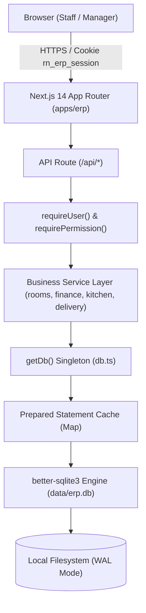
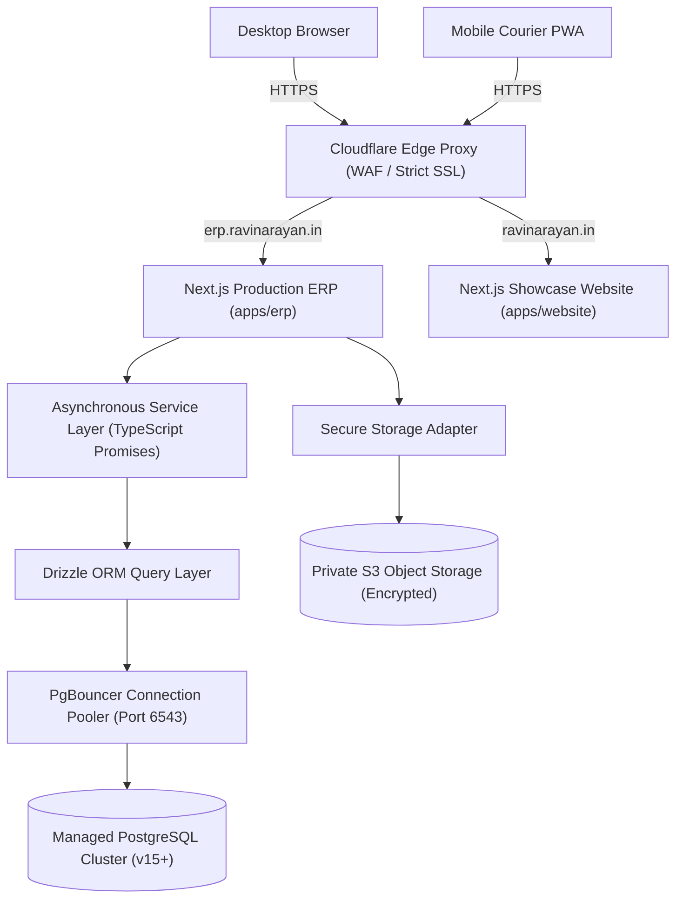

# Ravinarayan ERP — Architecture, Technical Audit & Decision Log

**Document Reference:** `docs/ARCHITECTURE_AND_DECISIONS.md`  
**Status:** Canonical Technical Record (Phase 00)  
**Date of Audit:** 16 October 2026  
**Repository:** `zevats/raviNarayana-Erp` (Branch: `master`)  
**Scope:** Current System State vs Target Production Architecture  

---

## 1. Repository Anatomy & Entry Points

```text
raviNarayana-Erp/
├── apps/
│   ├── website/                  # Public Customer Showcase (@ravinarayan/website)
│   │   ├── src/app/              # Next.js App Router (/, /about, /rooms, /tiffin-service, /contact)
│   │   ├── src/components/       # 3D Canvas, Hero, Lightboxes, luxury UI
│   │   ├── package.json          # Next.js 14.2.18, React 18.3.1, Three.js 0.169.0
│   │   └── next.config.mjs       # Independent Webpack / asset compilation
│   │
│   └── erp/                      # Operations Management ERP (@ravinarayan/erp)
│       ├── src/app/              # Next.js App Router (/login, /dashboard, /rooms, /residents, /finance, /kitchen, /delivery)
│       │   └── api/              # 30 Authenticated REST Route Handlers
│       ├── src/modules/          # Domain Components (auth, rooms, residents, finance, kitchen, delivery)
│       ├── src/server/           # Server-Only Core Services (db, auth, permissions, audit, business logic)
│       ├── package.json          # Next.js 14.2.18, better-sqlite3 11.8.1, bcryptjs 2.4.3
│       └── next.config.mjs       # External server components & path aliasing
│
├── packages/
│   ├── brand/                    # Authoritative Design System Tokens (@ravinarayan/brand)
│   │   └── index.ts              # Exports brandTokens, brandColors, brandFonts
│   └── config/                   # Shared TypeScript / Tooling configurations
│
├── data/                         # Local SQLite Persistent Filesystem (WAL Mode)
│   ├── erp.db                    # Primary database file (git-ignored)
│   ├── erp.db-wal                # Write-Ahead Log journal
│   └── erp.db-shm                # Shared Memory index
│
├── tests/                        # Automated Security, RBAC & Workflow Test Suite
│   ├── auth_hardening.test.ts    # Session & rate limiting tests (49 assertions)
│   ├── rbac_staff_foundation.test.ts # Staff role & permission tests (28 assertions)
│   ├── rooms_residents.test.ts   # Capacity, check-in/out tests (60 assertions)
│   ├── finance.test.ts           # Cashbook, rent ledger, reversals (102 assertions)
│   ├── kitchen.test.ts           # Meal plans, prep sheets, opt-outs (62 assertions)
│   ├── delivery.test.ts          # Dispatch, exception, retries (137 assertions)
│   └── integration_audit.test.ts # Cross-module lifecycle tests (26 assertions)
│
└── docs/                         # Canonical System Documentation
    ├── PROJECT_REQUIREMENTS.md
    ├── ARCHITECTURE_AND_DECISIONS.md
    ├── SECURITY_AUDIT.md
    ├── IMPLEMENTATION_ROADMAP.md
    ├── WORK_LOG.md
    └── production/               # Production readiness artifacts
```

---

## 2. Technology Stack & Manifest Versions

All versions grounded strictly in repository manifests (`package.json`, `apps/erp/package.json`, `apps/website/package.json`):

| Layer / Subsystem | Technology | Manifest Version | Role in Architecture |
| :--- | :--- | :---: | :--- |
| **Monorepo Engine** | npm Workspaces | `10.x` / Node `20.x`–`22.x` | Orchestrates dependencies across `apps/*` and `packages/*`. |
| **Runtime Environment** | Node.js LTS | `>=20.9.0 <21.0.0` (Pinned) | Active development runtime: `v22.16.0`. |
| **Language** | TypeScript | `^5.6.3` | Enforces strict static type safety across both applications. |
| **Web Framework** | Next.js (App Router) | `^14.2.18` | Server-side rendering, API routes, and client interactivity. |
| **Frontend UI Library** | React & React DOM | `^18.3.1` | Core declarative component rendering. |
| **Styling & Design** | Tailwind CSS | `^3.4.14` | Utility styling coupled with `@ravinarayan/brand` design tokens. |
| **Iconography** | Lucide React | `^0.453.0` | Comprehensive UI and operational icons. |
| **3D Graphics & Motion** | Three.js & Framer Motion | `^0.169.0` / `^11.11.9` | Botanical interactive 3D crest on public website. |
| **Database Driver (Current)**| `better-sqlite3` | `^11.8.1` | Synchronous C++ native bindings for SQLite in WAL mode. |
| **Password Hashing** | `bcryptjs` | `^2.4.3` | One-way password hashing (12 salt rounds). |

---

## 3. Architecture Diagrams

### 3.1 Current Architecture (Synchronous Prototype Baseline)



### 3.2 Target Production Architecture (Durable PostgreSQL & Async ORM)



---

## 4. Database Schema & Migration History

Database schema evolution is tracked via SQLite `PRAGMA user_version` inside [`apps/erp/src/server/database/migrations.ts`](file:///c:/Users/Rishabh/Desktop/raviNarayana-Erp/apps/erp/src/server/database/migrations.ts):

| Migration Version | Key Tables Created / Altered | Core Business Invariants & Constraints |
| :---: | :--- | :--- |
| **V1** | `staff_users`, `sessions`, `login_attempts` | Hashed session tokens at rest (`token_hash UNIQUE`), 3-layer rate limiting. |
| **V2** | `audit_logs` | Immutable audit trail, credential sanitization (`/password\|token/i`). |
| **V3** | `rooms`, `residents`, `resident_stays` | Room capacity $> 0$, base rent $\ge 0$, partial unique index: 1 active stay per resident (`WHERE status = 'ACTIVE'`). |
| **V4** | `financial_transactions` | Double-entry normalized ledger, positive amounts, `idempotency_key UNIQUE`, auditable reversals (`reversal_of_id`). |
| **V5** | `resident_meal_preferences`, `daily_meal_plans`, `resident_meal_records`, `meal_plan_adjustments` | Daily meal planning, unique constraints on `(service_date, meal_type)`, attendance records, justified overrides. |
| **V6** | `delivery_tasks`, `delivery_task_events` | Decoupled delivery tasks, resident snapshot preserving room history, courier event timeline. |
| **V7** | `delivery_tasks` (v7 swap), `staff_notification_reads` | Added `order_type ('RESIDENT', 'EXTERNAL')`, citywide delivery address, multi-device notification read tracking. |
| **V8** | `rooms` | Case-insensitive room number uniqueness (`room_number COLLATE NOCASE`). |

---

## 5. Current Data Flow by Domain

### 5.1 Resident Check-In & Capacity Allocation
1. Staff navigates to `/rooms` or `/residents` and initiates check-in.
2. `POST /api/residents/check-in` validates active session and `residents.manage` permission.
3. [`residentService.assignResidentToRoom`](file:///c:/Users/Rishabh/Desktop/raviNarayana-Erp/apps/erp/src/server/residents/residentService.ts#L227) executes inside a SQLite transaction:
   - Verifies resident exists and has no existing `ACTIVE` stay.
   - Queries `rooms` and evaluates `currentOccupancy < capacity`.
   - Inserts active stay record into `resident_stays`.
   - Updates `residents.status = 'ACTIVE'`.
   - Records `resident.checked_in` audit log entry.

### 5.2 Financial Transaction Ledger & Net Cash Movement
1. Staff initiates payment, deposit, or expense on `/finance`.
2. Mutation endpoint receives request with unique client-generated UUID (`idempotency_key`).
3. [`financeService`](file:///c:/Users/Rishabh/Desktop/raviNarayana-Erp/apps/erp/src/server/finance/financeService.ts) verifies `finance.manage` permission.
4. Checks idempotency table: if key exists with identical payload, returns existing record; if mismatched payload, rejects with HTTP 409.
5. Inserts positive integer record into `financial_transactions`.
6. Cashbook summary calculates:
   $$\text{Net Cash Movement} = (\text{Rent Collected} + \text{Deposits Collected}) - \text{Expenses Paid}$$
   *Cross-period reversals:* Reversals executed in the current period for prior-period transactions are cleanly deducted without rewriting historical ledger records.

### 5.3 Daily Tiffin Kitchen & Delivery Dispatch
1. `POST /api/delivery/tasks/generate` evaluates active resident meal preferences and external customer orders for the requested date and meal shift.
2. Idempotent task generation creates `delivery_tasks` records, snapshotting resident name, room number, and floor.
3. Operations Manager assigns tasks to active couriers (`POST /api/delivery/tasks/[id]/assign`).
4. Delivery staff marks parcel `DELIVERED` or reports structured `EXCEPTION` with mandatory reason.

---

## 6. Implementation Status: Verified vs Partial vs Absent

| Subsystem | Implemented & Verified | Partial / Demo-Only | Absent (Needs Implementation) |
| :--- | :--- | :--- | :--- |
| **Authentication** | Password verify (bcrypt), Token hashing (SHA-256), 3-layer rate limiting. | Session preemption (single session not yet strictly enforced). | Email OTP on login, self-service password reset. |
| **RBAC** | 5 discrete roles, fail-closed permission checks, sole admin protection. | Staff directory UI. | Granular permission editor. |
| **Rooms & PG** | Capacity enforcement, bed occupancy, check-in/out, anti-double-booking. | Room numbering based on synthetic 30-room model. | Owner's authoritative 22-room inventory (OL1–OL5, 001–008, 101–108, M01). |
| **Tiffin Orders** | Daily meal plans, attendance records, kitchen prep sheets, delivery tasks. | External city orders mock flow. | Persistent customer directory, repeat-order action, package subscriptions. |
| **Finance** | Cashbook ledger, rent billing, security deposits, reversals, CSV export. | Integer rupee amounts. | Fractional currency (paise/GST), GST tax invoices, downloadable PDF invoices. |
| **Inventory** | None. | None. | Ingredient tracking (flour, oil, rice, dal) & LPG cylinder tracking. |
| **Storage** | Local SQLite (`data/erp.db`). | None. | Managed PostgreSQL, private S3 attachment storage. |

---

## 7. Architectural Technical Debt & Risks

1. **Synchronous C++ Native Database Bindings:** `better-sqlite3` blocks the Node.js event loop during heavy reads. Must transition to asynchronous PostgreSQL I/O (`async/await`) before production scaling.
2. **Ephemeral Cloud Storage Risk:** Storing data in `data/erp.db` on cloud containers (Render/Fly/Docker) leads to catastrophic data loss on restart.
3. **Room Inventory Divergence:** The codebase currently seeds synthetic rooms `101`–`407` (30 rooms, 56 beds), whereas the owner's actual building layout contains `OL1`–`OL5`, `001`–`008`, `101`–`108`, and `M01` (22 rooms, 39 beds).
4. **Tracked Binary Database Files in Git:** `tests/test_erp.db*` is committed into Git, polluting builds and risking credential leaks.
5. **Missing HTTP Security Headers:** Next.js lacks `Content-Security-Policy`, `X-Frame-Options: DENY`, and HSTS headers.

---

## 8. Architectural Decision Log (ADR)

| Decision ID | Decision Title | Status | Rationale | Consequences | Date |
| :---: | :--- | :---: | :--- | :--- | :---: |
| **ADR-01** | **Adopt Drizzle ORM for PostgreSQL** | **Approved** | Lightweight, zero-engine binary overhead, fast cold starts, full support for `FOR UPDATE` row locks. | Requires refactoring service methods to `async/await`. | 16-Oct-2026 |
| **ADR-02** | **Deploy PgBouncer Connection Pooler** | **Approved** | Mitigates PostgreSQL connection exhaustion from serverless Next.js instances. | DDL migrations must execute on direct port 5432; application traffic on 6543. | 16-Oct-2026 |
| **ADR-03** | **Enforce Single Active Session Per Account** | **Approved** | Protects privileged accounts from unauthorized concurrent access across web and mobile. | Session preemption invalidates prior token when a new login succeeds. | 16-Oct-2026 |
| **ADR-04** | **PWA-First Architecture for Mobile Couriers** | **Approved** | Zero App Store fees/review cycles, instant deployments, low memory footprint, camera QR support. | Offline capabilities rely on Service Worker and IndexedDB caching. | 16-Oct-2026 |
| **ADR-05** | **Decouple Delivery from Finance Ledger** | **Approved** | Couriers must have zero visibility into resident rent balances or property cashbooks. | Deferred payments are recorded as receivables linked to order IDs, not cash collections. | 16-Oct-2026 |
| **ADR-06** | **Authoritative Room Inventory Alignment** | **Approved** | The real property layout (`OL1`–`OL5`, `001`–`008`, `101`–`108`, `M01`) must replace synthetic demo rooms. | Room numbers must strictly preserve leading zeros and case-insensitive uniqueness. | 16-Oct-2026 |

---

## 9. Implementation Progress

- **Completed Phases:**
  - *Phase 00 (Architecture, Requirements & Security Audit):* **COMPLETE**. Full repository discovery, PRD establishment, threat modeling, and implementation roadmap established.
- **Current Phase:**
  - *Phase 01 (Production Foundation & Security Hardening):* **PLANNED / READY FOR IMPLEMENTATION**.
- **Upcoming Phases:**
  - *Phase 02 (Tiffin Customer & Order Management)*
  - *Phase 03 (Kitchen, Dispatch, Delivery & Reconciliation)*
  - *Phase 04 (Authoritative PG Rooms, Occupancy & Resident Lifecycle)*
  - *Phase 05 (Finance, Billing, GST/Non-GST Invoices & Cashbook)*
  - *Phase 06 (Secure Documents, Reports & Ingredient/LPG Tracking)*
  - *Phase 07 (Mobile PWA Parity & Offline Reliability)*
  - *Phase 08 (Acceptance Testing & Production Launch)*
