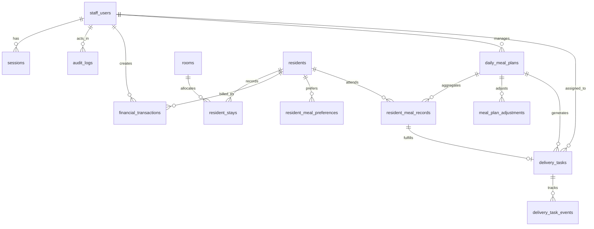

# Ravinarayan ERP — Verified Data Dictionary & Schema Reference

**Document Reference:** `docs/DATA_DICTIONARY.md`  
**Status:** Authoritative Schema Reference (Phase 00 Baseline)  
**Date of Audit:** 16 October 2026  
**Source Engine:** SQLite 3 (WAL Mode, `PRAGMA user_version = 8`)  
**Target Engine:** PostgreSQL v15+ (Drizzle ORM)  

---

## 1. Schema Overview

The database comprises 15 relational tables managing authentication, security rate limiting, tamper-evident audit logs, PG inventory, resident stays, double-entry financial ledger, kitchen meal planning, and tiffin delivery tasks.

---

## 2. Table-by-Table Data Dictionary

### 2.1 `staff_users`
Stores operational staff, managers, and property administrators.

| Column Name | SQLite Type | PostgreSQL Type | Nullable | Default / Constraint | Description |
| :--- | :--- | :--- | :---: | :--- | :--- |
| `id` | `TEXT` | `VARCHAR(64)` | No | `PRIMARY KEY` | Prefixed UUID (`usr_...`). |
| `username` | `TEXT` | `CITEXT` | No | `UNIQUE` | Case-insensitive login identifier. |
| `email` | `TEXT` | `CITEXT` | No | `UNIQUE` | Case-insensitive verified staff email. |
| `full_name` | `TEXT` | `VARCHAR(150)` | No | None | Display name of the staff member. |
| `password_hash` | `TEXT` | `VARCHAR(255)` | No | None | Bcrypt hash (12 salt rounds). |
| `role` | `TEXT` | `VARCHAR(32)` | No | None | `SUPER_ADMIN`, `OPERATIONS_MANAGER`, `ACCOUNTANT`, `KITCHEN_OPERATIONS`, `DELIVERY_PERSON`. |
| `is_active` | `INTEGER` | `BOOLEAN` | No | `1` / `TRUE` | Soft-deactivation toggle. `0` disables login & sessions. |
| `created_at` | `TEXT` | `TIMESTAMPTZ` | No | Current timestamp | ISO 8601 creation timestamp. |
| `updated_at` | `TEXT` | `TIMESTAMPTZ` | No | Current timestamp | ISO 8601 update timestamp. |
| `last_login_at` | `TEXT` | `TIMESTAMPTZ` | Yes | `NULL` | Stamped upon successful authentication. |

---

### 2.2 `sessions`
Active session tokens. Stores one-way SHA-256 digests at rest.

| Column Name | SQLite Type | PostgreSQL Type | Nullable | Default / Constraint | Description |
| :--- | :--- | :--- | :---: | :--- | :--- |
| `id` | `TEXT` | `VARCHAR(64)` | No | `PRIMARY KEY` | Prefixed UUID (`sess_...`). |
| `token_hash` | `TEXT` | `VARCHAR(64)` | No | `UNIQUE` | SHA-256 digest of the raw cookie token. |
| `staff_id` | `TEXT` | `VARCHAR(64)` | No | `REFERENCES staff_users(id) ON DELETE CASCADE` | Associated staff user. |
| `expires_at` | `TEXT` | `TIMESTAMPTZ` | No | None | Session expiration timestamp (7-day TTL). |
| `created_at` | `TEXT` | `TIMESTAMPTZ` | No | Current timestamp | ISO 8601 session generation timestamp. |
| `ip_address` | `TEXT` | `VARCHAR(45)` | Yes | `NULL` | Client IP address at session creation. |
| `user_agent` | `TEXT` | `TEXT` | Yes | `NULL` | Client browser / device User-Agent. |

---

### 2.3 `login_attempts`
Transient ledger for rate limiting and brute-force mitigation.

| Column Name | SQLite Type | PostgreSQL Type | Nullable | Default / Constraint | Description |
| :--- | :--- | :--- | :---: | :--- | :--- |
| `id` | `TEXT` | `VARCHAR(64)` | No | `PRIMARY KEY` | Prefixed UUID (`att_...`). |
| `identifier` | `TEXT` | `CITEXT` | No | None | Targeted username or email. |
| `ip_address` | `TEXT` | `VARCHAR(45)` | No | None | Client IP address (sanitized). |
| `attempted_at` | `TEXT` | `TIMESTAMPTZ` | No | Current timestamp | Timestamp of login attempt. |
| `success` | `INTEGER` | `BOOLEAN` | No | None | `1` if valid; `0` if invalid or reserved attempt. |

---

### 2.4 `audit_logs`
Tamper-evident record of security and business mutations.

| Column Name | SQLite Type | PostgreSQL Type | Nullable | Default / Constraint | Description |
| :--- | :--- | :--- | :---: | :--- | :--- |
| `id` | `TEXT` | `VARCHAR(64)` | No | `PRIMARY KEY` | Prefixed UUID (`aud_...`). |
| `actor_id` | `TEXT` | `VARCHAR(64)` | Yes | `NULL` | ID of performing staff user (survives deletion). |
| `actor_username` | `TEXT` | `VARCHAR(150)` | Yes | `NULL` | Username of performing actor. |
| `action` | `TEXT` | `VARCHAR(64)` | No | None | Structured verb (e.g., `resident.checked_in`). |
| `target_type` | `TEXT` | `VARCHAR(64)` | No | None | Entity kind (`resident`, `room`, `transaction`). |
| `target_id` | `TEXT` | `VARCHAR(64)` | Yes | `NULL` | Identifier of affected entity. |
| `metadata` | `TEXT` | `JSONB` | Yes | `NULL` | Redacted change details (passwords/tokens omitted). |
| `ip_address` | `TEXT` | `VARCHAR(45)` | Yes | `NULL` | Client IP address at mutation time. |
| `created_at` | `TEXT` | `TIMESTAMPTZ` | No | Current timestamp | Immutable ISO 8601 audit timestamp. |

---

### 2.5 `rooms`
Physical PG room inventory.

| Column Name | SQLite Type | PostgreSQL Type | Nullable | Default / Constraint | Description |
| :--- | :--- | :--- | :---: | :--- | :--- |
| `id` | `TEXT` | `VARCHAR(64)` | No | `PRIMARY KEY` | Prefixed UUID (`rm_...`). |
| `room_number` | `TEXT` | `CITEXT` | No | `UNIQUE (COLLATE NOCASE)` | Exact room identifier (e.g. `OL1`, `001`, `101`, `M01`). |
| `floor` | `INTEGER` | `INTEGER` | No | None | Floor number: `0` (Ground), `1` (First), `2`, `3`. |
| `type` | `TEXT` | `VARCHAR(32)` | No | None | `SINGLE`, `DOUBLE_SHARING`, `TRIPLE_SHARING`, `EXECUTIVE_SUITE`. |
| `capacity` | `INTEGER` | `INTEGER` | No | `CHECK (capacity > 0)` | Maximum operational beds. |
| `base_rent_monthly` | `INTEGER` | `INTEGER` / `BIGINT` | No | `CHECK (base_rent_monthly >= 0)` | Base monthly rent in INR. |
| `is_active` | `INTEGER` | `BOOLEAN` | No | `1` / `TRUE` | Active operational status. |
| `created_at` | `TEXT` | `TIMESTAMPTZ` | No | Current timestamp | Creation timestamp. |
| `updated_at` | `TEXT` | `TIMESTAMPTZ` | No | Current timestamp | Update timestamp. |

---

### 2.6 `residents`
Registered PG occupants and tenants.

| Column Name | SQLite Type | PostgreSQL Type | Nullable | Default / Constraint | Description |
| :--- | :--- | :--- | :---: | :--- | :--- |
| `id` | `TEXT` | `VARCHAR(64)` | No | `PRIMARY KEY` | Prefixed UUID (`res_...`). |
| `full_name` | `TEXT` | `VARCHAR(150)` | No | None | Tenant full name. |
| `phone` | `TEXT` | `VARCHAR(30)` | No | `UNIQUE` | Primary contact mobile number. |
| `email` | `TEXT` | `CITEXT` | Yes | `NULL` | Optional email address. |
| `emergency_contact` | `TEXT` | `VARCHAR(150)` | Yes | `NULL` | Emergency contact name, relation, and phone. |
| `notes` | `TEXT` | `TEXT` | Yes | `NULL` | Workplace (e.g. Panasonic/Reliance MET) or notes. |
| `status` | `TEXT` | `VARCHAR(32)` | No | `'ACTIVE'` | `ACTIVE`, `CHECKED_OUT`, `INACTIVE`. |
| `created_at` | `TEXT` | `TIMESTAMPTZ` | No | Current timestamp | Creation timestamp. |
| `updated_at` | `TEXT` | `TIMESTAMPTZ` | No | Current timestamp | Update timestamp. |

---

### 2.7 `resident_stays`
Historical and active room assignment records.

| Column Name | SQLite Type | PostgreSQL Type | Nullable | Default / Constraint | Description |
| :--- | :--- | :--- | :---: | :--- | :--- |
| `id` | `TEXT` | `VARCHAR(64)` | No | `PRIMARY KEY` | Prefixed UUID (`stay_...`). |
| `resident_id` | `TEXT` | `VARCHAR(64)` | No | `REFERENCES residents(id) ON DELETE RESTRICT` | Resident assigned. |
| `room_id` | `TEXT` | `VARCHAR(64)` | No | `REFERENCES rooms(id) ON DELETE RESTRICT` | Room assigned. |
| `check_in_date` | `TEXT` | `DATE` | No | None | Move-in date (`YYYY-MM-DD`). |
| `check_out_date` | `TEXT` | `DATE` | Yes | `NULL` | Departure date (`YYYY-MM-DD`). |
| `monthly_rent` | `INTEGER` | `INTEGER` / `BIGINT` | No | `CHECK (monthly_rent >= 0)` | Agreed monthly rent in INR. |
| `security_deposit` | `INTEGER` | `INTEGER` / `BIGINT` | No | `CHECK (security_deposit >= 0)` | Agreed refundable deposit in INR. |
| `status` | `TEXT` | `VARCHAR(32)` | No | `'ACTIVE'` | `ACTIVE`, `COMPLETED`, `CANCELLED`. |
| `created_at` | `TEXT` | `TIMESTAMPTZ` | No | Current timestamp | Creation timestamp. |
| `updated_at` | `TEXT` | `TIMESTAMPTZ` | No | Current timestamp | Update timestamp. |

*Unique Engine Invariant:* Partial unique index `idx_unique_active_resident_stay ON resident_stays(resident_id) WHERE status = 'ACTIVE'` guarantees that no resident can be assigned to multiple active beds simultaneously.

---

### 2.8 `financial_transactions`
Normalized double-entry-adjacent transaction ledger.

| Column Name | SQLite Type | PostgreSQL Type | Nullable | Default / Constraint | Description |
| :--- | :--- | :--- | :---: | :--- | :--- |
| `id` | `TEXT` | `VARCHAR(64)` | No | `PRIMARY KEY` | Prefixed UUID (`txn_...`). |
| `transaction_type`| `TEXT` | `VARCHAR(32)` | No | `CHECK IN ('RENT_CHARGE', 'RENT_PAYMENT', 'SECURITY_DEPOSIT', 'EXPENSE', 'REVERSAL')` | Ledger transaction classification. |
| `amount` | `INTEGER` | `INTEGER` / `BIGINT` | No | `CHECK (amount > 0)` | Positive amount in INR (whole rupees or paise). |
| `transaction_date`| `TEXT` | `DATE` | No | None | Date of financial event (`YYYY-MM-DD`). |
| `payment_method` | `TEXT` | `VARCHAR(32)` | Yes | `CHECK IN ('CASH', 'UPI', 'BANK_TRANSFER', 'CHEQUE', 'OTHER')` | Method of collection or payment. |
| `reference_number`| `TEXT` | `VARCHAR(100)` | Yes | `NULL` | Bank UTR, UPI transaction ID, or cheque number. |
| `resident_id` | `TEXT` | `VARCHAR(64)` | Yes | `REFERENCES residents(id) ON DELETE RESTRICT` | Associated resident (if applicable). |
| `stay_id` | `TEXT` | `VARCHAR(64)` | Yes | `REFERENCES resident_stays(id) ON DELETE RESTRICT` | Associated stay agreement. |
| `category` | `TEXT` | `VARCHAR(64)` | No | None | `RENT`, `SECURITY_DEPOSIT`, `GROCERY`, `FUEL`, `LPG`, `UTILITIES`, etc. |
| `description` | `TEXT` | `TEXT` | Yes | `NULL` | Transaction narrative or correction details. |
| `billing_period` | `TEXT` | `VARCHAR(50)` | Yes | `NULL` | Billed cycle (e.g. `'October 2026'`). |
| `payee_vendor` | `TEXT` | `VARCHAR(150)` | Yes | `NULL` | Vendor name for expense records. |
| `idempotency_key` | `TEXT` | `VARCHAR(128)` | Yes | `UNIQUE` | Client UUID preventing duplicate submissions. |
| `status` | `TEXT` | `VARCHAR(32)` | No | `CHECK IN ('POSTED', 'REVERSED')` | Transaction lifecycle status. |
| `reversal_of_id` | `TEXT` | `VARCHAR(64)` | Yes | `REFERENCES financial_transactions(id) ON DELETE RESTRICT` | Foreign key linking reversal to original transaction. |
| `created_by` | `TEXT` | `VARCHAR(64)` | No | `REFERENCES staff_users(id)` | Performing staff member. |
| `created_at` | `TEXT` | `TIMESTAMPTZ` | No | Current timestamp | Creation timestamp. |
| `updated_at` | `TEXT` | `TIMESTAMPTZ` | No | Current timestamp | Update timestamp. |

---

### 2.9 `resident_meal_preferences`
Resident meal inclusion preferences.

| Column Name | SQLite Type | PostgreSQL Type | Nullable | Default / Constraint | Description |
| :--- | :--- | :--- | :---: | :--- | :--- |
| `resident_id` | `TEXT` | `VARCHAR(64)` | No | `PRIMARY KEY REFERENCES residents(id) ON DELETE RESTRICT` | Resident identifier. |
| `breakfast_opt_in`| `INTEGER` | `BOOLEAN` | No | `1` / `TRUE` | Daily breakfast preference. |
| `lunch_opt_in` | `INTEGER` | `BOOLEAN` | No | `1` / `TRUE` | Daily lunch preference. |
| `dinner_opt_in` | `INTEGER` | `BOOLEAN` | No | `1` / `TRUE` | Daily dinner preference. |
| `dietary_preference`| `TEXT` | `VARCHAR(32)` | No | `'VEG'` | `VEG`, `JAIN`, `SPECIAL`. |
| `notes` | `TEXT` | `TEXT` | Yes | `NULL` | Specific dietary restrictions. |

---

### 2.10 `daily_meal_plans`
Aggregated kitchen production batches.

| Column Name | SQLite Type | PostgreSQL Type | Nullable | Default / Constraint | Description |
| :--- | :--- | :--- | :---: | :--- | :--- |
| `id` | `TEXT` | `VARCHAR(64)` | No | `PRIMARY KEY` | Prefixed UUID (`plan_...`). |
| `service_date` | `TEXT` | `DATE` | No | None | Meal date (`YYYY-MM-DD`). |
| `meal_type` | `TEXT` | `VARCHAR(32)` | No | `CHECK IN ('BREAKFAST', 'LUNCH', 'DINNER')` | Meal shift. |
| `planned_resident_count` | `INTEGER` | `INTEGER` | No | `0` | Calculated resident portions. |
| `guest_count` | `INTEGER` | `INTEGER` | No | `0` | Guest / external customer portions. |
| `final_preparation_count`| `INTEGER` | `INTEGER` | No | `0` | Total confirmed required portions. |
| `actual_cooked_count` | `INTEGER` | `INTEGER` | Yes | `NULL` | Actual physical portions cooked by kitchen. |
| `status` | `TEXT` | `VARCHAR(32)` | No | `'DRAFT'` | `DRAFT`, `CONFIRMED`, `COMPLETED`. |
| `notes` | `TEXT` | `TEXT` | Yes | `NULL` | Kitchen preparation notes. |
| `created_by` | `TEXT` | `VARCHAR(64)` | No | `REFERENCES staff_users(id)` | Planner. |
| `confirmed_by` | `TEXT` | `VARCHAR(64)` | Yes | `REFERENCES staff_users(id)` | Manager confirming plan. |
| `confirmed_at` | `TEXT` | `TIMESTAMPTZ` | Yes | `NULL` | Confirmation timestamp. |
| `completed_by` | `TEXT` | `VARCHAR(64)` | Yes | `REFERENCES staff_users(id)` | Staff marking shift complete. |
| `completed_at` | `TEXT` | `TIMESTAMPTZ` | Yes | `NULL` | Completion timestamp. |

*Constraint:* `CONSTRAINT uq_plan_date_meal UNIQUE (service_date, meal_type)` prevents duplicate plans for the same shift.

---

### 2.11 `resident_meal_records`
Individual meal attendance / inclusion records.

| Column Name | SQLite Type | PostgreSQL Type | Nullable | Default / Constraint | Description |
| :--- | :--- | :--- | :---: | :--- | :--- |
| `id` | `TEXT` | `VARCHAR(64)` | No | `PRIMARY KEY` | Prefixed UUID (`rec_...`). |
| `plan_id` | `TEXT` | `VARCHAR(64)` | No | `REFERENCES daily_meal_plans(id) ON DELETE RESTRICT` | Associated meal plan. |
| `resident_id` | `TEXT` | `VARCHAR(64)` | No | `REFERENCES residents(id) ON DELETE RESTRICT` | Associated resident. |
| `stay_id` | `TEXT` | `VARCHAR(64)` | No | `REFERENCES resident_stays(id) ON DELETE RESTRICT` | Associated stay agreement. |
| `service_date` | `TEXT` | `DATE` | No | None | Meal date. |
| `meal_type` | `TEXT` | `VARCHAR(32)` | No | `CHECK IN ('BREAKFAST', 'LUNCH', 'DINNER')` | Shift. |
| `status` | `TEXT` | `VARCHAR(32)` | No | `'CONFIRMED'` | `CONFIRMED`, `OPTED_OUT`. |

*Constraint:* `CONSTRAINT uq_res_date_meal UNIQUE (resident_id, service_date, meal_type)` prevents double counting.

---

### 2.12 `meal_plan_adjustments`
Append-only audit trail for manual kitchen quantity overrides.

| Column Name | SQLite Type | PostgreSQL Type | Nullable | Default / Constraint | Description |
| :--- | :--- | :--- | :---: | :--- | :--- |
| `id` | `TEXT` | `VARCHAR(64)` | No | `PRIMARY KEY` | Prefixed UUID (`adj_...`). |
| `plan_id` | `TEXT` | `VARCHAR(64)` | No | `REFERENCES daily_meal_plans(id) ON DELETE RESTRICT` | Target meal plan. |
| `previous_total`| `INTEGER` | `INTEGER` | No | None | Portions prior to adjustment. |
| `new_total` | `INTEGER` | `INTEGER` | No | None | Portions after adjustment. |
| `reason` | `TEXT` | `TEXT` | No | None | Mandatory justification text. |
| `created_by` | `TEXT` | `VARCHAR(64)` | No | `REFERENCES staff_users(id)` | Authorizing staff member. |
| `created_at` | `TEXT` | `TIMESTAMPTZ` | No | Current timestamp | Timestamp of override. |

---

### 2.13 `delivery_tasks`
Fulfillment dispatch tasks for residential and external customers.

| Column Name | SQLite Type | PostgreSQL Type | Nullable | Default / Constraint | Description |
| :--- | :--- | :--- | :---: | :--- | :--- |
| `id` | `TEXT` | `VARCHAR(64)` | No | `PRIMARY KEY` | Prefixed UUID (`del_...`). |
| `order_type` | `TEXT` | `VARCHAR(32)` | No | `'RESIDENT'` | `'RESIDENT'` or `'EXTERNAL'`. |
| `meal_record_id`| `TEXT` | `VARCHAR(64)` | Yes | `UNIQUE REFERENCES resident_meal_records(id)` | Unique resident record link (null for external). |
| `plan_id` | `TEXT` | `VARCHAR(64)` | No | `REFERENCES daily_meal_plans(id) ON DELETE RESTRICT` | Associated meal plan. |
| `service_date` | `TEXT` | `DATE` | No | None | Delivery date. |
| `meal_type` | `TEXT` | `VARCHAR(32)` | No | `CHECK IN ('BREAKFAST', 'LUNCH', 'DINNER')` | Shift. |
| `resident_id` | `TEXT` | `VARCHAR(64)` | Yes | `REFERENCES residents(id)` | Resident (if resident order). |
| `resident_name`| `TEXT` | `VARCHAR(150)` | Yes | `NULL` | Historical resident snapshot. |
| `room_number` | `TEXT` | `VARCHAR(32)` | Yes | `NULL` | Historical room number snapshot. |
| `floor` | `INTEGER` | `INTEGER` | Yes | `NULL` | Historical floor snapshot. |
| `customer_name`| `TEXT` | `VARCHAR(150)` | Yes | `NULL` | External customer name. |
| `customer_phone`| `TEXT` | `VARCHAR(30)` | Yes | `NULL` | External customer phone. |
| `delivery_address`| `TEXT` | `TEXT` | Yes | `NULL` | Delivery location or landmark. |
| `status` | `TEXT` | `VARCHAR(32)` | No | `'PENDING'` | `PENDING`, `ASSIGNED`, `OUT_FOR_DELIVERY`, `DELIVERED`, `EXCEPTION`. |
| `assigned_to` | `TEXT` | `VARCHAR(64)` | Yes | `REFERENCES staff_users(id)` | Assigned delivery courier. |
| `assigned_at` | `TEXT` | `TIMESTAMPTZ` | Yes | `NULL` | Timestamp assigned. |
| `dispatched_at`| `TEXT` | `TIMESTAMPTZ` | Yes | `NULL` | Timestamp dispatched. |
| `delivered_at` | `TEXT` | `TIMESTAMPTZ` | Yes | `NULL` | Timestamp delivered. |
| `delivery_notes`| `TEXT` | `TEXT` | Yes | `NULL` | Courier notes or parcel proof. |
| `recipient_name`| `TEXT` | `VARCHAR(150)` | Yes | `NULL` | Person who received the meal. |
| `exception_type`| `TEXT` | `VARCHAR(64)` | Yes | `NULL` | `RESIDENT_UNAVAILABLE`, `RESIDENT_DECLINED`, `LOCATION_UNCLEAR`, `MEAL_DAMAGED_OR_MISSING`, `OTHER`. |
| `exception_reason`| `TEXT`| `TEXT` | Yes | `NULL` | Detailed explanation of failure. |

---

### 2.14 `delivery_task_events`
Append-only state machine transition timeline.

| Column Name | SQLite Type | PostgreSQL Type | Nullable | Default / Constraint | Description |
| :--- | :--- | :--- | :---: | :--- | :--- |
| `id` | `TEXT` | `VARCHAR(64)` | No | `PRIMARY KEY` | Prefixed UUID (`dlev_...`). |
| `task_id` | `TEXT` | `VARCHAR(64)` | No | `REFERENCES delivery_tasks(id) ON DELETE RESTRICT` | Target delivery task. |
| `event_type` | `TEXT` | `VARCHAR(32)` | No | `CHECK IN ('CREATED', 'ASSIGNED', 'REASSIGNED', 'DISPATCHED', 'DELIVERED', 'EXCEPTION', 'RETRIED')` | Transition verb. |
| `from_status` | `TEXT` | `VARCHAR(32)` | Yes | `NULL` | State before transition. |
| `to_status` | `TEXT` | `VARCHAR(32)` | No | None | State after transition. |
| `actor_id` | `TEXT` | `VARCHAR(64)` | No | `REFERENCES staff_users(id)` | Performing staff ID. |
| `actor_name` | `TEXT` | `VARCHAR(150)` | No | None | Performing staff name. |
| `notes` | `TEXT` | `TEXT` | Yes | `NULL` | Transition notes or retry reason. |
| `created_at` | `TEXT` | `TIMESTAMPTZ` | No | Current timestamp | Timestamp of transition. |

---

### 2.15 `staff_notification_reads`
Multi-device read state tracking for operational notifications.

| Column Name | SQLite Type | PostgreSQL Type | Nullable | Default / Constraint | Description |
| :--- | :--- | :--- | :---: | :--- | :--- |
| `staff_id` | `TEXT` | `VARCHAR(64)` | No | `REFERENCES staff_users(id) ON DELETE CASCADE` | Staff member. |
| `notification_id`| `TEXT` | `VARCHAR(64)` | No | None | Unique notification event ID. |
| `read_at` | `TEXT` | `TIMESTAMPTZ` | No | Current timestamp | Timestamp notification was opened. |

*Primary Key:* Composite `PRIMARY KEY (staff_id, notification_id)`.
