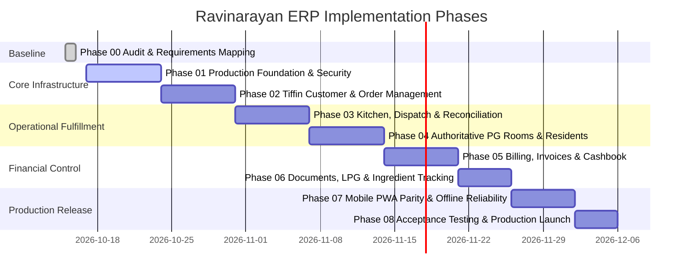

# Ravinarayan PG & Tiffin ERP — Implementation Roadmap (Phases 00–08)

**Document Reference:** `docs/IMPLEMENTATION_ROADMAP.md`  
**Status:** Authoritative Phased Execution Plan (Phase 00 Baseline)  
**Effective Date:** 16 October 2026  
**Repository:** `zevats/raviNarayana-Erp` (Branch: `master`)  

---

## 1. Roadmap Overview & Execution Timeline

---

## Phase 00 — Audit & Requirement Mapping
- **Status:** **COMPLETE & VERIFIED**
- **Goal:** Establish single source of truth for product scope, architectural baseline, security vulnerabilities, and implementation backlog.
- **Deliverables:**
  - `docs/PROJECT_REQUIREMENTS.md`
  - `docs/ARCHITECTURE_AND_DECISIONS.md`
  - `docs/SECURITY_AUDIT.md`
  - `docs/IMPLEMENTATION_ROADMAP.md`
  - `docs/WORK_LOG.md`
  - `docs/DATA_DICTIONARY.md`
  - `docs/TEST_STRATEGY.md`
  - `docs/PRODUCTION_RUNBOOK.md`
- **Definition of Done:** All stakeholders aligned on architecture, data models, room inventory discrepancies, and launch blockers.

---

## Phase 01 — Production Foundation & Security
- **Status:** **PLANNED / READY FOR EXECUTION**
- **Goal:** Replace ephemeral SQLite with managed PostgreSQL, enforce asynchronous database I/O, implement email OTP, single active session preemption, and security headers.
- **Prerequisites:** Phase 00 completion; managed PostgreSQL cluster provisioned.
- **Existing Implementation to Reuse:** Schema definitions in `migrations.ts`, rate-limiting engine in `auth.ts`, RBAC matrix in `permissions.ts`.
- **Planned Tasks:**
  1. Add `drizzle-orm` and `postgres` driver to `apps/erp/package.json`.
  2. Implement Drizzle schemas for all 15 tables with PostgreSQL types (`citext`, `timestamptz`, `boolean`).
  3. Refactor server services from synchronous `better-sqlite3` calls to asynchronous `async/await` Drizzle queries.
  4. Implement Email OTP on login (6-digit, 10-minute expiry) via Resend/AWS SES.
  5. Enforce single active session per account via server-side session preemption.
  6. Add HTTP security headers (CSP, HSTS, X-Frame-Options: DENY, nosniff) in `next.config.mjs`.
  7. Purge tracked binary SQLite test databases from Git index (`git rm --cached tests/test_erp.db*`).
- **Database / API / UI Impact:**
  - Migrates `data/erp.db` &rarr; Managed PostgreSQL + PgBouncer connection pooling.
  - Updates `/api/auth/login` to support 2-step OTP verification.
  - Adds `/api/health` probe endpoint.
- **Security Considerations:** Eliminates ephemeral data loss, stops Git database leaks, hardens against clickjacking and credential stuffing.
- **Automated Tests:** PostgreSQL schema migration test, session preemption test, email OTP expiry test, security header assertion test.
- **Acceptance Criteria:** Zero SQLite runtime dependencies in production; single session strictly enforced; all 464 tests passing against PostgreSQL test instance.
- **Definition of Done:** ERP runs cleanly against PostgreSQL with 0 errors on production builds.

---

## Phase 02 — Tiffin Customer & Order Management
- **Status:** **PLANNED**
- **Goal:** Implement persistent customer directory, quick-entry order screens, repeat-last-order action, and configurable product/pricing catalog.
- **Prerequisites:** Phase 01 completion.
- **Existing Implementation to Reuse:** Brand tokens for UI components, delivery task schemas.
- **Planned Tasks:**
  1. Create `tiffin_customers` table (Name, phone, alternate phone, delivery address, landmark, coordinates, dietary preferences, custom pricing).
  2. Create `tiffin_products` and `tiffin_prices` tables with supplied starting prices (Daily Tiffin ₹80, Monthly ₹3,500/₹2,000, Friday Bowl ₹60, Extras ₹8–₹50).
  3. Build Customer Directory UI at `/tiffin/customers` with instant multi-attribute search.
  4. Implement `Repeat Last Order` action creating new order for selected date without replicating old payment records.
  5. Build Manager Daily Order Entry screen with separate lunch and dinner views.
- **Database / API / UI Impact:** New customer and order management tables; routes under `/api/tiffin/*`.
- **Security Considerations:** Phone number validation; address sanitization; customer-specific pricing auditability.
- **Automated Tests:** Customer search query test, repeat order idempotency test, delivery distance tier calculation test.
- **Acceptance Criteria:** Staff can search customers in $<200$ms, repeat an order in 2 clicks, and place new orders with custom extras.
- **Definition of Done:** Orders persist reliably and feed cleanly into daily kitchen preparation totals.

---

## Phase 03 — Kitchen, Dispatch, Delivery & Reconciliation
- **Status:** **PLANNED**
- **Goal:** Connect daily confirmed customer orders, monthly subscribers, and PG resident meal consumption into unified kitchen prep sheets and mobile courier workflows.
- **Prerequisites:** Phase 02 completion.
- **Existing Implementation to Reuse:** `kitchenService.ts`, `deliveryService.ts`, `apps/erp/src/app/(management)/kitchen`, `apps/erp/src/app/(management)/delivery`.
- **Planned Tasks:**
  1. Unify kitchen demand calculation formula: Daily Orders + Monthly Subscribers + Bulk Orders + PG Residents Expected to Eat.
  2. Enforce PG resident consumption logging without triggering duplicate charges for included meals.
  3. Build Kitchen Production Screen tracking Planned, Cooked, Dispatched, Returned, and Wasted portions.
  4. Refine mobile courier interface for thumb-driven parcel handover and cash/UPI collection.
  5. Implement daily operational closing screen reconciling kitchen prep, delivery dispatches, and cash collected.
- **Database / API / UI Impact:** Daily close table; stock discrepancy logs; mobile courier optimized layout.
- **Security Considerations:** Couriers restricted strictly to assigned orders; zero financial ledger access.
- **Automated Tests:** Daily aggregate calculation test, PG zero-charge invariant test, courier ownership isolation test.
- **Acceptance Criteria:** Daily kitchen total matches sum of orders + resident preferences; couriers complete deliveries with payment status.
- **Definition of Done:** Full lifecycle from customer order to kitchen prep, courier handover, and daily closing verified end-to-end.

---

## Phase 04 — Authoritative PG Rooms, Occupancy & Resident Lifecycle
- **Status:** **PLANNED**
- **Goal:** Replace synthetic demo rooms with the owner's authoritative 22-room layout (`OL1`–`OL5`, `001`–`008`, `101`–`108`, `M01`), enforce row-level locking overbooking defense, and implement complete resident lifecycle.
- **Prerequisites:** Phase 01 completion.
- **Existing Implementation to Reuse:** `roomService.ts`, `residentService.ts`, `apps/erp/src/app/(management)/rooms`, `apps/erp/src/app/(management)/residents`.
- **Planned Tasks:**
  1. Migrate room table to authoritative 22-room inventory preserving leading zeros (`001`, `008`) and alphanumeric codes (`OL1`, `M01`).
  2. Implement PostgreSQL row-level locking (`SELECT id FROM rooms WHERE id = $1 FOR UPDATE`) in `assignResidentToRoom`.
  3. Build Resident Profile drawer with stay history, emergency contacts, food package selection, and billing terms.
  4. Implement checkout settlement workflow calculating deposit deductions, unpaid balances, and net refund.
  5. Implement room transfer workflow with effective dates and authorized manager approval.
- **Database / API / UI Impact:** Updates `rooms` seed to 22 rooms / 39+ beds; checkout settlement table.
- **Security Considerations:** Anti-double-booking partial unique index; capacity exhaustion concurrency test.
- **Automated Tests:** Concurrent 5-user check-in race test, checkout capacity release test, room transfer history test.
- **Acceptance Criteria:** All 22 owner rooms displayed accurately; zero overbooking under concurrent access; seamless check-in and checkout.
- **Definition of Done:** Real property room layout fully operational with live bed occupancy tracking.

---

## Phase 05 — Finance, Billing, GST/Non-GST Invoices & Cashbook
- **Status:** **PLANNED**
- **Goal:** Implement GST and non-GST invoice generation, downloadable PDF receipts, 3 toggleable business views (Combined, Tiffin-only, PG-only), and fractional minor unit currency.
- **Prerequisites:** Phase 04 completion.
- **Existing Implementation to Reuse:** `financeService.ts`, `FinancialSummaryCards.tsx`, `CashbookLedger.tsx`.
- **Planned Tasks:**
  1. Transition currency storage to integer minor units (paise) or `NUMERIC(12, 2)` to support fractional GST amounts.
  2. Build Invoice Generation workflow supporting unique sequential invoice numbers (e.g. `INV-2026-0001`).
  3. Implement branded PDF invoice generation using React-PDF or Puppeteer.
  4. Implement the 3 canonical business filters across dashboard, cashbook, and exports:
     - Combined (PG + Tiffin)
     - PG Guesthouse Only
     - Tiffin Service Only
  5. Add Fuel and LPG expense categories to cashbook disbursement entry.
- **Database / API / UI Impact:** `invoices` table; invoice items; filter parameters on financial query routes.
- **Security Considerations:** Formula injection defense in CSV exports; immutable transaction reversal auditability.
- **Automated Tests:** GST calculation test, cross-period reversal accounting test, 3-way cashbook filter isolation test.
- **Acceptance Criteria:** Invoices generate valid downloadable PDFs; cashbook filter perfectly isolates PG from Tiffin finances.
- **Definition of Done:** Complete financial traceability from billing to payment collection and cashbook reconciliation.

---

## Phase 06 — Secure Documents, Reports & Ingredient/LPG Tracking
- **Status:** **PLANNED**
- **Goal:** Implement private cloud attachment storage (S3), basic physical inventory tracking (LPG cylinders & staples), and executive operational reporting.
- **Prerequisites:** Phase 05 completion.
- **Existing Implementation to Reuse:** `apps/erp/src/app/api/reports/executive/route.ts`, `ExportReportModal.tsx`.
- **Planned Tasks:**
  1. Implement secure S3 attachment upload for tenant KYC documents and expense receipts with magic-byte validation and 5 MB limits.
  2. Implement LPG cylinder tracking table (purchases, active cylinders, empty cylinders, supplier).
  3. Implement staple ingredient stock log (Flour, Rice, Dal, Oil) with stock received vs issued entries.
  4. Build Executive Summary report generation supporting customized date ranges, occupancy tallies, and net cash movement.
- **Database / API / UI Impact:** `document_attachments` table; `inventory_items` table; `lpg_logs` table.
- **Security Considerations:** Authenticated short-lived signed URLs for documents; zero public file access.
- **Automated Tests:** File MIME validation test, LPG cylinder balance calculation test, executive report aggregation test.
- **Acceptance Criteria:** KYC images upload securely; LPG inventory accurately reflects physical stock; executive report exports clean CSV/PDF.
- **Definition of Done:** Physical kitchen inventory and digital document storage operational.

---

## Phase 07 — Web/Mobile Parity, Offline Reliability & Cross-Device Validation
- **Status:** **PLANNED**
- **Goal:** Complete Progressive Web App (PWA) configuration for field couriers, offline route manifest caching, camera QR delivery scanning, and cross-device testing.
- **Prerequisites:** Phases 03 & 06 completion.
- **Existing Implementation to Reuse:** Responsive mobile ERP layout verified across 390px, 768px, 1024px.
- **Planned Tasks:**
  1. Add Web App Manifest (`manifest.json`), service worker, and Apple Touch icons to `apps/erp`.
  2. Implement Service Worker caching for courier delivery manifests via IndexedDB.
  3. Implement HTML5 camera QR code scanner for instant delivery parcel handover proof.
  4. Conduct cross-device visual and functional testing on Android Chrome, iOS Safari, Windows Desktop, and macOS.
- **Database / API / UI Impact:** PWA service worker; offline sync queues.
- **Security Considerations:** Offline data encryption in IndexedDB; secure sync replay validation.
- **Automated Tests:** Service worker registration test, offline mutation queue replay test, PWA Lighthouse audit ($\ge 90$).
- **Acceptance Criteria:** Couriers can inspect delivery addresses offline and sync completed deliveries upon regaining mobile data.
- **Definition of Done:** Mobile web app behaves indistinguishably from a native application with zero App Store friction.

---

## Phase 08 — Acceptance Testing, Production Readiness & Live Launch
- **Status:** **PLANNED**
- **Goal:** Final staging rehearsal, disaster recovery drill, security regression audit, staff training, and live production cutover.
- **Prerequisites:** Phases 01 through 07 complete.
- **Existing Implementation to Reuse:** Deployment guide in `PRODUCTION_RUNBOOK.md`.
- **Planned Tasks:**
  1. Execute full disaster recovery drill: restore automated PostgreSQL snapshot into clean staging database and verify ledger balances.
  2. Perform penetration test and security review against OWASP Top 10.
  3. Conduct owner acceptance walkthrough with Dr. Ravinder Gulia.
  4. Provision production DNS: `erp.ravinarayan.in` and `ravinarayan.in` on Cloudflare with Full (Strict) SSL.
  5. Seed real Owner accounts; verify zero synthetic demo records exist in production.
  6. Execute final cutover and monitor `/api/health`.
- **Database / API / UI Impact:** Production cluster cutover.
- **Security Considerations:** Rotate all staging secrets; verify production admin password length $\ge 12$ chars.
- **Automated Tests:** Full automated test suite (500+ assertions); load test (100 concurrent requests, response time $< 200$ms).
- **Acceptance Criteria:** Zero critical/high security findings; disaster recovery restore verified in $< 15$ minutes; 100% owner sign-off.
- **Definition of Done:** Production system live, stable, and serving authentic daily business operations.
