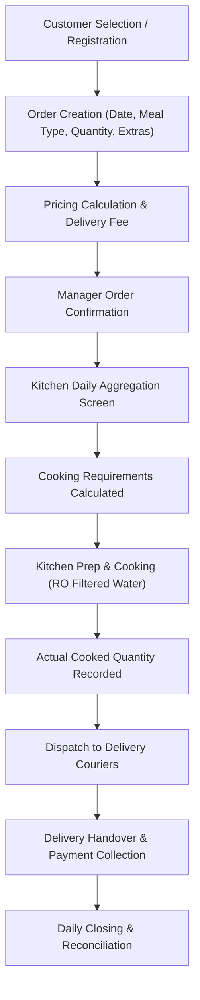
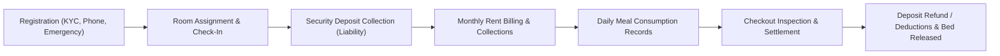

# Ravinarayan PG & Tiffin ERP — Authoritative Product Requirements Document (PRD)

**Document Reference:** `docs/PROJECT_REQUIREMENTS.md`  
**Status:** Canonical Product Baseline (Phase 00)  
**Effective Date:** 16 October 2026  
**System:** Ravinarayan Management ERP & Public Platform  
**Target Entities:** Ravinarayan PG Guesthouse & Fresh Tiffin Service  
**Location:** Met City / Yakubpur / Jhajjar, Haryana  

---

## 1. Product Vision & Scope

The **Ravinarayan PG & Tiffin ERP** is a unified, secure, internal business management platform designed for the dual operations of Ravinarayan PG Guesthouse and its commercial Tiffin Culinary Service.

### 1.1 Core Objectives
1. **Operational Traceability:** Unify resident stays, room inventory, customer orders, kitchen cooking tallies, and delivery fulfillment into a cohesive, auditable system.
2. **Financial Precision:** Maintain an immutable double-entry-adjacent ledger tracking cash, bank transfers, and UPI receipts, cleanly distinguishing billed revenue, custodial security deposits, operational disbursements, and customer receivables.
3. **Cross-Platform Access:** Provide responsive web access for property management and mobile-optimized interfaces for field delivery couriers and on-property floor staff.
4. **Data Isolation & Security:** Enforce strict server-side role-based access control (RBAC), layered brute-force defense, session integrity, and zero exposure of sensitive resident and financial evidence.

---

## 2. User Roles & Account Configuration

### 2.1 Initial Account Allocation
The production deployment must initialize with the following initial operational accounts:
- **Owner Accounts:** 2 accounts (Full administrative, operational, financial, and configuration authority).
- **Manager Account:** 1 account (Day-to-day PG management, room check-in/out, kitchen preparation, order approval, delivery dispatch, and general cashbook entry).
- **Delivery Account:** 1 account (Mobile courier workflow: assigned delivery orders, parcel status updates, proof of delivery, and payment collections).

### 2.2 Operational Role Hierarchy & Capabilities
- **Super Administrator (Owner):**
  - Unrestricted access across all modules.
  - Can perform all Manager and Delivery tasks directly.
  - Full user management: provision new accounts, deactivate staff, modify role assignments, and configure custom permission grants.
  - Authority to perform sensitive financial corrections, transaction reversals, and audit log inspections.
  - *Sole Super Admin Invariant:* Deactivation or role demotion of a Super Admin is rejected if total active Super Admins $\le 1$.
- **Operations Manager:**
  - Full management of rooms, resident stays, daily meal plans, order generation, and delivery dispatches.
  - Financial entry: record rent charges, log rent collections, record security deposits, and log operating expenses.
  - Restricted from managing staff credentials, altering system settings, or viewing raw database diagnostics.
- **Delivery Staff (Courier):**
  - Strictly limited to assigned delivery tasks.
  - View assigned customer names, delivery addresses, landmarks, map coordinates, and contact details.
  - Record parcel handover status (`DELIVERED`, `EXCEPTION`), customer payment collection (Cash/UPI), or deferred payment status.
  - **Zero Access Rule:** Strictly prohibited from accessing financial ledgers, rent records, resident stay histories, or staff directories.

### 2.3 Individual Attribution & Server-Side Enforcement
- Every mutation must be stamped with the performing user's authenticated identifier (`actor_id`) and username (`actor_username`), not merely their role.
- Permissions must be validated on the server for every API mutation and service call (`requirePermission(user, permission)`). UI hiding alone is explicitly prohibited as a security control.

---

## 3. Authentication, Sessions & Account Security

### 3.1 Authentication Workflow
1. **Primary Authentication:** Username or email identifier paired with a high-entropy password (verified via `bcrypt` with 12 salt rounds).
2. **Email OTP Verification:** 
   - Following primary password verification, a cryptographically secure 6-digit numeric One-Time Password (OTP) is generated (`crypto.randomInt(100000, 999999)`).
   - Delivered to the user's verified registered email address.
   - Validity window: **10 minutes**. Max attempts: **3 failed entries** before OTP invalidation.
3. **Forgot-Password Workflow:**
   - Password reset initiation requires submitting the registered account email.
   - Generates a high-entropy 256-bit reset token (`crypto.randomBytes(32).toString('hex')`) valid for **1 hour**.
   - Timing-safe response: The API returns a generic confirmation message regardless of whether the email exists in the database.
   - Single-use invalidation: Completing a password reset consumes the token and immediately revokes all existing sessions for that user account.

### 3.2 Single Active Session Policy
- **One Active Session Per Account:** Each account is permitted exactly **one active session at any given time**, enforced server-side across web and mobile.
- **Session Preemption:** A successful new login automatically terminates and revokes any existing active session for that account (`DELETE FROM sessions WHERE staff_id = ?`).
- **User Notification:** Upon next request by the preempted session, the server returns HTTP 401 with code `SESSION_PREEMPTED` informing the user: *"Your account was signed in from another device. This session has been closed."*
- **Clarification:** Single-session enforcement guarantees exclusivity of access but does not inherently authenticate physical device identity or geographic location.

### 3.3 Session Storage & Token Security
- Raw session tokens are never stored in the database. The database records only the one-way SHA-256 digest (`token_hash = sha256(rawToken)`).
- Cookies use hardened attributes: `rn_erp_session; Path=/; HttpOnly; Secure; SameSite=Lax; Max-Age=604800` (7 days).
- Multi-layer rate limiting: IP-based limits (20 failures/15 min), Account+IP pair limits (5 failures/15 min), and distributed velocity throttling (progressive 1000ms delay without lockout).

---

## 4. Tiffin Customer Directory

The ERP must maintain a persistent, searchable customer directory supporting corporate employees, local residents, factory supervisors, and one-off clients.

### 4.1 Customer Profile Data Model
- **Identifiers:** Unique Customer ID (`cust_...`), Full Name, Primary Phone (validated 10-digit Indian standard), Optional Alternate Phone, Customer Type (`CORPORATE`, `INDIVIDUAL`, `RESIDENTIAL_PG`).
- **Geographic Location:** Full Street Address, Locality / Sector, Landmark, Optional GPS Coordinates (`latitude`, `longitude`), Specific Delivery Instructions (e.g., *"Leave with security gate 2"*).
- **Saved Delivery Locations:** Ability to maintain multiple addresses (e.g., "Office / Factory Unit" vs "Home / Rental Room").
- **Meal Preferences & Custom Pricing:** Usual meal selection (Lunch, Dinner, Both), default packaging, dietary requirements (`VEG`, `JAIN`, `SPECIAL`), and customer-specific negotiated rates.
- **Subscription Package Tracking:** Active monthly package start date, end date, active/paused status, and agreed billing credit terms.

### 4.2 Customer Search & Quick Operations
- **Real-Time Search:** Multi-attribute lookup supporting name, partial phone number, address, customer ID, and landmark.
- **Fast Actions:**
  - `Repeat Last Order`: Creates a new order for the selected date matching the customer's prior order items. **Strict rule:** Repeating an order creates a new order payload; it must never replicate or alter past payment transactions.
  - `New Order`: Quick-entry modal pre-populated with customer defaults.
  - `Record Payment`: Direct collection entry linked to customer receivable account.
  - `Order & Payment History`: Drawer showing timeline of delivered meals, payments, and balances.
- **Bulk Entry:** Manager screen supporting rapid multi-customer batch entry for daily delivery runs.

---

## 5. Tiffin Products, Menu & Pricing

All products, pricing, and meal menus must be configurable in the database rather than hardcoded in UI components.

### 5.1 Supplied Initial Product Catalog & Baseline Rates

| Product Code | Item Description | Unit / Portion Size | Base Price (INR) | Pricing Notes |
| :--- | :--- | :--- | :--- | :--- |
| `TIF-DAILY` | **Daily Standard Tiffin** | 1 Complete Thali (4 Roti, Sabzi, Dal, Rice, Salad) | **₹80** | Single daily meal (Lunch or Dinner) |
| `TIF-MON-BOTH` | **Monthly Lunch & Dinner** | 60 Meals / Month (30 Days × 2) | **₹3,500** | Full monthly board |
| `TIF-MON-SINGLE`| **Monthly Single Meal** | 30 Meals / Month (Lunch-only or Dinner-only) | **₹2,000** | Half board subscription |
| `TIF-FRI-BOWL` | **Friday Curry Rice Bowl** | 1 Generous Bowl (Curry + Steamed Rice) | **₹60** | Available Fridays only |
| `SNK-PARTY` | **Samosa / Bread Pakora / Burger** | Min Batch: 15 pieces | *Quoted* | Event & plant bulk order rate |
| `EXT-ROTI` | Extra Chapati / Tawa Roti | 1 Piece | **₹8** | Fresh hot wheat roti |
| `EXT-CURD` | Fresh Curd (Dahi) | 1 Cup (100g) | **₹30** | Chilled plain curd |
| `EXT-RAITA` | Boondi / Veg Raita | 1 Cup (150ml) | **₹35** | Seasoned yogurt accompaniment |
| `EXT-SWEET` | Sweet of the Day | 1 Portion (Gulab Jamun / Halwa) | **₹40** | Daily chef special |
| `EXT-LASSI` | Sweet Punjabi Lassi | 1 Glass (300ml) | **₹50** | Chilled sweet yogurt beverage |
| `EXT-CHAAS` | Buttermilk / Spiced Chaas | 1 Glass (250ml) | **₹25** | Light digestive buttermilk |
| `EXT-PAPAD` | Roasted / Fried Papad | 1 Piece | **₹10** | Crisp lentil cracker |
| `EXT-PICKLE` | Premium Pickle Pack | 1 Sachet / Tub | **₹15** | Mango / Mixed pickle |
| `EXT-PANEER` | Paneer Sabzi Upgrade | 1 Upgrade Portion | **₹40** | Replaces seasonal veg with paneer |
| `EXT-RICE` | Extra Steamed Rice | 1 Portion (150g) | **₹20** | Extra long grain basmati rice |

*Pricing Policy:* The prices above represent configurable initial baselines. Authorized managers can override prices per order, and customer-specific negotiated contract rates take precedence. Historical orders preserve the historical agreed price.

### 5.2 Operating Hours & Order Cutoff Timers
- **Business Hours:** Monday through Saturday, **10:00 AM – 9:00 PM**.
- **Lunch Order Cutoff:** **10:30 AM** (Orders after 10:30 AM require authorized manager override).
- **Dinner Order Cutoff:** **7:30 PM** (Orders after 7:30 PM require authorized manager override).
- **Friday Curry Rice Bowl:** Active on **Fridays only**, 9:00 AM – 9:00 PM.

### 5.3 Delivery Fee Structure
- **0.0 to 2.0 km:** **FREE Delivery** (Advertised on website).
- **2.1 to 4.0 km:** **₹10 per additional 2 km tier**.
- **Maximum Delivery Radius:** **4.0 km** from the central kitchen.
- *Manual Override Guard:* Where GPS distance calculation is unavailable, staff may manually confirm the delivery fee.

---

## 6. Tiffin Ordering & Kitchen Production Workflow

### 6.1 Daily Demand Calculation Formula
To avoid overproduction or food shortages, the kitchen preparation sheet aggregates:
$$\text{Total Portions Required} = \text{Daily Customer Orders} + \text{Active Monthly Subscribers} + \text{Bulk Party Orders} + \text{Eligible PG Residents (Expected to Eat)} + \text{Manual Kitchen Buffer}$$

### 6.2 PG Resident Meal Rules & Anti-Double-Billing
- PG residents whose monthly stay agreement includes meals must be counted in kitchen prep sheets based on their active preferences (`breakfast_opt_in`, `lunch_opt_in`, `dinner_opt_in`).
- **Strict Accounting Rule:** Recording a PG resident's meal consumption must **never trigger a separate meal charge** if the meal is covered under their agreed room rent. Only separately ordered extras (e.g. Lassi, Paneer upgrade) create separate charges.
- Resident opt-outs submitted prior to the cutoff automatically deduct from the day's prep tally.

### 6.3 Kitchen Production Tracking
The kitchen module must record:
1. `Planned Quantity`: System aggregate of all confirmed requirements.
2. `Actual Cooked Quantity`: Recorded by kitchen staff after prep.
3. `Dispatched Quantity`: Handed over to delivery personnel.
4. `Returned / Undelivered Quantity`: Meals brought back from failed deliveries.
5. `Wastage / Leftover Quantity`: Excess unconsumed portions with mandatory justification.

---

## 7. Delivery & Courier Fulfillment Workflow

### 7.1 Courier Interface (Mobile-First)
The delivery staff view is restricted strictly to assigned tasks for the active shift:
- Customer Name and Phone Number (with direct `tel:` tap-to-call action).
- Delivery Address, Locality, Landmark, and Google Maps Navigation link.
- Order Contents: Meal type, quantities, and specific extras (e.g. "2 Standard Tiffins, 1 Sweet").
- Status Buttons: **Delivered**, **Partial Delivery**, **Failed / Exception**.

### 7.2 Delivery Completion & Exception States
- **Full Delivery:** All ordered portions handed over to recipient.
- **Partial Delivery:** Subset of items delivered (e.g., customer rejected extra item); requires entering delivered count and undelivered reason.
- **Exception / Failure:** Mandatory categorization:
  - `RESIDENT_UNAVAILABLE`: Customer absent, phone unreachable.
  - `RESIDENT_DECLINED`: Customer refused order upon arrival.
  - `LOCATION_UNCLEAR`: Address or gate could not be located.
  - `MEAL_DAMAGED_OR_MISSING`: Spilled or damaged in transit.
  - `OTHER`: Free-text justification of at least 5 characters.

### 7.3 Payment Collection on Delivery
- **Collected Now (Cash / UPI QR):** Amount recorded immediately, stamped with date/time and collector ID.
- **Deferred Payment (Pay Later):** Customer balance increases; amount is recorded as an open accounts receivable linked to the specific Order ID. **Never record deferred amounts as cashbook collections.**

---

## 8. PG Rooms & Capacity Management

### 8.1 Authoritative Room Inventory (Supplied by Owner)
The physical property inventory consists of **22 rooms** with **39 confirmed beds** (plus master suite `M01`):

| Room Identifier | Floor Level | Room Type Description | Confirmed Bed Capacity | Status |
| :--- | :---: | :--- | :---: | :---: |
| **`OL1`** | Ground / Outhouse | Single Bed Dedicated Room | **1 Bed** | Active |
| **`OL2`** | Ground / Outhouse | Single Bed Dedicated Room | **1 Bed** | Active |
| **`OL3`** | Ground / Outhouse | Single Bed Dedicated Room | **1 Bed** | Active |
| **`OL4`** | Ground / Outhouse | Single Bed Dedicated Room | **1 Bed** | Active |
| **`OL5`** | Ground / Outhouse | Single Bed Dedicated Room | **1 Bed** | Active |
| **`001`** | Ground Floor | Double Sharing Room | **2 Beds** | Active |
| **`002`** | Ground Floor | Double Sharing Room | **2 Beds** | Active |
| **`003`** | Ground Floor | Double Sharing Room | **2 Beds** | Active |
| **`004`** | Ground Floor | Double Sharing Room | **2 Beds** | Active |
| **`005`** | Ground Floor | Double Sharing Room | **2 Beds** | Active |
| **`006`** | Ground Floor | Double Sharing Room | **2 Beds** | Active |
| **`007`** | Ground Floor | Double Sharing Room | **2 Beds** | Active |
| **`008`** | Ground Floor | Double Sharing Room | **2 Beds** | Active |
| **`101`** | First Floor | Triple Sharing Room | **3 Beds** | Active |
| **`102`** | First Floor | Triple Sharing Room | **3 Beds** | Active |
| **`103`** | First Floor | Double Sharing Room | **2 Beds** | Active |
| **`104`** | First Floor | Double Sharing Room | **2 Beds** | Active |
| **`105`** | First Floor | Double Sharing Room | **2 Beds** | Active |
| **`106`** | First Floor | Double Sharing Room | **2 Beds** | Active |
| **`107`** | First Floor | Double Sharing Room | **2 Beds** | Active |
| **`108`** | First Floor | Double Sharing Room | **2 Beds** | Active |
| **`M01`** | Upper Floor | Fully Furnished Master Bedroom | **TBD (1 or 2)** | *Requires Owner Confirmation* |

*Critical Formatting Note:* Room identifiers must strictly preserve leading zeros (e.g. `001`, `008`) and alphanumeric prefixes (`OL1`, `M01`). Case-insensitive uniqueness (`COLLATE NOCASE`) must be enforced at the database level.

### 8.2 Room Assignment & Transfer Rules
1. **Capacity Enforcement:** Active assignments in a room cannot exceed `rooms.capacity`. The database engine enforces this via transactional row-level locks.
2. **One Active Room Per Resident:** Enforced by partial unique index `idx_unique_active_resident_stay ON resident_stays(resident_id) WHERE status = 'ACTIVE'`.
3. **Room Transfers:** Normally executed at the conclusion of a monthly rental cycle. Mid-month room transfers require entering an effective date and authorized manager approval, creating a completed stay record for the old room and a new active stay record for the destination room.

---

## 9. Resident Lifecycle & Tenancy Management

### 9.1 Registration & KYC
- Full Name, Phone (Unique 10-digit), Optional Email, Emergency Contact (Name, Relation, Phone).
- Government ID verification (Aadhaar / Voter ID / Passport) with secure image attachment.
- Mandatory capture of tenant employer / college details (e.g. Panasonic factory, Reliance MET, Denso).

### 9.2 Food Package Selections
Residents select their meal plan upon check-in:
- `NO_FOOD`: Pure lodging accommodation.
- `LUNCH_ONLY`: Single afternoon meal.
- `DINNER_ONLY`: Single evening meal.
- `FULL_BOARD`: Breakfast, Lunch, and Dinner included.
- `CUSTOM_PACKAGE`: Specific meals with agreed contract rate.

### 9.3 Checkout & Final Settlement
- Checkout records the departure date and marks the stay `COMPLETED`.
- Capacity is released immediately for new check-ins.
- Financial settlement calculates:
  $$\text{Net Settlement} = \text{Security Deposit Held} - \text{Unpaid Rent Balance} - \text{Damage / Maintenance Deductions}$$
- Unused deposits refunded to the resident are posted as auditable cashbook disbursements.

---

## 10. Billing, Invoicing & GST Handling

### 10.1 Invoicing Workflow
1. Select resident or tiffin corporate customer.
2. Select invoice category: **GST Tax Invoice** or **Regular Non-GST Bill**.
3. System pulls pending billable charges, agreed rent, or meal quantities.
4. Issue invoice with standardized unique sequential invoice number (e.g., `INV-2026-0001`).
5. Generates downloadable PDF with official Ravinarayan branding.
6. Record full or partial payments applied directly against invoice ID.

### 10.2 Strict Distinction of Financial Artifacts
- **Invoices / Charges (`RENT_CHARGE`):** Represents recognized revenue or accrued obligation.
- **Payment Receipts (`RENT_PAYMENT`):** Represents actual liquid funds collected from the tenant.
- **Cashbook Movements:** Represents actual physical cash or bank transfers.
- **Custodial Deposits (`SECURITY_DEPOSIT`):** Held as balance sheet liabilities; never treated as operating income.

---

## 11. Expenses, Cashbook & Business Filtering

### 11.1 Expense Data Capture
Every disbursement requires:
- Transaction Date, Amount (INR), Expense Category, Vendor / Payee, Description, Payment Method, and Paying Account (Cash-in-hand vs Bank/UPI).
- Mandatory Expense Categories: **Fuel**, **LPG Cylinders**, **Grocery**, **Utilities**, **Maintenance**, **Staff Salary**, **Kitchen Supplies**, **Internet**, **Marketing**, **Other**.
- Optional receipt file attachment.

### 11.2 The Three Canonical Business Views
The ERP dashboard, cashbook, reports, and charts must provide 3 toggleable views:
1. **Combined (PG + Tiffin):** Consolidated financial health of the entire business.
2. **PG Guesthouse Only:** Accommodations, bed occupancy, room rents, room maintenance, and tenant deposits.
3. **Tiffin Service Only:** Commercial meal subscriptions, grocery purchases, delivery costs, LPG consumption, and fuel expenses.

---

## 12. Attachments & Financial Evidence

### 12.1 Secure Storage Architecture
- Documents (expense receipts, tenant ID proofs, payment slips) must be stored in private, non-public storage.
- Allowed MIME types: `image/jpeg`, `image/png`, `image/webp`, `application/pdf`.
- Max file size: **5 MB**.
- Checksum verification (SHA-256) on upload to detect corrupted or duplicate files.
- Access requires authenticated session with role permission; direct public URL access is prohibited.

---

## 13. Ingredient & LPG Tracking (Approved Scope)

The kitchen operations require basic physical inventory tracking:
- **LPG Cylinder Log:** Purchases, supplier, refill dates, cylinders in use, cylinders empty, remaining reserve stock.
- **Bulk Staples Tracking:** Flour (Atta), Rice, Lentils (Dal), Cooking Oil, Spices.
- **Stock Movement Records:** Stock Received (Purchases) vs Stock Issued (Kitchen Usage).
- **Periodic Physical Verification:** Monthly stock count adjustments with mandatory discrepancy reasons.

---

## 14. Operational Reports & Daily Closing

### 14.1 Daily Operational Close
At the end of each operational day (9:30 PM):
1. **Kitchen Reconciliation:** Planned vs Cooked vs Dispatched vs Leftover portions.
2. **Delivery Reconciliation:** Dispatched parcels vs Delivered parcels vs Collected Cash/UPI vs Receivables.
3. **Cashbook Reconciliation:** Physical cash on hand matched against recorded cash transactions.
4. **Closing Lock:** Day marked closed; subsequent edits require authorized Super Admin override and produce audit log entries.

---

## 15. Deferred & Unapproved Enhancements

The following brainstormed items are **explicitly deferred** from the initial release:
- Advanced automated route optimization with real-time GPS tracking.
- Automated OCR receipt scanning with AI data extraction.
- Predictive algorithmic inventory forecasting.
- Customer-facing mobile application / customer portal.

---

## 16. Open Business Decisions Requiring Owner Confirmation

| Decision Item | Context & Trade-Off | Impacted Subsystem |
| :--- | :--- | :--- |
| **1. Room `M01` Bed Capacity** | Master bedroom capacity is currently unconfirmed (1 bed vs 2 beds). | Room Inventory & Capacity Metrics |
| **2. Monthly Rent Due Date & Prorating** | Policy on residents moving in mid-month (fixed 1st of month vs rolling 30 days). | Billing & Charge Calculation |
| **3. Meal Package Pause Policy** | Minimum notice period and credit adjustments for subscribers pausing meals. | Tiffin Subscription Billing |
| **4. Late Delivery / Wastage Billing** | Whether meals returned due to courier failure are absorbed as operating loss. | Delivery & Kitchen Accounting |
| **5. GST Registration Status** | Exact GSTIN and tax rates (e.g. 5% on tiffin without ITC vs 12% on rooms). | Invoicing & Tax Reports |
| **6. Single-Session Exceptions** | Whether owner accounts should be permitted simultaneous desktop/mobile logins. | Authentication & Session Layer |
