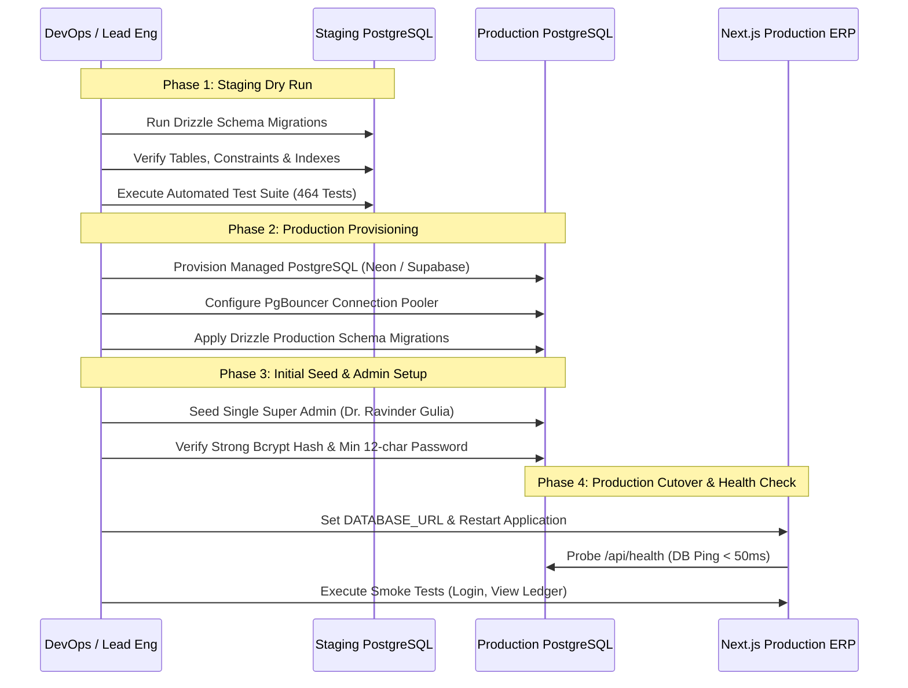

# Ravinarayan ERP — PostgreSQL Migration Plan & Blueprint

**Source Database:** SQLite 3 (`data/erp.db` via `better-sqlite3` 11.8.1)  
**Target Database:** Managed PostgreSQL (v15+ or v16+) with Connection Pooling (PgBouncer)  
**Migration Tooling:** Drizzle ORM (`drizzle-kit`)  
**Data Integrity Policy:** Zero Loss, Full Constraint Parity, Strict Demo Data Isolation  

---

## 1. Schema Mapping & Type Translation Matrix

The existing system contains 15 tables defined across migrations V1 through V8 in `apps/erp/src/server/database/migrations.ts`.

| Table Name | Primary Key | Foreign Keys | Key Constraints & Indexes | SQLite Type &rarr; PostgreSQL Type |
| :--- | :--- | :--- | :--- | :--- |
| **`staff_users`** | `id TEXT` (`usr_...`) | None | `username UNIQUE`, `email UNIQUE`, `idx_staff_users_role`, `idx_staff_users_active` | `is_active INTEGER` &rarr; `BOOLEAN`<br>`created_at TEXT` &rarr; `TIMESTAMPTZ` |
| **`sessions`** | `id TEXT` (`sess_...`) | `staff_id REFERENCES staff_users(id) ON DELETE CASCADE` | `token_hash UNIQUE`, `idx_sessions_expires` | `token_hash TEXT` &rarr; `VARCHAR(64)`<br>`expires_at TEXT` &rarr; `TIMESTAMPTZ` |
| **`login_attempts`** | `id TEXT` (`att_...`) | None | `idx_login_attempts_ip`, `idx_login_attempts_ident_ip` | `success INTEGER` &rarr; `BOOLEAN`<br>`attempted_at TEXT` &rarr; `TIMESTAMPTZ` |
| **`audit_logs`** | `id TEXT` (`aud_...`) | None (Preserves audit history across deletions) | `idx_audit_logs_created`, `idx_audit_logs_actor`, `idx_audit_logs_action` | `metadata TEXT` &rarr; `JSONB`<br>`created_at TEXT` &rarr; `TIMESTAMPTZ` |
| **`rooms`** | `id TEXT` (`rm_...`) | None | `capacity > 0`, `base_rent_monthly >= 0`, `UNIQUE(room_number COLLATE NOCASE)` | `room_number TEXT` &rarr; `CITEXT` or `LOWER(room_number)` index<br>`base_rent_monthly INTEGER` &rarr; `INTEGER` (or `BIGINT` paise) |
| **`residents`** | `id TEXT` (`res_...`) | None | `phone UNIQUE`, `idx_residents_status` | `created_at TEXT` &rarr; `TIMESTAMPTZ` |
| **`resident_stays`** | `id TEXT` (`stay_...`) | `resident_id REFERENCES residents(id) ON DELETE RESTRICT`, `room_id REFERENCES rooms(id) ON DELETE RESTRICT` | `monthly_rent >= 0`, `security_deposit >= 0`, **`idx_unique_active_resident_stay UNIQUE(resident_id) WHERE status = 'ACTIVE'`** | Partial Unique Index is 100% natively supported in PostgreSQL |
| **`financial_transactions`** | `id TEXT` (`txn_...`) | `resident_id REFERENCES residents(id) ON DELETE RESTRICT`, `stay_id REFERENCES resident_stays(id) ON DELETE RESTRICT`, `reversal_of_id REFERENCES financial_transactions(id) ON DELETE RESTRICT`, `created_by REFERENCES staff_users(id)` | `amount > 0`, `status IN ('POSTED', 'REVERSED')`, `idempotency_key UNIQUE`, `idx_fin_tx_date` | `amount INTEGER` &rarr; `INTEGER` (or `BIGINT` paise)<br>`transaction_date TEXT` &rarr; `DATE` |
| **`resident_meal_preferences`** | `resident_id TEXT` | `resident_id REFERENCES residents(id) ON DELETE RESTRICT` | `breakfast_opt_in IN (0,1)`, `lunch_opt_in IN (0,1)`, `dinner_opt_in IN (0,1)` | `INTEGER` flags &rarr; `BOOLEAN` |
| **`daily_meal_plans`** | `id TEXT` (`plan_...`) | `created_by`, `confirmed_by`, `completed_by REFERENCES staff_users(id)` | `planned_resident_count >= 0`, `guest_count >= 0`, `final_preparation_count >= 0`, `UNIQUE(service_date, meal_type)` | `service_date TEXT` &rarr; `DATE`<br>`confirmed_at TEXT` &rarr; `TIMESTAMPTZ` |
| **`resident_meal_records`** | `id TEXT` (`rec_...`) | `plan_id REFERENCES daily_meal_plans(id)`, `resident_id REFERENCES residents(id)`, `stay_id REFERENCES resident_stays(id)` | `UNIQUE(resident_id, service_date, meal_type)` | `service_date TEXT` &rarr; `DATE` |
| **`meal_plan_adjustments`** | `id TEXT` (`adj_...`) | `plan_id REFERENCES daily_meal_plans(id)`, `created_by REFERENCES staff_users(id)` | `previous_total >= 0`, `new_total >= 0`, `idx_meal_adj_date` | `created_at TEXT` &rarr; `TIMESTAMPTZ` |
| **`delivery_tasks`** | `id TEXT` (`del_...`) | `meal_record_id UNIQUE REFERENCES resident_meal_records(id)`, `plan_id REFERENCES daily_meal_plans(id)`, `resident_id REFERENCES residents(id)`, `assigned_to`, `assigned_by`, `dispatched_by`, `delivered_by`, `exception_by REFERENCES staff_users(id)` | `status IN ('PENDING', 'ASSIGNED', 'OUT_FOR_DELIVERY', 'DELIVERED', 'EXCEPTION')`, `order_type IN ('RESIDENT', 'EXTERNAL')` | `service_date TEXT` &rarr; `DATE`<br>`delivered_at TEXT` &rarr; `TIMESTAMPTZ` |
| **`delivery_task_events`** | `id TEXT` (`dlev_...`) | `task_id REFERENCES delivery_tasks(id) ON DELETE RESTRICT`, `actor_id REFERENCES staff_users(id)` | `event_type IN ('CREATED', 'ASSIGNED', 'REASSIGNED', 'DISPATCHED', 'DELIVERED', 'EXCEPTION', 'RETRIED')` | `created_at TEXT` &rarr; `TIMESTAMPTZ` |
| **`staff_notification_reads`** | Composite: `(staff_id, notification_id)` | `staff_id REFERENCES staff_users(id) ON DELETE CASCADE` | `PRIMARY KEY (staff_id, notification_id)` | `read_at TEXT` &rarr; `TIMESTAMPTZ` |

---

## 2. PostgreSQL DDL Schema Definition (Drizzle ORM Equivalent)

```sql
-- Enable necessary PostgreSQL extensions
CREATE EXTENSION IF NOT EXISTS "citext";
CREATE EXTENSION IF NOT EXISTS "uuid-ossp";

-- 1. Staff Users Table
CREATE TABLE staff_users (
  id VARCHAR(64) PRIMARY KEY,
  username CITEXT UNIQUE NOT NULL,
  email CITEXT UNIQUE NOT NULL,
  full_name VARCHAR(150) NOT NULL,
  password_hash VARCHAR(255) NOT NULL,
  role VARCHAR(32) NOT NULL,
  is_active BOOLEAN NOT NULL DEFAULT TRUE,
  created_at TIMESTAMPTZ NOT NULL DEFAULT CURRENT_TIMESTAMP,
  updated_at TIMESTAMPTZ NOT NULL DEFAULT CURRENT_TIMESTAMP,
  last_login_at TIMESTAMPTZ
);
CREATE INDEX idx_staff_users_role ON staff_users(role);
CREATE INDEX idx_staff_users_active ON staff_users(is_active);

-- 2. Sessions Table (SHA-256 Digest at Rest)
CREATE TABLE sessions (
  id VARCHAR(64) PRIMARY KEY,
  token_hash VARCHAR(64) UNIQUE NOT NULL,
  staff_id VARCHAR(64) NOT NULL REFERENCES staff_users(id) ON DELETE CASCADE,
  expires_at TIMESTAMPTZ NOT NULL,
  created_at TIMESTAMPTZ NOT NULL DEFAULT CURRENT_TIMESTAMP,
  ip_address VARCHAR(45),
  user_agent TEXT
);
CREATE INDEX idx_sessions_expires ON sessions(expires_at);

-- 3. Login Attempts (Rate Limiting Ledger)
CREATE TABLE login_attempts (
  id VARCHAR(64) PRIMARY KEY,
  identifier CITEXT NOT NULL,
  ip_address VARCHAR(45) NOT NULL,
  attempted_at TIMESTAMPTZ NOT NULL DEFAULT CURRENT_TIMESTAMP,
  success BOOLEAN NOT NULL
);
CREATE INDEX idx_login_attempts_ip ON login_attempts(ip_address, attempted_at);
CREATE INDEX idx_login_attempts_ident_ip ON login_attempts(identifier, ip_address, attempted_at);

-- 4. Audit Logs (Tamper-Evident History)
CREATE TABLE audit_logs (
  id VARCHAR(64) PRIMARY KEY,
  actor_id VARCHAR(64),
  actor_username VARCHAR(150),
  action VARCHAR(64) NOT NULL,
  target_type VARCHAR(64) NOT NULL,
  target_id VARCHAR(64),
  metadata JSONB,
  ip_address VARCHAR(45),
  created_at TIMESTAMPTZ NOT NULL DEFAULT CURRENT_TIMESTAMP
);
CREATE INDEX idx_audit_logs_created ON audit_logs(created_at);
CREATE INDEX idx_audit_logs_action ON audit_logs(action);
CREATE INDEX idx_audit_logs_actor ON audit_logs(actor_id);
CREATE INDEX idx_audit_logs_target ON audit_logs(target_type, target_id);

-- 5. Rooms Table
CREATE TABLE rooms (
  id VARCHAR(64) PRIMARY KEY,
  room_number CITEXT UNIQUE NOT NULL,
  floor INTEGER NOT NULL,
  type VARCHAR(32) NOT NULL,
  capacity INTEGER NOT NULL CHECK (capacity > 0),
  base_rent_monthly INTEGER NOT NULL CHECK (base_rent_monthly >= 0),
  is_active BOOLEAN NOT NULL DEFAULT TRUE,
  created_at TIMESTAMPTZ NOT NULL DEFAULT CURRENT_TIMESTAMP,
  updated_at TIMESTAMPTZ NOT NULL DEFAULT CURRENT_TIMESTAMP
);
CREATE INDEX idx_rooms_floor ON rooms(floor);
CREATE INDEX idx_rooms_active ON rooms(is_active);

-- 6. Residents Table
CREATE TABLE residents (
  id VARCHAR(64) PRIMARY KEY,
  full_name VARCHAR(150) NOT NULL,
  phone VARCHAR(30) UNIQUE NOT NULL,
  email CITEXT,
  emergency_contact VARCHAR(150),
  notes TEXT,
  status VARCHAR(32) NOT NULL DEFAULT 'ACTIVE',
  created_at TIMESTAMPTZ NOT NULL DEFAULT CURRENT_TIMESTAMP,
  updated_at TIMESTAMPTZ NOT NULL DEFAULT CURRENT_TIMESTAMP
);
CREATE INDEX idx_residents_status ON residents(status);

-- 7. Resident Stays Table
CREATE TABLE resident_stays (
  id VARCHAR(64) PRIMARY KEY,
  resident_id VARCHAR(64) NOT NULL REFERENCES residents(id) ON DELETE RESTRICT,
  room_id VARCHAR(64) NOT NULL REFERENCES rooms(id) ON DELETE RESTRICT,
  check_in_date DATE NOT NULL,
  check_out_date DATE,
  monthly_rent INTEGER NOT NULL CHECK (monthly_rent >= 0),
  security_deposit INTEGER NOT NULL DEFAULT 0 CHECK (security_deposit >= 0),
  status VARCHAR(32) NOT NULL DEFAULT 'ACTIVE',
  created_at TIMESTAMPTZ NOT NULL DEFAULT CURRENT_TIMESTAMP,
  updated_at TIMESTAMPTZ NOT NULL DEFAULT CURRENT_TIMESTAMP
);
CREATE INDEX idx_stays_resident_id ON resident_stays(resident_id);
CREATE INDEX idx_stays_room_id ON resident_stays(room_id);
CREATE INDEX idx_stays_status ON resident_stays(status);
CREATE INDEX idx_stays_room_active ON resident_stays(room_id, status);

-- Partial Unique Index: Strictly 1 ACTIVE stay per resident
CREATE UNIQUE INDEX idx_unique_active_resident_stay 
ON resident_stays(resident_id) WHERE status = 'ACTIVE';

-- 8. Financial Transactions Table
CREATE TABLE financial_transactions (
  id VARCHAR(64) PRIMARY KEY,
  transaction_type VARCHAR(32) NOT NULL CHECK (transaction_type IN ('RENT_CHARGE', 'RENT_PAYMENT', 'SECURITY_DEPOSIT', 'EXPENSE', 'REVERSAL')),
  amount INTEGER NOT NULL CHECK (amount > 0),
  transaction_date DATE NOT NULL,
  payment_method VARCHAR(32) CHECK (payment_method IN ('CASH', 'UPI', 'BANK_TRANSFER', 'CHEQUE', 'OTHER') OR payment_method IS NULL),
  reference_number VARCHAR(100),
  resident_id VARCHAR(64) REFERENCES residents(id) ON DELETE RESTRICT,
  stay_id VARCHAR(64) REFERENCES resident_stays(id) ON DELETE RESTRICT,
  category VARCHAR(64) NOT NULL,
  description TEXT,
  billing_period VARCHAR(50),
  payee_vendor VARCHAR(150),
  idempotency_key VARCHAR(128) UNIQUE,
  status VARCHAR(32) NOT NULL DEFAULT 'POSTED' CHECK (status IN ('POSTED', 'REVERSED')),
  reversal_of_id VARCHAR(64) REFERENCES financial_transactions(id) ON DELETE RESTRICT,
  created_by VARCHAR(64) NOT NULL REFERENCES staff_users(id),
  created_at TIMESTAMPTZ NOT NULL DEFAULT CURRENT_TIMESTAMP,
  updated_at TIMESTAMPTZ NOT NULL DEFAULT CURRENT_TIMESTAMP
);
CREATE INDEX idx_fin_tx_type ON financial_transactions(transaction_type);
CREATE INDEX idx_fin_tx_date ON financial_transactions(transaction_date);
CREATE INDEX idx_fin_tx_resident ON financial_transactions(resident_id);
CREATE INDEX idx_fin_tx_stay ON financial_transactions(stay_id);
CREATE INDEX idx_fin_tx_category ON financial_transactions(category);
CREATE INDEX idx_fin_tx_status ON financial_transactions(status);

-- 9. Resident Meal Preferences
CREATE TABLE resident_meal_preferences (
  resident_id VARCHAR(64) PRIMARY KEY REFERENCES residents(id) ON DELETE RESTRICT,
  breakfast_opt_in BOOLEAN NOT NULL DEFAULT TRUE,
  lunch_opt_in BOOLEAN NOT NULL DEFAULT TRUE,
  dinner_opt_in BOOLEAN NOT NULL DEFAULT TRUE,
  dietary_preference VARCHAR(32) NOT NULL DEFAULT 'VEG',
  notes TEXT,
  created_at TIMESTAMPTZ NOT NULL DEFAULT CURRENT_TIMESTAMP,
  updated_at TIMESTAMPTZ NOT NULL DEFAULT CURRENT_TIMESTAMP
);

-- 10. Daily Meal Plans
CREATE TABLE daily_meal_plans (
  id VARCHAR(64) PRIMARY KEY,
  service_date DATE NOT NULL,
  meal_type VARCHAR(32) NOT NULL CHECK (meal_type IN ('BREAKFAST', 'LUNCH', 'DINNER')),
  planned_resident_count INTEGER NOT NULL DEFAULT 0 CHECK (planned_resident_count >= 0),
  guest_count INTEGER NOT NULL DEFAULT 0 CHECK (guest_count >= 0),
  final_preparation_count INTEGER NOT NULL DEFAULT 0 CHECK (final_preparation_count >= 0),
  actual_cooked_count INTEGER CHECK (actual_cooked_count IS NULL OR actual_cooked_count >= 0),
  status VARCHAR(32) NOT NULL DEFAULT 'DRAFT' CHECK (status IN ('DRAFT', 'CONFIRMED', 'COMPLETED')),
  notes TEXT,
  created_by VARCHAR(64) NOT NULL REFERENCES staff_users(id),
  confirmed_by VARCHAR(64) REFERENCES staff_users(id),
  confirmed_at TIMESTAMPTZ,
  completed_by VARCHAR(64) REFERENCES staff_users(id),
  completed_at TIMESTAMPTZ,
  created_at TIMESTAMPTZ NOT NULL DEFAULT CURRENT_TIMESTAMP,
  updated_at TIMESTAMPTZ NOT NULL DEFAULT CURRENT_TIMESTAMP,
  CONSTRAINT uq_plan_date_meal UNIQUE (service_date, meal_type)
);
CREATE INDEX idx_meal_plans_date ON daily_meal_plans(service_date);
CREATE INDEX idx_meal_plans_status ON daily_meal_plans(status);

-- 11. Resident Meal Records
CREATE TABLE resident_meal_records (
  id VARCHAR(64) PRIMARY KEY,
  plan_id VARCHAR(64) NOT NULL REFERENCES daily_meal_plans(id) ON DELETE RESTRICT,
  resident_id VARCHAR(64) NOT NULL REFERENCES residents(id) ON DELETE RESTRICT,
  stay_id VARCHAR(64) NOT NULL REFERENCES resident_stays(id) ON DELETE RESTRICT,
  service_date DATE NOT NULL,
  meal_type VARCHAR(32) NOT NULL CHECK (meal_type IN ('BREAKFAST', 'LUNCH', 'DINNER')),
  status VARCHAR(32) NOT NULL DEFAULT 'CONFIRMED' CHECK (status IN ('CONFIRMED', 'OPTED_OUT')),
  notes TEXT,
  created_by VARCHAR(64) REFERENCES staff_users(id),
  created_at TIMESTAMPTZ NOT NULL DEFAULT CURRENT_TIMESTAMP,
  updated_at TIMESTAMPTZ NOT NULL DEFAULT CURRENT_TIMESTAMP,
  CONSTRAINT uq_res_date_meal UNIQUE (resident_id, service_date, meal_type)
);
CREATE INDEX idx_res_meal_plan ON resident_meal_records(plan_id);
CREATE INDEX idx_res_meal_resident ON resident_meal_records(resident_id);
CREATE INDEX idx_res_meal_date ON resident_meal_records(service_date);

-- 12. Meal Plan Adjustments
CREATE TABLE meal_plan_adjustments (
  id VARCHAR(64) PRIMARY KEY,
  plan_id VARCHAR(64) NOT NULL REFERENCES daily_meal_plans(id) ON DELETE RESTRICT,
  previous_resident_count INTEGER NOT NULL CHECK (previous_resident_count >= 0),
  new_resident_count INTEGER NOT NULL CHECK (new_resident_count >= 0),
  previous_guest_count INTEGER NOT NULL CHECK (previous_guest_count >= 0),
  new_guest_count INTEGER NOT NULL CHECK (new_guest_count >= 0),
  previous_total INTEGER NOT NULL CHECK (previous_total >= 0),
  new_total INTEGER NOT NULL CHECK (new_total >= 0),
  reason TEXT NOT NULL,
  created_by VARCHAR(64) NOT NULL REFERENCES staff_users(id),
  created_at TIMESTAMPTZ NOT NULL DEFAULT CURRENT_TIMESTAMP
);
CREATE INDEX idx_meal_adj_plan ON meal_plan_adjustments(plan_id);

-- 13. Delivery Tasks
CREATE TABLE delivery_tasks (
  id VARCHAR(64) PRIMARY KEY,
  order_type VARCHAR(32) NOT NULL DEFAULT 'RESIDENT' CHECK (order_type IN ('RESIDENT', 'EXTERNAL')),
  meal_record_id VARCHAR(64) UNIQUE REFERENCES resident_meal_records(id) ON DELETE RESTRICT,
  plan_id VARCHAR(64) NOT NULL REFERENCES daily_meal_plans(id) ON DELETE RESTRICT,
  service_date DATE NOT NULL,
  meal_type VARCHAR(32) NOT NULL CHECK (meal_type IN ('BREAKFAST', 'LUNCH', 'DINNER')),
  resident_id VARCHAR(64) REFERENCES residents(id) ON DELETE RESTRICT,
  resident_name VARCHAR(150),
  room_number VARCHAR(32),
  floor INTEGER,
  stay_id VARCHAR(64) REFERENCES resident_stays(id) ON DELETE RESTRICT,
  customer_name VARCHAR(150),
  customer_phone VARCHAR(30),
  delivery_address TEXT,
  status VARCHAR(32) NOT NULL DEFAULT 'PENDING' CHECK (status IN ('PENDING', 'ASSIGNED', 'OUT_FOR_DELIVERY', 'DELIVERED', 'EXCEPTION')),
  assigned_to VARCHAR(64) REFERENCES staff_users(id) ON DELETE SET NULL,
  assigned_to_name VARCHAR(150),
  assigned_by VARCHAR(64) REFERENCES staff_users(id) ON DELETE SET NULL,
  assigned_at TIMESTAMPTZ,
  dispatched_at TIMESTAMPTZ,
  dispatched_by VARCHAR(64) REFERENCES staff_users(id) ON DELETE SET NULL,
  delivered_at TIMESTAMPTZ,
  delivered_by VARCHAR(64) REFERENCES staff_users(id) ON DELETE SET NULL,
  delivery_notes TEXT,
  recipient_name VARCHAR(150),
  exception_type VARCHAR(64) CHECK (exception_type IS NULL OR exception_type IN ('RESIDENT_UNAVAILABLE', 'RESIDENT_DECLINED', 'LOCATION_UNCLEAR', 'MEAL_DAMAGED_OR_MISSING', 'OTHER')),
  exception_reason TEXT,
  exception_at TIMESTAMPTZ,
  exception_by VARCHAR(64) REFERENCES staff_users(id) ON DELETE SET NULL,
  created_at TIMESTAMPTZ NOT NULL DEFAULT CURRENT_TIMESTAMP,
  updated_at TIMESTAMPTZ NOT NULL DEFAULT CURRENT_TIMESTAMP
);
CREATE INDEX idx_del_tasks_date ON delivery_tasks(service_date);
CREATE INDEX idx_del_tasks_status ON delivery_tasks(status);
CREATE INDEX idx_del_tasks_assigned_to ON delivery_tasks(assigned_to);

-- 14. Delivery Task Events
CREATE TABLE delivery_task_events (
  id VARCHAR(64) PRIMARY KEY,
  task_id VARCHAR(64) NOT NULL REFERENCES delivery_tasks(id) ON DELETE RESTRICT,
  event_type VARCHAR(32) NOT NULL CHECK (event_type IN ('CREATED', 'ASSIGNED', 'REASSIGNED', 'DISPATCHED', 'DELIVERED', 'EXCEPTION', 'RETRIED')),
  from_status VARCHAR(32),
  to_status VARCHAR(32) NOT NULL,
  actor_id VARCHAR(64) NOT NULL REFERENCES staff_users(id),
  actor_name VARCHAR(150) NOT NULL,
  notes TEXT,
  created_at TIMESTAMPTZ NOT NULL DEFAULT CURRENT_TIMESTAMP
);
CREATE INDEX idx_del_events_task ON delivery_task_events(task_id);

-- 15. Staff Notification Reads
CREATE TABLE staff_notification_reads (
  staff_id VARCHAR(64) NOT NULL REFERENCES staff_users(id) ON DELETE CASCADE,
  notification_id VARCHAR(64) NOT NULL,
  read_at TIMESTAMPTZ NOT NULL DEFAULT CURRENT_TIMESTAMP,
  PRIMARY KEY (staff_id, notification_id)
);
```

---

## 3. Strict Demo Data Isolation Policy

> [!CAUTION]
> **DEMO DATA MUST NEVER BE IMPORTED INTO PRODUCTION.**

### 3.1 Classification
- **Synthetic Demo Records:** All records generated by `apps/erp/src/server/database/seedSyntheticData.ts` (tracked via `seed_manifest` table with batch prefix `batch_demo_2026_v1`) are strictly for design demonstration and local load testing.
- **Production Records:** Only the real Owner account (`usr_super_admin_01` — Dr. Ravinder Gulia) and authentic operational records entered by staff during physical onboarding constitute genuine business data.

### 3.2 Production Guardrail
```typescript
// Enforced in production startup sequence
if (process.env.NODE_ENV === "production" && process.env.ALLOW_SYNTHETIC_SEED === "true") {
  throw new Error("[SECURITY CRITICAL] Attempted to run synthetic demo seed in a PRODUCTION environment. Aborting startup.");
}
```

---

## 4. Phased Migration Execution Strategy



### Step 1: Pre-Migration Staging Dry Run
1. Provision staging PostgreSQL instance.
2. Execute migration script via Drizzle Kit: `npx drizzle-kit push:pg`.
3. Run the full regression test suite (`npm test`) configured with `DATABASE_URL=postgresql://staging...`.
4. Validate that all 15 tables, 28 indexes, and constraints are created accurately.

### Step 2: Production Cutover
1. Schedule a 30-minute maintenance window.
2. Set marketing announcement if necessary (ERP only; public website remains online).
3. Apply migrations to the production PostgreSQL cluster.
4. Verify initial admin account creation using `ERP_ADMIN_PASSWORD` from the secret manager.
5. Point Next.js ERP environment variable `DATABASE_URL` to production PgBouncer endpoint.
6. Verify `/api/health` returns `200 OK`.

### Step 3: Rollback Strategy
If any migration step fails or runtime assertions throw fatal errors:
1. Immediately revert `DATABASE_URL` to point back to the standby node or local SQLite fallback.
2. Restart the ERP process (`npm run start:erp`).
3. Retain the target PostgreSQL database in its failed state for offline diagnostic analysis without destroying logs.
