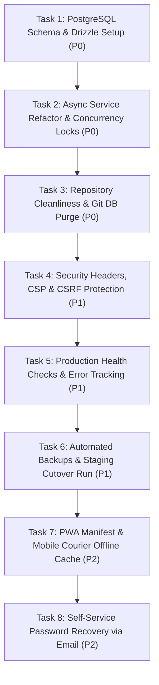

# Ravinarayan ERP — Production Readiness Audit

**Repository:** `zevats/raviNarayana-Erp`  
**Branch:** `master`  
**Audit Date:** October 16, 2026  
**Auditor:** Antigravity Engineering (Senior Staff AI Architect)  
**Target Environment:** Production Deployment (`erp.ravinarayan.in` & `ravinarayan.in`)  
**Property:** Ravinarayan PG Guesthouse (Jhajjar / Model Economic Township, Haryana)  

---

## 1. Executive Summary

This audit assesses the production readiness of the Ravinarayan PG Guesthouse management system, comprising an operational Next.js Management ERP (`apps/erp`), a Next.js public showcase website (`apps/website`), shared brand tokens (`packages/brand`), and an embedded SQLite data layer (`data/erp.db` via `better-sqlite3`).

### Core Conclusion
The demonstration phase has delivered a functional, well-structured modular prototype with server-side authentication, role-based access control (RBAC), multi-layer rate limiting, tamper-evident audit logging, and responsive user interfaces. 

**However, the application is NOT ready for live production hosting in its current state.**

The primary blockers are:
1. **Durable Data Storage:** The persistence model relies on a local SQLite file (`data/erp.db`) accessed through synchronous native C++ bindings (`better-sqlite3`). Hosting this on containerized or serverless cloud infrastructure (such as Render Free, Docker containers without persistent volumes, or Vercel) results in catastrophic data loss on process restart or deploy, and crashes in multi-threaded/V8 GC environments.
2. **Concurrency & Race Conditions in PostgreSQL:** SQLite transactions currently rely on single-writer database file locks. Transitioning to a concurrent managed PostgreSQL cluster requires explicit row-level locking (`SELECT ... FOR UPDATE`) or serializable transactions to prevent double-booking of beds and race conditions in financial balance updates.
3. **Repository Cleanliness & Tracked Test Databases:** Binary SQLite databases (`tests/test_erp.db`, `tests/test_erp.db-wal`, `tests/test_erp.db-shm`) are actively committed into the Git repository tree.
4. **Missing HTTP Security Headers & CSRF Tokens:** Neither Next.js application emits standard HTTP security headers (Content Security Policy, HSTS, X-Frame-Options, X-Content-Type-Options). While session cookies use `SameSite=lax`, dedicated CSRF tokens or custom request header validations are absent on mutating REST endpoints.
5. **Lack of Automated Off-Site Backups, Secret Management & Monitoring:** No Sentry error tracking, uptime health checks, automated database snapshots, or alert pipelines exist.

---

## 2. Verified Current Architecture & Baseline

### 2.1 Monorepo Anatomy
- **Root Directory:** Orchestrated via npm workspaces (`package.json`) defining `apps/*` and `packages/*`.
- **Node Engine:** Pinned to `>=20.9.0 <21.0.0` in root and `apps/erp/package.json`. Active runtime is Node `v22.16.0`.
- **Applications:**
  - `apps/website`: Next.js 14.2.18 App Router, React 18.3.1, Tailwind CSS 3.4.14, Framer Motion 11.11.9, Three.js 0.169.0. Port: `3000`. Serves marketing routes (`/`, `/about`, `/rooms`, `/tiffin-service`, `/contact`).
  - `apps/erp`: Next.js 14.2.18 App Router, React 18.3.1, Tailwind CSS 3.4.14, `better-sqlite3` 11.8.1, `bcryptjs` 2.4.3. Port: `3001`. Serves operations routes (`/login`, `/dashboard`, `/rooms`, `/residents`, `/finance`, `/kitchen`, `/delivery`).
- **Shared Packages:**
  - `packages/brand`: Authoritative single source of truth for color tokens, typography scales, spacing, shadows, and status tokens (`packages/brand/index.ts`).
- **Database & Storage:**
  - Active database: `data/erp.db` running in WAL mode with foreign keys enabled (`PRAGMA journal_mode = WAL; PRAGMA foreign_keys = ON;`).
  - Schema migrations: 8 sequential migrations managed via `PRAGMA user_version` inside `apps/erp/src/server/database/migrations.ts`.
- **Test Infrastructure:**
  - 7 automated suites in `tests/` compiled via `tsc -p tests/tsconfig.json` and executed with custom module aliasing (`tests/register_paths.js`).
  - Total automated assertions: 464 passing tests across delivery, finance, kitchen, rooms, security, RBAC, and integration.

---

## 3. Severity-Ranked Production Findings

Findings are classified according to risk:
- **P0 (Critical Launch Blocker):** Must be resolved before any production traffic is routed.
- **P1 (High Priority / Launch Prerequisite):** Required for a reliable, maintainable v1.0 release.
- **P2 (Medium Priority):** Post-launch improvements that should be implemented within 30 days of launch.
- **P3 (Low Priority):** Architectural enhancements and long-term optimizations.

### Summary Table

| ID | Category | Severity | Title | Evidence / Code Location |
| :--- | :--- | :---: | :--- | :--- |
| **SEC-01** | Data Loss / Infra | **P0** | Ephemeral SQLite Storage on Cloud Hosts | `apps/erp/src/server/database/db.ts:17-47` |
| **SEC-02** | Security | **P0** | Binary SQLite Databases Committed to Git | `tests/test_erp.db`, `tests/test_erp.db-wal` |
| **DAT-01** | Data Integrity | **P0** | Synchronous Driver & Concurrency Oversell Risk | `apps/erp/src/server/residents/residentService.ts:285-293` |
| **SEC-03** | Security | **P1** | Missing HTTP Security Headers & CSP | `apps/erp/next.config.mjs`, `apps/website/next.config.mjs` |
| **FIN-01** | Financial | **P1** | Missing Fractional Currency (Paise) Precision | `apps/erp/src/server/database/migrations.ts:304` |
| **SEC-04** | Security | **P1** | No Automated Self-Service Password Recovery | `apps/erp/src/app/api/auth/*` |
| **OPS-01** | Operations | **P1** | Absence of Production Logging, APM & Health Checks | `apps/erp/src/app/api/*` |
| **OPS-02** | Operations | **P1** | Lack of Automated PostgreSQL Backup Pipeline | Infrastructure Level |
| **SEC-05** | Security | **P2** | Absence of Explicit CSRF Defense on REST APIs | `apps/erp/src/app/api/*` |
| **PERF-01**| Performance | **P2** | Dynamic Client Fetching without Stale Invalidation | `apps/erp/src/modules/finance/components/CashbookLedger.tsx` |
| **MOB-01** | Architecture | **P2** | Undecided Mobile Delivery Client Architecture | Delivery Driver Workflow |
| **REP-01** | Governance | **P3** | CSV Export Streaming for Massive Ledger Datasets | `apps/erp/src/app/api/reports/executive/route.ts:244` |

---

## 4. Top 5 Highest-Priority Production Risks

### 1. Risk: Total Business Data Loss via Ephemeral SQLite
- **Impact:** Catastrophic.
- **Evidence:** [`apps/erp/src/server/database/db.ts`](file:///c:/Users/Rishabh/Desktop/raviNarayana-Erp/apps/erp/src/server/database/db.ts#L17-L47). The application resolves `data/erp.db` on local disk. Cloud hosting platforms (Render, Fly.io, Railway, AWS ECS) recycle container filesystems upon every redeploy, restart, or configuration change. All resident stay records, cashbook transactions, and audit logs would vanish permanently.
- **Remediation:** Migrate to a dedicated managed PostgreSQL database cluster (e.g. Neon, Supabase, or AWS RDS PostgreSQL) with version-controlled migrations and automated point-in-time recovery (PITR).

### 2. Risk: Bed Overbooking & Financial Race Conditions Under Concurrent Access
- **Impact:** Financial and operational corruption.
- **Evidence:** [`apps/erp/src/server/residents/residentService.ts#L285-L293`](file:///c:/Users/Rishabh/Desktop/raviNarayana-Erp/apps/erp/src/server/residents/residentService.ts#L285-L293). SQLite's synchronous single-file locking masks concurrency bugs. In a multi-worker PostgreSQL deployment, two front desk staff members checking in residents to the same vacant bed simultaneously will both observe `occupiedBeds < capacity` and execute concurrent inserts, resulting in 3 residents assigned to a 2-bed room.
- **Remediation:** Implement row-level locking (`SELECT id FROM rooms WHERE id = $1 FOR UPDATE`) and database-level exclusion constraints during the PostgreSQL migration.

### 3. Risk: Tracked SQLite Database Files in Git Repository
- **Impact:** Confidentiality and build pipeline pollution.
- **Evidence:** `git ls-files tests` reveals `tests/test_erp.db`, `tests/test_erp.db-wal`, and `tests/test_erp.db-shm` are tracked in version control. Production builds copying the repository bundle test databases into deployment artifacts.
- **Remediation:** Purge tracked `.db` files from Git using `git rm --cached tests/test_erp.db*`, update `.gitignore` from `/data/*.db` to `**/*.db` and `**/*.db-*`, and generate test databases dynamically in temporary memory or throwaway test directories.

### 4. Risk: Absence of Production HTTP Security Headers and CSP
- **Impact:** Vulnerability to clickjacking, MIME-sniffing, and cross-site scripting (XSS).
- **Evidence:** Neither [`apps/erp/next.config.mjs`](file:///c:/Users/Rishabh/Desktop/raviNarayana-Erp/apps/erp/next.config.mjs) nor [`apps/website/next.config.mjs`](file:///c:/Users/Rishabh/Desktop/raviNarayana-Erp/apps/website/next.config.mjs) implement a `headers()` block. Browsers receive no `Content-Security-Policy`, `X-Frame-Options: DENY`, `X-Content-Type-Options: nosniff`, or `Strict-Transport-Security`.
- **Remediation:** Define standard security headers in `next.config.mjs` for both applications, disallowing iframe embedding, enforcing HTTPS, and restricting script execution.

### 5. Risk: Synchronous Node.js Architecture Incompatible with Scaled Database I/O
- **Impact:** Server thread stalling and high latency.
- **Evidence:** `better-sqlite3` executes synchronously on the Node.js event loop. Every database query blocks the Node thread. Moving to PostgreSQL requires asynchronous I/O (`async/await`) across all service functions in `apps/erp/src/server/`. Attempting to wrap synchronous services around asynchronous database drivers will fail.
- **Remediation:** Re-architect the data access layer into clean asynchronous repositories using a modern, lightweight TypeScript ORM (Drizzle ORM recommended).

---

## 5. Explicit Launch Blockers

Production launch cannot proceed until all of the following requirements are fulfilled:

1. **PostgreSQL Migration Completed:** SQLite completely decommissioned in favor of managed PostgreSQL with connection pooling (PgBouncer).
2. **Asynchronous Service Layer Refactor:** All server service methods (`roomService`, `residentService`, `financeService`, `kitchenService`, `deliveryService`, `auditService`, `authService`) converted to return typed `Promise<T>`.
3. **Demo Data Isolation Enforced:** Production startup verification fails if synthetic demo seeding scripts are executed in `NODE_ENV=production`.
4. **Environment Secret Management:** Real production secrets (`DATABASE_URL`, `ERP_ADMIN_PASSWORD`, `SESSION_SECRET`) injected via KMS / secret manager, with `.env` files removed from deployment containers.
5. **Security Headers & Clickjacking Defenses:** `X-Frame-Options: DENY`, `CSP`, and `Strict-Transport-Security` headers active in HTTP responses.
6. **Automated Daily Backups with Verified Recovery Drill:** Automated snapshot retention (minimum 30 days) and a documented, tested restore procedure.
7. **Production Health Check Endpoint:** `/api/health` verifying database connectivity and query response time.

---

## 6. Decisions Requiring Owner Approval (Dr. Ravinder Gulia)

| Decision Item | Context & Trade-Offs | Recommendation |
| :--- | :--- | :--- |
| **1. Database Hosting Provider** | Self-hosted PostgreSQL on VPS (low cost, high maintenance) vs Managed Cloud PostgreSQL (Neon / Supabase / AWS RDS, \$15-\$25/mo, zero maintenance, automated backups). | **Managed PostgreSQL (Neon or Supabase)** for zero operational burden and automated point-in-time recovery. |
| **2. Mobile App Delivery Strategy** | Responsive Web App (PWA) (\$0 added development, immediate updates, zero app store fees) vs Native App (Flutter/React Native, requires App Store/Play Store review, device maintenance, high cost). | **Progressive Web App (PWA)** for staff and delivery couriers; evaluate native app later only if hardware Bluetooth printers or background GPS tracking become compulsory. |
| **3. Financial Precision & GST Handling** | Storing integer rupees (₹) vs minor units (paise, 1 INR = 100 paise). If GST billing or prorated partial day calculations are introduced, integer rupees cause truncation errors. | **Store money in integer minor units (paise)** or `NUMERIC(12, 2)` in PostgreSQL to support GST compliance. |
| **4. Password Recovery Policy** | Self-service email reset (requires third-party transactional email service like Resend/SendGrid at ~\$15/mo) vs Owner-assisted reset (Super Admin resets passwords via ERP dashboard). | **Owner-assisted reset for initial release**, adding Resend email automation in Phase 2. |
| **5. Resident Portal Scope** | Keep ERP staff-only vs building resident-facing login portal (view rent statements, download receipts, submit meal opt-outs). | **Staff-only ERP for Launch**, resident self-service portal in subsequent phase. |

---

## 7. Ordered Implementation Backlog

### Detailed Backlog Items

| Phase | Task ID | Description | Severity | Complexity | Dependencies |
| :---: | :--- | :--- | :---: | :---: | :--- |
| **1** | **PROD-01** | **PostgreSQL Setup & Drizzle ORM Schema Migration** Provision staging PostgreSQL database, author Drizzle ORM schemas matching all 15 tables, configure connection pooling. | **P0** | **L** | None |
| **1** | **PROD-02** | **Asynchronous Service Layer Conversion** Refactor `db.prepare()` across all 7 server services to asynchronous Drizzle queries; implement `FOR UPDATE` row locks for room capacity. | **P0** | **XL** | PROD-01 |
| **1** | **PROD-03** | **Git Repository Sanitization** Remove `tests/test_erp.db*` from version control, update `.gitignore` to match `**/*.db*`, configure in-memory SQLite for quick unit tests. | **P0** | **S** | None |
| **2** | **PROD-04** | **HTTP Security Headers & CSP Enforcement** Implement Next.js `headers()` block in both `apps/erp` and `apps/website` with CSP, HSTS, frame denial, and nosniff rules. | **P1** | **S** | None |
| **2** | **PROD-05** | **Production Health Checks & Error Monitoring** Implement `/api/health` with DB roundtrip checks; integrate Sentry SDK for real-time exception logging and alerts. | **P1** | **M** | PROD-02 |
| **2** | **PROD-06** | **Automated Backup & Disaster Recovery Pipeline** Configure daily automated PostgreSQL snapshots, write restore automation script, execute dry-run recovery drill. | **P1** | **M** | PROD-01 |
| **3** | **PROD-07** | **PWA Configuration for Mobile Delivery Workflow** Add Web App Manifest, offline service worker for delivery route checklist, camera QR scanning for meal handover. | **P2** | **M** | PROD-02 |
| **3** | **PROD-08** | **Transactional Email & Password Reset Workflow** Integrate Resend API, implement cryptographic password reset token generation with 1-hour expiration and single-use invalidation. | **P2** | **M** | PROD-01 |

---

## 8. Recommended Next Immediate Implementation Task

### **Task: PROD-01 — PostgreSQL Schema Migration & Drizzle ORM Integration**
- **Objective:** Establish the production database foundation by creating version-controlled PostgreSQL schemas using Drizzle ORM without modifying existing runtime behavior or deleting any SQLite development data.
- **Acceptance Criteria:**
  1. Add `drizzle-orm` and `postgres` (or `@neondatabase/serverless`) to `apps/erp/package.json`.
  2. Author Drizzle schema definitions under `apps/erp/src/server/database/schema/` mapping all 15 tables with identical constraints, foreign keys, and indexes.
  3. Create an abstract database client module supporting dual-mode (SQLite in local development if desired, PostgreSQL in production).
  4. Generate initial PostgreSQL migration SQL scripts using `drizzle-kit generate`.
  5. Verify that running `npm test` continues to pass 100% against the test suite without regression.
